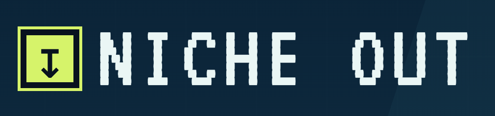

## About

Niche Out is a custom multiplayer trivia game inspired by Krillion. Players compete to come up with the most niche answer to each prompt.

Build a game using a JSON file containing prompts, accepted answers, spelling aliases, and tiers. The game maker assigns each tier its points. After each round, everyone sees the answers, how many people chose them, and the standings.

The host runs the game on their own computer and manages it through a browser. Players join on their phones or computers using a QR code or link. A temporary Cloudflare tunnel lets everyone connect from different networks, with internet access required for both the host and players.

- Automatic timed rounds, answer reveals, and leaderboards.
- Custom games with up to 20 prompts.
- Browser-based play without player accounts or installations.
- A shared host screen and player removal controls.

## Network limitations

**Connection reliability and large-game performance are not guaranteed.** The game runs on the host's computer and relies on its internet connection and a temporary Cloudflare Quick Tunnel to reach players. Both the host and players need internet access, even though the server runs locally.

- Large groups and simultaneous reconnects can cause slow updates, delayed answer confirmations, or submission timeouts. The 100-player admission limit is not a guarantee of smooth play with 100 players.
- Some school, workplace, or public networks may block or interrupt WebSocket connections. The polling fallback uses more HTTP requests and can encounter tunnel request limits.
- Temporary tunnel addresses can take a few minutes to become reachable. DNS issues, provider interruptions, or the host losing connectivity can disrupt a session.
- Keep the host computer awake and the launcher running. If hosting must restart with a new public address, players need a fresh invitation and game; previous results are not saved after the server stops.

Try the game with your intended devices, player count, and network before an event, and have a backup activity available. See the [operator guide](docs/release/OPERATOR-GUIDE.md) for connection troubleshooting.

## Why I made this

Normally for Boston University Singapore Student Association's annual Great Singapore Social event, we play Jeopardy or Kahoot. However, during a meeting someone suggested a multiplayer Krillion since (at the time of development) it's a fairly new online game that has gone viral and is very popular. Hence, I embarked on this project, but also decided to make it open source and general use, so that others may also use it as a locally-hosted party game.

## How to download

**[Niche Out 0.2.0 is available on npm](https://www.npmjs.com/package/niche-out/v/0.2.0).** The host installs Node.js through NVM, then runs the command below. Players only need a web browser. You do not need to clone this repository or create an npm or Cloudflare account to play or host.

### Host requirements

- **Node.js 24.22.3 or a newer 24.x version**, with npm. The supported range is `>=24.22.3 <25`; Node 25 and newer are outside that range.
- An internet connection for the host and every player. They can use different networks, including cellular data.
- A host computer that stays awake with its terminal running throughout the game.

The current release is verified on an Apple Silicon Mac. Included Intel Mac, Windows and Linux helpers remain unverified pending further testing. Intended host targets are macOS 15+ on Apple Silicon/Intel, Windows 11 x64 and Ubuntu 24.04+ x64/glibc. Linux also needs `xdg-open` to open the browser and systemd/logind with `systemd-inhibit` for idle-sleep prevention. The package includes compiled application assets and native helpers; hosts do not need a compiler or application build.

### Install Node.js with NVM (recommended)

**Use NVM to select Node.js `24.22.3` before running Niche Out locally.** NVM (Node Version Manager) lets you keep multiple Node.js versions installed and switch between them for different projects. This is particularly useful if your other projects use a different Node.js version. These instructions use the exact version tested for Niche Out; the application also accepts newer 24.x versions, but not Node 25 or newer.

On **macOS/Linux**, use [nvm-sh/nvm](https://github.com/nvm-sh/nvm). On **Windows**, use [NVM for Windows](https://github.com/nvm-windows/nvm), a separate project with its own installer. Choose either setup option below; both use NVM to manage Node.js and npm.

#### Option 1: Follow the official NVM website/installation guide

1. Install the version manager for your operating system:
   - **macOS/Linux:** follow the [official NVM installation guide](https://github.com/nvm-sh/nvm#install--update-script), including its shell setup instructions.
   - **Windows:** download and run the free Community Build installer from the [official NVM for Windows installation page](https://docs.nvm-windows.com/install/installers/). Follow its guidance for migrating any existing Node.js installation.
2. Open a new **Terminal** window on macOS/Linux or **Command Prompt** on Windows, then run:

```sh
nvm install 24.22.3
nvm use 24.22.3
node --version
npm --version
```

`node --version` should print **`v24.22.3`**; `npm --version` should print a version number. npm comes with the Node.js version installed by NVM.

#### Option 2: Set up NVM and Node.js from the terminal

**macOS/Linux — Bash or Zsh**

If NVM is already installed, skip the installation block and run the Node.js commands below. Otherwise, install NVM and load it into your current shell:

```sh
export NVM_DIR="${NVM_DIR:-$HOME/.nvm}"
mkdir -p "$NVM_DIR"
curl -fsSL https://raw.githubusercontent.com/nvm-sh/nvm/v0.41.0/install.sh | bash
. "$NVM_DIR/nvm.sh"
```

Then install and select the tested Node.js version:

```sh
nvm install 24.22.3
nvm use 24.22.3
node --version
npm --version
```

This uses the [official NVM installer](https://github.com/nvm-sh/nvm#install--update-script), which updates your shell profile to load NVM on future terminal sessions. If a new terminal cannot find `nvm`, follow the installer's shell-profile instructions. If macOS requests Xcode Command Line Tools, run `xcode-select --install`, finish that installation, then retry the NVM installation block. These are NVM setup requirements, not a Niche Out source build.

**Windows — PowerShell or Command Prompt**

With [WinGet](https://learn.microsoft.com/en-us/windows/package-manager/winget/) available, install the NVM for Windows Community Build from a normal, non-administrator terminal:

```powershell
winget install --id AuthorSoftware.NVMWindows --exact --source winget
```

Close that terminal and open a new **Command Prompt** so the updated PATH is loaded. Then run:

```bat
nvm install 24.22.3
nvm use 24.22.3
node --version
npm --version
```

If WinGet is unavailable, use Option 1's installer. See the [NVM for Windows installation documentation](https://docs.nvm-windows.com/install/installers/) for existing-install migration and PATH setup.

#### Switch versions before playing

Once Node.js is installed, you only need `nvm use 24.22.3` before launching Niche Out. When returning to another project, use NVM to select that project's Node.js version. If `node --version` still shows the wrong version, check NVM's PATH/troubleshooting guidance before launching the game. Global npm commands may need installing separately for each Node.js version; the `npm exec` launch command below avoids relying on a global Niche Out installation.

See the [changelog](docs/release/RELEASE-NOTES.md) for this release's changes.

<details>
<summary>For contributors: get the source code</summary>

The commands below are for working on the project. Normal hosts can go straight to **How to use**.

[Download the source ZIP](https://github.com/hongkian03/niche-out/archive/refs/heads/main.zip), or clone it:

```sh
git clone https://github.com/hongkian03/niche-out.git
cd niche-out
```

Source builds require the development toolchain and native build prerequisites in the [development guide](docs/DEVELOPMENT.md). The published npm package does not require those build tools.

</details>

## How to use

### Set up the host

With supported Node.js and npm installed, paste this into your terminal. It works from any directory:

```sh
nvm use 24.22.3
npm exec --yes --ignore-scripts --package=niche-out@0.2.0 -- niche-out
```

npm downloads version **0.2.0** and its runtime dependencies, then opens the **private local hosting dashboard** in your default browser. The first run needs internet access and may take longer while downloading. If the browser does not open, check that a default browser is configured, then press **Enter** in the launcher terminal to try again.

**Keep that terminal open.** Closing the browser leaves hosting running; **Ctrl-C** in the terminal or **Quit launcher** in the dashboard stops the application. Stop hosting and quit before updating or uninstalling.

On Windows, use **Command Prompt** if PowerShell blocks npm's `.ps1` launcher. You can also replace `npm` with `npm.cmd` in the command above. No machine-wide execution-policy change is needed.

<details>
<summary>Optional: install a reusable global command</summary>

Instead of the command above, install the same release globally:

```sh
npm install --global --ignore-scripts niche-out@0.2.0
niche-out
```

On later runs, just enter `niche-out`. If global installation fails because your npm installation directory is not writable, use the recommended `npm exec` command above.

</details>

<details>
<summary>Optional: prepare the tunnel component in advance</summary>

This verifies or downloads the pinned cloudflared component into your user cache without opening a hosting session:

```sh
npm exec --yes --ignore-scripts --package=niche-out@0.2.0 -- niche-out prepare
```

This is optional: **Start hosting** performs the same preparation automatically. A cold download needs internet access. Playing still requires internet even when the component is cached.

</details>

### Host a game

1. In the dashboard, click **Start hosting**. The application verifies or downloads its cloudflared component, then creates a temporary public address. Wait until the session is ready; a new address can take a few minutes to become reachable. No Cloudflare account, domain or router configuration is required.
2. Click **Open host page** and upload a game JSON file. For a first test, download the [one-round example](examples/game.example.json): open it on GitHub, select **Raw**, and save it as a `.json` file. The [five-round](examples/game.five-rounds.json) and [Singapore](examples/game.singapore.json) packs are available for longer games.
3. Review the game summary, then click **Create lobby**.
4. Share the lobby's player QR code or join link. Players enter a nickname; they do not need to use your Wi-Fi.
5. Click **Start game** once everyone has joined. New players cannot join after the game starts.

The host manages the game and does not compete. Keep the launcher running throughout the session. Closing the browser leaves the game running; use **Open host page** to return. **Finish hosting** ends the session, and **Quit launcher** shuts down the application. Games and results are held in memory and are lost when hosting stops.

Share the player invitation only; keep the private host-access link to yourself. A game code is used at that host's game site, rather than through a global code lookup.

### Play a game

Scan the host's QR code or open their join link, enter a nickname, and wait for the host to start. Submit an accepted answer before the timer ends. Rejected answers can be retried; the first accepted answer locks. Its tier and points are revealed at the end of the round.

Rounds advance automatically. The highest total wins, and tied players share a place. If your connection drops, return using the same browser to recover your player identity and accepted answers.

### Make your own game

Start with one of the [example game files](examples/):

- [One-round example](examples/game.example.json) for a quick check.
- [Five-round example](examples/game.five-rounds.json) for testing the game flow.
- [Ten-round Singapore example](examples/game.singapore.json) for a themed game.

Copy an example, edit its prompts, answers, aliases, tiers, and timers, then upload it through the host page. Scoring follows the tiers in the JSON; answer popularity during play does not change the points. See the [game format guide](examples/FORMAT.md) for the full structure and validation rules.

For recovery and troubleshooting, read the [operator guide](docs/release/OPERATOR-GUIDE.md). Developer setup, test commands, and project structure are in the [development guide](docs/DEVELOPMENT.md).

## Credits

- **Krillion** — inspiration for the niche-answer gameplay and visual direction. Thanks kp.
- **The VT323 Project Authors** — the [VT323 font](https://github.com/google/fonts/tree/main/ofl/vt323), distributed under the [SIL Open Font License](apps/web/public/VT323-OFL.txt).
- **Cloudflare** — [cloudflared](https://github.com/cloudflare/cloudflared), used to connect players to the host's computer through a temporary tunnel. Its [license notice](scripts/notices/cloudflared-LICENSE.txt) is included in the project.
- **React, Fastify, Socket.IO, and the project's other dependencies** — the libraries behind the interface, server, and real-time connections.

The ocean scenery, submarine, and other decorative graphics are original project SVG/CSS artwork. See the [asset notices](apps/web/public/asset-notices.txt) for details.

## License

Licensed under the [MIT License](LICENSE).
