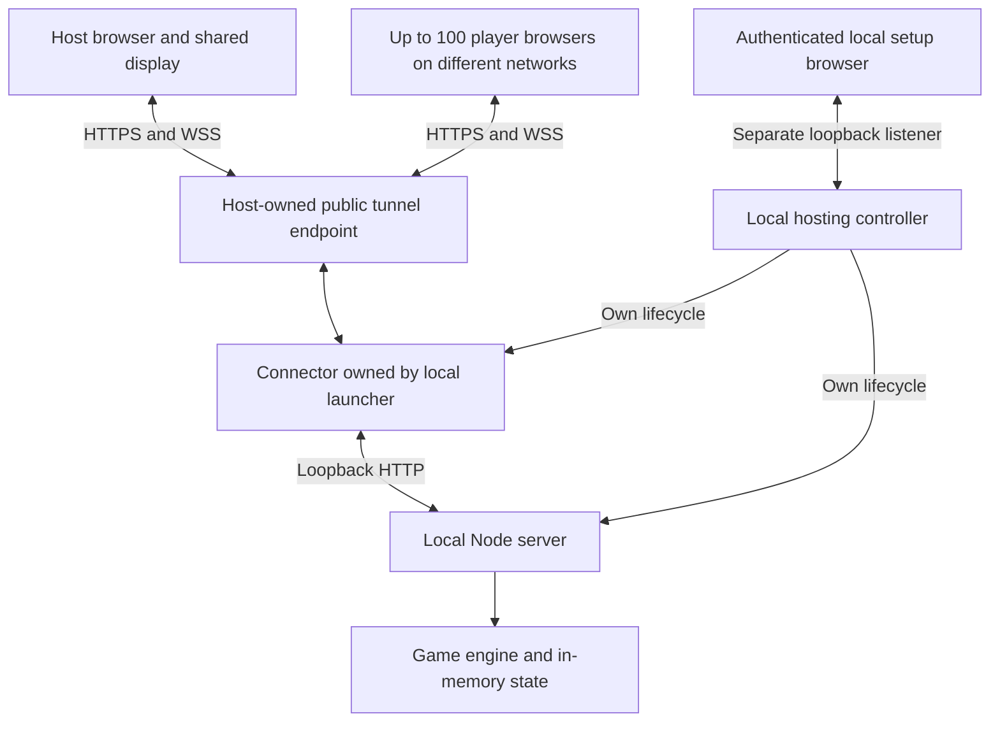
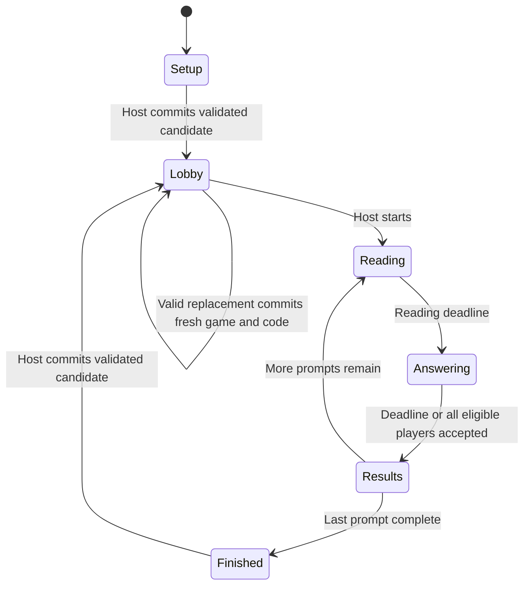

# Custom Rarity Game Architecture Baseline Version 3

Status: Managed temporary tunnel per hosting session adopted and implemented in the Epic 1 expansion on November 14, 2026. The application now has a reusable manager, separate authenticated local controller, dashboard/private owner handoff and synthetic public connection page. Event-purpose Quick Tunnels are accepted by the executable schema. The managed application has no ten-minute expiry; the old probe retains its own limit. Consult the [managed-hosting handoff](implementation/evidence/EPIC-1-MANAGED.md) and [master tracker](IMPLEMENTATION-PLAN.md) for final verification/status. The [PRD](PRD.md) and [UI/UX](UI-UX.md) retain the full product scope; gameplay, capacity, platform packaging and release remain their later gates.

## Lean initial npm release policy — November 19, 2026

This owner-approved policy supersedes earlier mandatory paid publisher-signing and exhaustive qualification wording. A scoped first release requires an exact installable npm tarball, intact resource/native/connector digests, source/dependency traceability, complete license notices, meaningful functional/security/recovery checks, accurate platform/network limitations, and explicit publication approval. Keep any platform-required or linker-generated ad-hoc signatures. Paid Apple Developer ID/notarization, Windows publisher certificates, independently signed Linux/native inventories and a desktop installer/container are optional future enhancements, not initial-release gates.

Release claims must match executed evidence. The available Apple Silicon Mac may qualify the initial release while bundled Intel/Windows/Linux targets remain clearly unverified/experimental pending the owner's manual testing. Exhaustive OS/browser/phone, physical sleep/network outage, 8 GiB reference-host, actual-venue, all-polling and repeated stress qualification are follow-up evidence for the corresponding compatibility/capacity/event claims, not universal prerequisites to publish a scoped prototype. Preserve their known limitations and prior results; a game correctness, credential/privacy, dependency-integrity or representative supported-path regression still blocks release. Registry readback of the approved bytes is required after publication; hosted provenance/trusted publishing is recommended when available, without requiring a new CI publishing system for the first authorized release.

## npm distribution implementation update

The owner-selected npm migration is implemented as one local, unpublished CLI candidate. The [Epic 5 npm migration stories](implementation/epic-05-npm-distribution.md) retain its acceptance contract; the [npm handoff](implementation/evidence/EPIC-5-NPM.md) binds the actual installed-package checks and 100-player mixed-transport game to the candidate. The tarball contains compiled application/browser assets and four small prebuilt native-helper targets. Hosts install a supported Node runtime themselves; the package does not bundle Node or require a compiler. Its pinned cloudflared executable is downloaded into a verified per-user cache only after explicit Start hosting or an explicit prepare action. Package installation and ordinary CLI launch run no install-time build/download hooks. This supersedes the former self-contained-archive, bundled-runtime and no-first-use-download requirements for new distribution; earlier archives and their evidence remain historical.

Gameplay, the 100-player target, owned Quick Tunnels, private local controller and existing clock/power/process-ownership guarantees remain applicable. The CLI enforces Node >=24.22.3 <25 independently of exact contributor/build pins, verifies immutable npm resources and injects selected native/worker paths into the existing launcher. Available-Mac checks do not certify actual Intel Mac/Windows/Linux execution or physical terminal/power lifecycle acceptance; those remain explicit owner-deferred verification items, with Epic 5 closed by owner instruction. A scoped npm release and accurate qualification record remain Epic 6 obligations; paid native publisher authentication/notarization is optional. The local candidate is neither a registry publication nor an authenticated public release.

## Baseline architecture

Run one authoritative Node application process and an owned tunnel connector on the host's computer. The application serves the compiled browser interface, accepts JSON uploads, and manages the game in memory. Host and player browsers use the same configured public HTTPS origin. The connector forwards requests to the application's loopback listener. The optional documentation/download site remains independent.

Use TypeScript, React/Vite, Fastify, Socket.IO and Zod. Keep one active game and one authoritative engine per process, without a database or central game service operated for all installations.



Internet access and provider availability are required for tunneled play. The laptop supplies computation and state; the selected provider relays traffic through a connector owned by that hosting session. The maintainer supplies software without operating a shared relay account or global room directory. The first migrated release supports tunnel hosting; direct LAN hosting remains historical investigation work until explicitly added as a supported mode.

## Host application and player access

The intended host experience is a foreground CLI installed or executed through npm on the host’s own supported Node runtime. Starting it opens local hosting setup. Selecting Start hosting starts the local application listener and temporary tunnel, verifies the public endpoint, and enables a private Open host page action. The server process and browser interface are separate parts of the same hosting experience; a separate native game interface is not required.

The host uses that public-origin website to upload the JSON game definition, review its effective settings, create the lobby, share joining information, start the game, and remove players. Prompts, tiers, points, and timers remain authored in the JSON for the prototype. Browser administration does not add a visual settings or prompt editor to the agreed scope.

The lobby supports both player access paths:

1. Scan a QR code containing the public HTTPS join URL and game code, then enter a nickname.
2. Open the displayed public join address manually, enter the game code and a nickname, then join.

Players install no application and need a browser with internet access to the configured public endpoint. They may use different Wi-Fi networks or cellular data. QR codes are generated locally and contain no admin credentials. The room code identifies the game after the player reaches that server; it does not discover the server through a public website. Both joining paths are existing PRD requirements.

The selected public distribution target is one npm CLI package for macOS arm64 and Intel x64 on macOS 15+, Windows x64 on Windows 11, and Linux x64 with Ubuntu 24.04+ as the officially validated distribution family. Hosts supply Node; players supply only a browser. Windows/Linux ARM64 and older or additional OS validation are deferred. Platform-specific native prebuilds remain required; paid native publisher authentication is optional. Verified support is limited to executed evidence, with other bundled targets unverified/experimental pending owner tests. Existing portable archives are historical artifacts, not the target for new public releases.

Use a visible launcher or console while the server is running. Closing the host's browser leaves the game running; quitting or closing the launcher or console stops its server and connector and ends the current game. There is no background tray or menu-bar service in the first release. Packaging must ensure that closing the launcher does not leave an orphan game server or connector running. The existing in-memory lifecycle still applies: stopping and restarting loses the current game and results.

## Technology choices

| Area | Baseline recommendation | Reason |
| --- | --- | --- |
| Language | TypeScript | Shared message types and validation contracts across browser and server. |
| Frontend | React with Vite | Component-based screens and a static production build suited to local serving. |
| Styling and art | CSS tokens plus original SVG, pixel sprites, or canvas scenery | Implements the UI baseline; keep game controls and text in accessible HTML. |
| Server | Node.js on a supported LTS release, with Fastify | One process provides HTTP endpoints, static assets, and the real-time transport. |
| Tunnel connector | One pinned provider integration, locally supervised | Publishes the loopback application under one HTTPS origin for the current hosting session. |
| Real-time transport | Socket.IO | Events, acknowledgements, and reconnection support, backed by explicit application resynchronization. |
| Validation | Zod | Validate imported files and incoming commands at runtime, with inferred TypeScript types. |
| Storage | In-memory maps and arrays | Sessions are temporary and restart recovery is outside the PRD. |
| Public site | GitHub Pages initially | A small static information site fits an open-source project. Cloudflare Pages is an alternative. |
| Distribution | One npm CLI with compiled application assets and four bundled native prebuilds; pinned connector prepared explicitly into a user cache | Hosts install supported Node; no user compilation or install hooks. The foreground CLI owns server and connector lifetime. |

Vite produces a deployable static build; its preview command is not the production game server. Serve that build through the local backend. [Vite deployment documentation](https://vite.dev/guide/static-deploy.html)

Use a pinned supported LTS runtime and a dependency lockfile rather than tracking arbitrary latest versions at startup. [Node.js release policy](https://nodejs.org/en/about/previous-releases) Zod provides runtime schemas and inferred types; application-specific checks still validate alias uniqueness and tier references. [Zod documentation](https://zod.dev/)

React with Vite is selected for the baseline implementation. The frontend boundary leaves room for a future replacement, but this release does not implement multiple frameworks. A static client build and local server cover gameplay without server rendering.

## Public hosting and software distribution

Recommend GitHub Pages for the initial public information site, alongside the open-source repository and downloadable release artifacts. It supports static HTML, CSS, and JavaScript from a repository. [GitHub Pages documentation](https://docs.github.com/en/pages/getting-started-with-github-pages/what-is-github-pages)

Cloudflare Pages is a reasonable alternative when a separate static-site workflow is preferred. It also supports static HTML deployments. [Cloudflare Pages documentation](https://developers.cloudflare.com/pages/framework-guides/deploy-anything/)

Neither choice is needed to host active games. A player never needs to load the public website to join a room. The public site contains hosting instructions, the JSON example and format guide, source and release links, and network troubleshooting guidance. It does not offer a cloud Create game endpoint or a global room-code directory.

These recommendations do not promise unlimited public-site traffic or free bandwidth. They separate normal website and download usage from the repeated requests and connections generated by games. Managed cloud game servers, serverless functions, and hosted real-time databases would create the central dependency the PRD excludes.

## Local hosting experience

1. Install a supported Node runtime and install/execute the npm CLI. Current verification uses the local candidate tarball; registry commands require a later published package. Contributors retain lockfile-based install/build commands.
2. Launch the application and select Start hosting in local setup; no account, domain or manual connector command is required for the default temporary-tunnel path.
3. On explicit Start hosting, prepare and integrity-check the pinned connector in its per-user cache if absent; then bind loopback, start the verified connector, discover and validate its assigned public origin, and verify endpoint readiness.
4. Open the locally minted private owner bootstrap link on that public origin.
5. Upload and validate JSON, create the lobby, and share its public HTTPS link, code and locally generated QR.
6. Players join through their browsers from any network that permits that endpoint.
7. Keep the launcher, connector, laptop and internet connection available through the session and final results. Finish hosting explicitly when results are no longer needed.

A hosting session owns one connector and one public origin. It spans setup, lobby, timed play and final results. A replacement game inside an allowed Lobby/Finished flow still receives a fresh game identity/code and requires rejoining; it can reuse the hosting session's unchanged origin. A new hosting session receives a newly assigned endpoint and fresh application state. There is no ten-minute application expiry: that limit belongs only to the historical probe.

Cloudflare Quick Tunnel is the default managed-session provider candidate. The application obtains its temporary address automatically. A named tunnel and permanent domain are optional future alternatives, not prerequisites or a second first-release setup mode. Temporary addresses are acceptable for this product; provider availability, request limits, venue egress and measured 100-player behavior still require validation. The Quick Tunnel service's development positioning and lack of an uptime guarantee must be considered at the event/release qualification gate. The request-concurrency ceiling is not a player-capacity claim. [Quick Tunnels](https://developers.cloudflare.com/tunnel/get-started/quick-tunnels/)

The package bundles the verified connector for each supported target. No dependency or connector is downloaded during hosting startup. If a future optional provider mode requires credentials, provision them locally outside source and archives. The maintainer runs no shared account or relay for installations. Changing provider requires updating its explicit forwarding and lifecycle contract.

### Local setup and public application boundary

The launcher setup interface uses a separate 127.0.0.1 listener that the connector never forwards. The public application listener serves host/player views, application APIs and Socket.IO. Do not mount Start hosting, Finish hosting, Quit, or owner-link minting routes on the public application router. A public visitor cannot operate the launcher or obtain an owner bootstrap token.

Local setup mutations require a launcher-issued, unguessable per-launch capability plus exact local Host, Origin and HTTP method validation. Bind authorization to the current launcher instance; invalidate it on quit. Deliver initial access only through the locally opened setup page or local console, with no credential in logs or public links. Remove any bootstrap fragment after exchange. Loopback address checks alone do not authorize local mutations: web pages must not be able to drive the launcher through cross-origin requests or DNS rebinding. S17/S18 define and test the local capability exchange and browser-refresh path before exposing controls. Keep this local setup authority distinct from the public host role.

The public host role is established using the existing one-use bootstrap exchange below. E1-S18 implements its narrow credential/role foundation; E3 reuses it and completes game/session authorization. Existing player-to-host conflict refusal remains required. Both public host and player game interfaces use the same public HTTPS origin; the local launcher page is a separate setup surface.

Finish hosting stops the owned application session and connector but can leave the local launcher setup page available for another session. Quit also closes that local controller. Confirm a deliberate Finish hosting or Quit action when it would discard a game/results; explain player disconnection and loss of in-memory state. This is application shutdown, not a new game command such as End Game, Pause or Skip. Forced process termination cannot promise a dialog. Closing a browser tab does not finish hosting. Final Results/Finished does not automatically close the tunnel.

E1-S18's public page and QR demonstrate connectivity with synthetic state. Production code-prefilled invitations, admission, JSON authoring flow and playable rounds arrive through E3/E4; do not label the diagnostic page a working game.

### Power and interruption policy

During active Reading, Answering, and Results phases, request OS idle-sleep prevention through a platform-specific adapter. Release that request when the game finishes or the application exits. This is a temporary application power request, not a permanent change to the host's power settings. It does not promise to override deliberate sleep or a closed laptop lid. If the environment cannot honour the request, show a local launcher notice asking the host to keep the computer awake.

If the server process survives sleep or suspension and the connector returns at the same public origin, resume the existing game. A phase that has expired closes once; an expired Answering phase preserves accepted answers and awards 0 to players without one. Give the following phase its full configured duration from recovery. Do not consume the whole suspension interval by skipping multiple unplayed phases or rounds. If the current phase still has time remaining, continue its remaining duration. A Lobby or Finished session remains in that state. Reconnecting clients receive a fresh snapshot before input is enabled.

The implementation must account for suspension when establishing whether a deadline expired on each supported OS. Epic 5 implements synchronous native clock adapters (macOS mach_continuous_time, Windows GetTickCount64, Linux CLOCK_BOOTTIME) and a 250 ms watchdog for gaps over five seconds; ordinary wall-clock changes must not alter game deadlines. If the process stopped rather than merely suspended, the existing no-restart-recovery rule applies.

## Network binding and reachability

Bind the origin listener to 127.0.0.1. The owned connector forwards only to that application port. Discover one assigned public HTTPS origin from the owned connector, then validate and bind that origin to the hosting session: require a DNS hostname and no credentials, path, query or fragment. Construct invitation and bootstrap links from validated deployment configuration. At runtime compare invitation origins against that configuration; a shape validator alone cannot prove hostname ownership.

Specify the connector's exact upstream Host behavior, including any deliberate rewrite. Accept only the configured public authority or the precisely configured upstream authority required by that integration. Reject unexpected Host values. Enforce exact public Origin on HTTP mutations and WebSocket upgrades. Legitimate navigation and same-origin polling GETs can omit Origin, while supplied Origin values must match. Apply checks to both Fastify and Engine.IO middleware.

Keep blanket proxy trust disabled. Accept forwarded metadata only on the documented connector path and after testing its header overwrite/stripping behavior. A loopback peer or an asserted forwarding header grants no host authority. Prefer explicit external-origin configuration for redirects and Secure-cookie policy. Rate limits must retain session/global bounds because many participants share a campus/carrier IP, and the origin commonly sees the connector address.

Internet-facing discovery, code attempts and owner exchanges require bounded work and tested throttles. Apply resource protections without evicting valid players. The room code remains an instance-scoped identifier and removal excludes the current identity. Forwarding an invitation can allow another person to attempt joining; stronger invitation secrets or host approval remain outside this baseline.

A changed local interface or IP may preserve the game if the application survives and the connector reestablishes the same public origin. A changed public scheme, hostname or port requires explicit creation of a fresh hosting session, game, code and invitation. Invalidate the old ready invitation and do not silently rotate an endpoint under an existing game. Browser credentials and tab storage do not migrate across origins. A process restart loses the game as before.

### HTTP and browser constraints

Serve host/player HTML, assets, API and Socket.IO through the same public HTTPS origin. TLS terminates according to the selected provider configuration, with the final HTTP hop on loopback. Document the provider's access to traffic and inspection/logging settings. Retain manual clipboard fallback even on HTTPS.

Use Secure, HttpOnly, SameSite=Strict host-only cookies. The explicit HTTPS deployment policy determines Secure even though the final local hop is HTTP. Protect mutations with exact Origin and method checks. Bypass shared caching for all session, owner, host-operation, snapshot and real-time responses, and prevent owner HTML from being cached with secrets. Explicitly version static-asset caching. Disable or redact request-body/credential inspection where supported; credentials and raw answers must not enter application diagnostics.

A provider error may be HTML or a connection failure before the app loads. Treat it as transport uncertainty and retain existing same-ID retry/reconciliation rules. It cannot prove that a host mutation failed.

### Tunnel readiness and outage policy

The launcher validates configuration, binds loopback, starts the connector, and verifies public reachability before presenting a ready invitation. Keep Start disabled while tunnel readiness is unavailable. A running connector process alone is insufficient evidence. Use bounded connection retries with backoff and actionable local feedback. While the same connector preserves the same origin, transient recovery may continue the session. A connector exit or permanently lost Quick Tunnel endpoint is a failed hosting session; do not respawn it behind the existing game and silently accept a different URL. Require explicit Start new hosting session with clear state-loss feedback. Never automatically restart a failed application server and imply recovery.

During a brief connector or internet interruption, an awake server continues its timers. Disconnected players keep slots and locked answers, and may miss a round. Restore authoritative state before re-enabling input; never queue or auto-submit unsent text. This introduces no pause phase. Actual OS sleep follows the existing one-expired-phase policy, then waits for connector/browser resynchronization.

Readiness belongs to hosting/transport state. Expose sanitized status to the host and launcher without exposing credentials, raw provider output or diagnostic infrastructure to players. E1-S11/S12 implement configuration, invitation, cookie, ingress and status contracts in `packages/contracts/src/deployment.ts` and host views in `views.ts`; E3 must enforce them in the production server. E1-S13 retains probe evidence; E1-S15–S20 implement and verify managed application hosting. E6 validates the actual event workload and venue.

## Backend responsibilities

| Module | Responsibility |
| --- | --- |
| Hosting controller | Own local authenticated setup, session identity, Start/Finish hosting, shutdown and private owner-link issuance; never expose these controls through the tunnel. |
| Tunnel manager | Verify connector, discover and validate assigned origin, supervise bounded readiness/recovery and connector cleanup. |
| Application startup | Bind loopback, accept the session-bound public origin, prepare owner exchange, serve bundled assets. |
| Game importer | Parse JSON, enforce the agreed schema, validate references and limits, build answer indexes. |
| Session manager | Own room code, player identities, roster capacity, host authorization, and removal. |
| Game engine | Apply all commands, phase transitions, submission locks, scoring, and ranking. |
| Scheduler | Maintain phase deadlines and trigger transitions without browser participation. |
| View serializers | Produce separate public, player-private, and host views without leaking answer data. |
| Transport adapter | Expose HTTP operations and Socket.IO events, authenticate, validate, and acknowledge commands. |
| Local diagnostics | Report startup, phase transitions, connection counts, and errors without logging credentials or answer banks. |

One backend process serves the production frontend and real-time endpoint on the same origin. The developer Vite server can be used during development with a local proxy, but it is not part of the host's release setup.

## Frontend responsibilities

Build one React application with host and player routes, sharing the visual system and connection client. Separate the authoritative server snapshot from local UI state such as typed text, focus, expanded rows, and animation progress.

The local setup screens cover hosting startup, connection status, public link/QR, private Open host page and explicit lifecycle actions. The public host screens cover file upload, validation feedback, lobby, presentation, roster removal, results, and post-game setup. Player screens cover joining, waiting, prompt reading, answering, acceptance, reconnection, round results, standings, and personal recap.

The browser displays the countdown from a server deadline and draws scenery and transitions locally. It never assigns points, decides whether an answer is valid, advances a game phase, or establishes its own submission deadline. A closed host tab does not stop the server. A sleeping or stopped host computer does interrupt hosting.

Bundle the font, CSS, artwork, QR generator, client scripts, and all other runtime assets. Do not load fonts, scripts, validation services, or game assets from public CDNs during a session. Keep future prompts and answer indexes out of frontend bundles and public responses.

## Game state and transitions

Use a small explicit state machine:



Initial file validation failure stays in Setup. A failed replacement import preserves the existing lobby or finished game and its results. Replacing a pack in Lobby or Finished commits a fresh game identity and room code, discards previous memberships, and requires players to join again. Replacement is unavailable during Reading, Answering, and Results. Host disconnection does not add a pause phase.

The engine owns an immutable validated game definition, the current game ID, phase and round IDs, a monotonically increasing state revision, phase deadlines, players, accepted submissions, finalized round records, totals, removed-identity records, and command acknowledgement records. All of this lives in memory for the process lifetime.

Keep answer indexes private to the server. Normalize each canonical answer and alias once on import into a per-prompt lookup map. Lookup returns a canonical answer and tier. Validation rejects conflicting mappings. Scoring uses the manually assigned tier points; frequencies only count canonical accepted answers.

Finalization runs once per round: record misses, settle totals, calculate canonical counts, select the highest-scoring unused answer, and compute shared ranks. Retain removed players' submissions in statistics while excluding those players from standings and early-completion eligibility. Disconnected admitted players remain eligible and occupy roster places. With no eligible players, allow the scheduled deadline to close the round.

## Shared timing and concurrent commands

Use a server monotonic clock for phase durations and deadline decisions. Include a presentation deadline and server-time sample in snapshots so each browser can estimate remaining time; refine that estimate through bounded clock-sync exchanges. Browsers animate their own countdowns without receiving one event per timer tick.

A timer callback is a wake-up signal, not the source of truth. Check the monotonic deadline on every relevant command as well, so a delayed callback cannot accidentally accept an expired answer. Treat receipt as the first application transport handler receiving the complete command, not the client's claimed send time.

Apply engine mutations synchronously through one serialized path. Avoid awaiting network or disk work between validation and committing an accepted answer. For asynchronous preparation, recheck game, phase, and revision before committing. A round-ID guard makes a stale timer or duplicated finalization harmless. The last accepted answer and a concurrent removal must never close a round twice.

Apply the agreed sleep/resume policy: close an expired interrupted phase once and give the next phase its full duration. Record the interruption in local diagnostics. Use the starting watchdog threshold specified in the implementation contract below and validate suspension detection on each platform; it must not introduce ordinary timer drift or permit late submissions.

## Real-time protocol and reconnects

Use HTTP for file import, session bootstrap, and simple setup requests. Use Socket.IO for game commands and state updates. The browser opens directly with WebSocket on the same local listener. A network opening error or the 10-second Manager opening timeout selects polling (with optional WebSocket upgrade) for the next application-scheduled attempt. Structured authority denials do not trigger transport fallback. One manager owns the connection; automatic Socket.IO reconnection is disabled. Successful opening restores WebSocket preference for a later recovery cycle without replacing the established transport.

Define typed commands with a request ID, game ID, round ID where applicable, and validated payload. Use the namespaced commands in the implementation-contract table below, rather than introducing alternate command names. The server derives the participant role and identity from its session credential rather than trusting a playerId supplied in a payload.

A submission acknowledgement distinguishes accepted, rejected, already locked, wrong round, expired, and removed. Accepted means the answer is locked; it contains no tier, point value, or newly calculated total before results. Rejected attempts allow another request while time remains.

Socket.IO provides ordering but defaults to at-most-once arrival; acknowledgements and retry behavior must be designed at the application level. [Delivery guarantees](https://socket.io/docs/v4/delivery-guarantees/)

Use bounded retries with the same request ID. Store acknowledgement outcomes for the current game so a lost acknowledgement cannot double-count points or create a second player on a repeated join. An acknowledged rejection may be followed by a new request ID for a changed answer. Expired queued submissions must not become answers to a later round.

Disable editing and new answer submission while disconnected; preserve the loaded page's in-memory draft without buffering it for automatic sending on reconnection. Unsubmitted drafts are not persisted across reloads. A fresh snapshot restores accepted submissions, not an unsent draft. Retrying a previously sent command may recover its acknowledgement; it must not create a new submission after the deadline.

Use a server-issued browser session cookie and a separate stable player ID, not a transient socket ID, for same-browser reconnection. The newest player tab takes control of that identity; older tabs show that the game is active elsewhere and cannot submit commands. All tabs share the same score, locked answers, and single roster place. Validate credentials and removal status on every connection and command.

Track a client-tab identifier and a server-issued control generation separately from the browser session. A newly opened tab can acquire control; reconnecting an existing tab does not automatically steal it back. A superseded tab may send player.claimControl only in response to the explicit Take control here action, then obtain a fresh generation and snapshot before enabling play. Revoke the older generation when transferring control and reject its commands, including commands racing with takeover. A refresh with valid continuation proof can resume control; stale or ambiguous recovery requires the explicit takeover fallback. Automatic reconnect loops in superseded tabs must not cause a takeover cycle.

On initial player-page load and reconnect, verify existing game membership and support a fresh role-filtered snapshot containing the current phase, deadline, previously revealed score, and that player's locked-answer status. Valid existing membership resumes without another nickname/admission form; an old credential alone never joins a replacement game. State revisions discard old updates. Transport recovery is an optional later optimization: its own documentation says recovery may fail, so it cannot replace snapshot synchronization. [Connection recovery](https://socket.io/docs/v4/connection-state-recovery/)

## Host authority and data visibility

Mint a high-entropy one-use owner bootstrap secret at local startup. Open a host URL containing it in the fragment, exchange it through a same-origin request for an HttpOnly, SameSite session cookie, then remove the fragment. Do not publish this URL in the player QR code or structured logs. Game codes provide room selection, not admin authority.

The local launcher or console provides Open host page to mint a fresh private link and recover host browser access without restarting the server or interrupting the game. This works after cookies are cleared or a different browser is used. Minting a recovery link requires local application access; players cannot request one over an unauthenticated public route. Token lifetime and authorization rotation follow the implementation contract below.

Host authorization protects import, Start, Remove Player, and post-game setup. Revalidate it on every admin command. The initial host browser role does not join as a competitor. A new game rotates player membership and game identifiers; the operator's host session can remain valid for the process lifetime.

Apply authentication, connector-ingress and public-origin restrictions, message validation, and rate limits to the Socket.IO handshake and events explicitly as well as HTTP routes. Do not assume Fastify route hooks automatically protect a separately attached real-time transport.

Define explicit response schemas rather than broadcasting the internal game object:

| Recipient and phase | Data available |
| --- | --- |
| All admitted clients before reveal | Current prompt, round and phase, timing, previously revealed standings, permitted readiness counts. |
| Individual accepted player | Their submitted wording and locked status, without canonical tier metadata or new points. |
| Host during answering | Administrative roster and accepted count, without live answers or tier outcomes on the shared display. |
| Round results | Completed-round counts, revealed tier points and standings, and the chosen unused-answer example. |
| Final player recap | That player's completed-round answers, tiers and points, plus permitted completed-round results. |

Upload success returns summary counts, not answer banks or future prompts. Reconnecting during Answering must not leak a precomputed current-round score through total-score fields. Do not send full answer sets merely to let the frontend hide them.

## Limits and the 100-player target

The 100-player cap is an admission rule, not a performance benchmark. Enforce it atomically in the engine, count disconnected admitted players, and allow valid reconnects when full. Cap duplicate connections per identity separately so one participant cannot create an unlimited number of sockets.

Limit game files to 1–20 prompts. Accepted-answer and alias counts may vary with the file; do not preallocate a fixed allowance per prompt or duplicate the game definition for each player. Let runtime memory grow with actual content, retaining one validated definition and its lookup indexes on the server.

Node's heap grows as needed within its runtime limit. Available process memory and actual usage can inform import admission and diagnostics, but source JSON bytes do not predict the exact memory required for parsed objects, indexes, and temporary allocations. Available-memory checks are advisory, not a guarantee that an arbitrary file will fit. [Node heap statistics](https://nodejs.org/api/v8.html#v8getheapstatistics), [available process memory](https://nodejs.org/api/process.html#processavailablememory)

Validate and index before opening the lobby. Large JSON parsing can block the main thread; use the required import worker for parsing and compilation, and measure representative packs to tune its limits. [Node JSON parsing guidance](https://nodejs.org/en/learn/asynchronous-work/dont-block-the-event-loop#blocking-the-event-loop-json-dos)

Use the adopted 10 MiB upload ceiling, 4 KiB answer-command limit, and advisory memory-headroom checks specified in the contract below. Tune resource thresholds only after recording representative measurements and updating the specification. Memory still grows with actual data; no fixed accepted-answer count per prompt is imposed.

Keep request-history maps bounded by game lifetime and admitted identities, limit outstanding validation work, and reject excess work rather than creating an unlimited queue. Small readiness updates can be batched briefly. Do not stream scene animation, timer ticks, or complete answer dictionaries to clients.

Target an ordinary laptop with 8 GB of RAM and a reasonably modern processor. Record the reference machine, host uplink, provider plan/version and event network. Use 100 simulated players plus a host through the real tunnel, followed by actual mixed-phone Wi-Fi/cellular tests. Measure handler latency separately from end-to-end delay, tunnel egress, polling fallback and reconnect bursts. Admission limits do not cap unauthenticated traffic or provider charges.

## Packaging and project structure

Start with a TypeScript workspace organized as follows:

```text
apps/web/             React screens, CSS, local artwork, connection client
apps/server/          Fastify, Socket.IO, startup, authorization, local serving
packages/game-core/   Deterministic rules, scoring, phase transitions, projections
packages/contracts/   JSON and command schemas, public response types
examples/             Example prompt packs
scripts/              Build, release, local startup helpers
```

Game-core should be testable without a browser, socket, real clock, or network. Inject the clock and scheduler. Keep private game definitions separate from client contracts even when TypeScript types are shared.

The Epic 2 implementation uses a pure `GameEngine` with injected clock/ID generators and fenced timer tokens; the server adapter schedules those tokens externally. Frozen internal snapshots retain private game data, while `projectHost`/`projectPlayer` construct schema-checked permitted views. Compiler transfer helpers support trusted import-worker IPC without rerunning compilation on the parent thread. See the [core integration guide](../packages/game-core/README.md) and [recorded G2 evidence](implementation/evidence/EPIC-2.md); production protocol dispatch and scheduling remain Epic 3.

For contributors, provide install, build and host commands with the existing pinned runtime and lockfile. The delivered local npm candidate contains compiled server/core/contracts, browser assets, examples/notices and all four small native-helper prebuilds. It contains no Node runtime, requires no user compiler and performs no npm dependency installation during hosting; explicit connector acquisition remains the declared setup step. Package assembly must not leave unpublished/private workspace dependency references or repository-relative symlinks in the artifact.

`scripts/npm/assemble.mjs` stages a separate manifest and runtime shrinkwrap in `dist-npm/package`, bundles private workspace code into `apps/server/dist/hosting/launch.js` and `apps/server/dist/game/import-worker.js`, and copies the allowlisted built assets and four native target sets. Preserving those directory depths keeps package-relative browser/setup assets stable; `launch.ts` explicitly supplies the bundled worker URL. `bin/niche-out.cjs` and `bin/runtime.cjs` perform lightweight dispatch/preflight. `resources.json` and `native-manifest.json` describe immutable installed resources; local hash verification detects corruption, while paid publisher authentication is an optional future enhancement. No connector executable is bundled.

Installing the package runs no lifecycle build/download hooks. Launching the CLI opens local setup without downloading cloudflared. Explicit Start hosting or prepare may download the exact manifest-pinned connector, verify size/archive/executable hashes and install atomically into a version/hash-keyed per-user cache. Running sessions never update in place; an installed package or new connector version is adopted between hosting sessions. Docker and alternative package-manager support remain future work.

## Verification before calling the baseline implemented

| Area | Required evidence |
| --- | --- |
| Core rules | Deterministic tests for normalization, aliases, tier scores, misses, zero-point acceptance, tied ranks, removal, and unused-answer selection. |
| Timing | Fake-clock tests around deadline boundaries, early finish, zero eligible players, stale timers, and duplicated finalization. |
| Command handling | Duplicate IDs, lost acknowledgements, repeated joins, simultaneous final submissions, removal races, and stale-round commands. |
| Information boundaries | Inspect serialized messages before reveal; no tier, current-round points, future prompts, or full answer banks leak to players. |
| Identity | Reload, dropped Wi-Fi, concurrent tabs, removed-identity resume, host refresh, and new-game invalidation. |
| Capacity | 100 admitted players and a host; reject an extra new player; preserve reconnects, bounded memory, and responsive phase changes. |
| Tunnel deployment | Test loopback binding, configured public Origin/Host, forwarded-header spoof rejection, secure sessions, polling/upgrade, startup port conflicts and actual venue egress. |
| Internet interruption | Verify failure feedback, timer continuation, same-origin reconnect and fresh game on public-origin change. Confirm all assets are bundled and served through the application. |
| Browser UI | Real Safari and Chrome phones with keyboards open, reduced motion, and the shared host display. |

The performance target is server-side command acknowledgement processing below 100 ms at the 95th percentile under the defined 100-player workload, excluding network transit and bounded import work. Measure event-loop delay, memory, network traffic, and end-to-end response separately. Record hardware, pack size, and workload; a passing target is scoped to that measured workload.

**November 16 qualification update:** [Epic 6 measurements](implementation/evidence/EPIC-6.md) pass local 100-player churn and a real 100-player mixed-transport run on the available 18 GiB M3 Pro Mac over eduroam. All measured eligible command groups met the processing p95 target. Complete all-polling qualification remains open: simultaneous reconnects encountered provider 429s and recovered, but a later DNS/interrupted-request boundary stopped the full game test. Significant full-view traffic and latency tails are documented. Neither an 8 GB host nor 100 physical phones/venue conditions are certified by these tests.

The owner requested [provider/transport alternatives](implementation/evidence/EPIC-6-ALTERNATIVES.md) and subsequently retained account-free Quick Tunnels. The November 17 networking extension implements WebSocket-first fallback, retry jitter, smaller live player views and coalesced metadata publications; its verification is recorded separately from the earlier qualification results. Named Cloudflare hosting is excluded from this extension. The 100-player target and identity/retry rules remain in force. Public signing and deferred platform/device evidence also keep the full release gate open.

## Decision coverage and implementation gates

Review rounds 1–6 have resolved the product-facing architecture choices and adopted the technical contract. The remaining work is to implement, pin, test, and package those decisions. The table separates that work from additional product discovery.

| Area | Settled specification | Implementation or release evidence |
| --- | --- | --- |
| Host platforms | One npm CLI, four native prebuild targets; macOS 15+, Windows 11, Ubuntu 24.04+ validation family. | Packed-install tests on the host Node range and actual target machines. |
| Host lifecycle | Managed session setup, visible launcher, browser independence, local owner recovery, explicit Finish hosting, same-origin resume. | E1-S15–S20 common hosting; E5 platform power/process adapters and packaged shutdown/recovery tests. |
| Network | Loopback listener, operator-owned tunnel, same public HTTPS origin, fresh game after public-origin changes. | E1-S11–S14 probe foundation; E1-S15–S20 managed hosting; E3 game integration; E6 venue/capacity qualification. |
| Imports | Strict known fields, 1–20 prompts, variable answer data, adopted byte/text/time defaults, atomic replacement. | Schema implementation, peak-memory and timeout tests, representative pack fixtures. |
| Protocol | Versioned HTTP/socket contracts, bounded retries, serialized engine, filtered snapshots. | Concrete schemas, adapters, integration tests, and message inspection. |
| Identity | Same-browser recovery, newest-tab control, local owner-link recovery, removed identity exclusion. | Cookie, takeover, deduplication, generation, and expiry tests. |
| Timing | Strict server deadline, shared countdown, early closure, one-phase suspension recovery. | Monotonic/suspend clock adapter and fake-clock/platform tests. |
| Results | Manual tier points, canonical counts, tied ranks, deterministic unused-answer example, hidden current-round scores. | Engine/projection tests and UI verification. |
| Resources | Adopted thresholds and ordinary 8 GB laptop target; 100 players plus host. | Record reference laptop/uplink/provider, workload, egress, latency, memory and mixed-network phone results. |
| Language and UI | English prototype, agreed visual baseline and real phone keyboard support. | English-content, accessibility, viewport, and actual device tests. |
| Public distribution | Exact npm artifact/source/native inventories, verified connector, notices, scoped installation evidence and explicit between-session updates. | Approved account/version/bytes, known-limit review and publication authorization. Paid publisher signing is optional. |

The tunnel deployment direction is adopted. Managed temporary hosting requires no account/domain setup. Provider suitability, applicable limits and venue connectivity remain qualification gates; no payment or account purchase is implied. Product name, final artwork, publisher identity, license, and actual release credentials must be settled before public publication as applicable; the application can be built and tested locally first.

## Implementation contract

The following starting contract is adopted for implementation. It preserves confirmed gameplay and fixes the routes, commands, validation, session, timing, and packaging defaults. Numerical resource thresholds remain tunable through measured tests; they are not claims of proven capacity. The prototype supports English-language content and application labels. Non-English localization and multilingual content/font validation are deferred.

### Runtime and platform matrix

For npm hosts, the enforced runtime range is **Node >=24.22.3 <25**. Preserve the exact contributor/build pins (currently Node 24.22.3/npm 11.19.1) and workspace lockfile. Record build dependencies/source and supported runtime range in release metadata; do not require the host runtime to equal the build patch. The CLI validates runtime/OS/architecture before loading native code, opening listeners or preparing the connector; `engines` provides matching installation metadata. Test the floor and current supported Node 24 patch with the actual npm tarball. [Node 24 platform requirements](https://raw.githubusercontent.com/nodejs/node/v24.x/BUILDING.md)

| Native prebuild target in npm package | Agreed CPU target | Supported OS floor and validation |
| --- | --- | --- |
| darwin-arm64 | Apple Silicon arm64 | macOS 15+; native arm64 Node |
| darwin-x64 | Intel x64 | macOS 15+; actual Intel validation; x64 Node selects x64 assets even under Rosetta |
| win32-x64 | x64 | Windows 11; PowerShell and Command Prompt |
| linux-x64 | x64 | Ubuntu 24.04+ glibc; supported LTS validation |

The running Node process’s `process.platform` and `process.arch` select the helper, guard and connector target. The current native builds use explicit Node-API level 8; verify minimum/current patch loading because ABI stability does not make binaries portable across CPU/OS/libc. Hosts need no native build tools. [Node-API](https://nodejs.org/api/n-api.html)

Musl/Alpine, Windows/Linux ARM64, 32-bit Node and additional distributions are outside this first support matrix. Linux shared-library prerequisites, native executable permissions, actual Intel hardware and OS power/process behavior require target evidence. Missing idle inhibition remains a warning; unavailable continuous clock/process ownership remains fatal. Test npm/npx wrapper lifetime, terminal close, abrupt CLI and wrapper-parent death, Windows nested Job Objects, and default-browser launch. Do not silently fall back to weaker clock or orphan-cleanup semantics. [Windows nested jobs](https://learn.microsoft.com/en-us/windows/win32/procthread/nested-jobs)

Use package-relative resource lookup with no package-directory/CWD writes. Test read-only installations, paths with spaces/non-ASCII text, Windows drives and user-writable cache permissions. npm may invoke command wrappers; document `.cmd` invocation if a PowerShell script policy blocks a shim instead of advising global policy relaxation. No installation lifecycle scripts are needed, including under `--ignore-scripts`. [npm script configuration](https://docs.npmjs.com/cli/v11/using-npm/config/#script-shell)

### Content language scope

Support and test English-language prompts, answers, tier names, nicknames, and interface labels for the prototype. Keep UTF-8 JSON and deterministic string normalization; English-only scope does not require rejecting every non-ASCII character, such as an accented name or typographic punctuation. Translation, transliteration, CJK/RTL layout guarantees, and bundled multilingual font coverage are outside the first prototype. Aliases remain explicit.

### Launcher contract and owner recovery

The implemented npm candidate contains compiled application/frontend assets, native prebuilds, examples, notices and a CLI entry point. Hosts provide supported Node. It locates immutable resources relative to its installed package directory, not the caller’s working directory, and launches local setup without installing dependencies or downloading a connector. Only explicit Start hosting or prepare may populate the connector cache. Cache entries are version/hash keyed, verified before execution and atomically committed; concurrent preparation, interrupted/corrupt downloads and unwritable/noexec locations must have actionable failures. Runtime download proxy/CA configuration is explicit rather than assumed to inherit npm registry settings. No secrets belong in a shared binary cache.

The visible launcher/console exposes Start hosting, local setup access, Open host page after readiness, Finish hosting, and Quit. The browser setup surface provides equivalent lifecycle actions through its authenticated local controller. Closing the console also stops the server. Open host page creates a fresh one-use owner bootstrap token, opens the configured public host URL, and preserves the game, players, timers, and results. It is invoked through the local application, not an unauthenticated public endpoint. This action remains available after browser cookies are cleared.

Use 32 random bytes for session secrets, a 60-second lifetime for unused bootstrap tokens, and replacement of an earlier unused bootstrap token when another is requested. On successful recovery exchange, rotate host authorization and revoke earlier host-session credentials. Do not revoke the current host merely because a new link was generated but never opened. Existing player credentials are unaffected.

Credentials may appear in the interactive owner-only recovery link but never in structured logs, crash reports, QR codes, or public join responses. Clear the fragment after exchange. A browser reload with its valid cookie resumes normally and does not require a recovery exchange.

### HTTP routes and browser sessions

Use protocol version 2 and JSON responses. Version 2 removes unused published standings from live player views; live host and revealed standings remain. Server and bundled browser update together, and version 1 clients are rejected explicitly. A common failure shape contains code, message, requestId when supplied, and optional field errors. IDs are opaque server-generated strings except command request IDs, which may use a server-issued tab prefix and a monotonically increasing client sequence. This preserves deterministic request identity across retries and does not establish authority.

| Route | Access | Behavior |
| --- | --- | --- |
| GET /health | Configured public endpoint | App/protocol version and liveness only; no game contents, credentials, or roster. |
| GET /hosting-health | Managed startup probe | Return the hosting instance and nonce expected by the local manager. The nonce is not administrative authority; protocol health remains at /health. |
| POST /api/session | Approved same-origin browser | Establish or validate the browser cookie; return its effective role, own current membership and permitted game ID before resume, plus tab/request metadata governed by the tab-control contract. Does not admit a player. |
| POST /api/owner/exchange | Same-origin browser with valid one-use bootstrap secret | Establish or recover host authorization; reject HOST_PLAYER_CONFLICT if this browser has an admitted, nonremoved membership in the current game. |
| POST /api/host/import | Host only, in Setup/Lobby/Finished | Validate a bounded raw candidate pack and return sanitized summary or field errors. Failure leaves the existing state untouched. |
| POST /api/host/games | Host only, in Setup/Lobby/Finished for a new commit | Commit a validated candidate once using its candidate ID, expected game/setup generation, and request ID. Identical retries recover the prior outcome without creating another game. Active timed phases reject new replacement. |
| POST /api/host/operations/resolve | Host only | Atomically recover or fence an uncertain create/replace, Start, or removal operation and return the permitted current host snapshot. This is protocol recovery, not an additional gameplay control. |
| GET /api/snapshot | Authorized participant or host | Return only that role's view of its current game; reject obsolete game IDs. |
| GET /host and /join | Configured public endpoint | Serve frontend shell; shell access alone grants no admin authority. |

HTTP errors use 400 for malformed payloads, 401 for absent or expired authentication, 403 for forbidden roles or removed/superseded identities, 409 for phase/game/candidate conflicts, 413 for upload-size violations, 422 for game-file validation errors, 429 for rate limits, and 503 for unavailable local capacity (including session/page/history limits) or import timeout. Socket acknowledgements retain equivalent machine-readable codes without pretending that an HTTP status was transmitted. User messages do not expose answer banks or credentials.

Use Secure, HttpOnly, SameSite=Strict host-only cookies scoped to the configured public origin and application path. Use 24-hour admitted-player and host credential expiry, refreshed on valid use, with all server-side credentials invalidated on process exit. Waiting guest sessions instead use the shorter idle lifetime in the resource table; expiration never grants membership or invalidates an admitted player to free a guest slot. Set Secure from explicit public HTTPS configuration even when the connector forwards HTTP over loopback. A player's browser credential can survive a new lobby but its old game membership cannot: a fresh game still requires explicit joining and creates a new player membership.

Host credentials and player credentials have distinct roles. Refuse player admission through the active host browser role. Conversely, owner exchange refuses an existing nonremoved membership in the current game, including Lobby and Finished, with HTTP 409 and HOST_PLAYER_CONFLICT. It does not remove that player, change scores/control, consume the unused bootstrap token, or revoke the current host. Explain that the host link must be opened in a separate browser profile or private window. The unused link retains only its original remaining lifetime; the local launcher can mint a fresh one. Successful owner recovery in an eligible browser follows the existing token rotation rules and leaves unrelated player sessions unchanged. Clearing player cookies after entry closes cannot recover membership by nickname; no manual player-account recovery is added. A removed identity cannot rejoin the same game. Before Start, removal frees its roster slot and nickname for a different admitted identity; after Start, new entry remains closed.

### Initial session discovery

Run POST /api/session before trying to resume a game or showing an admission form. The response contains protocolVersion, serverInstanceId, role, membership, hostGameId, lastGameCommit, and the permitted tab/request metadata. The tab bootstrap and reload mechanism is specified in the tab-control contract below; this discovery operation alone never transfers player control.

| Response field | Contract |
| --- | --- |
| role | Server-derived host, player, or guest. Host means valid owner authorization; player means a recognized current membership, including a removed membership so its terminal state can be shown; guest has no current membership or owner authority. |
| membership | Null or the authenticated browser's own gameId, playerId, fixed nickname, and status (admitted or removed). Admitted includes Lobby, timed play, and Finished. Never contains another player's membership. |
| hostGameId | Current game ID for an authenticated host, otherwise null; null in Setup when no game exists. |
| protocolVersion and serverInstanceId | Identify the wire contract and process lifetime so clients can discard state from a previous server instance. |
| tab/request metadata | Fresh page tabId and requestPrefix on a full document bootstrap; resume classification and permitted continuation metadata as specified below. It is not a membership credential or permission to submit. Control-generation checks remain mandatory. |
| lastGameCommit | Host-only descriptor of the current game's successful commit: requestId, candidateId, gameId, setupGeneration, and revision; otherwise null. Supports recovery after reload without storing file contents in the browser. |

A new or expired cookie yields only a guest session with null membership and hostGameId. A removed player receives their own removed status, not a resume grant. Replacing a game invalidates old memberships; the same browser cookie then discovers no membership in the new game and must explicitly join. Nicknames, invitation codes, client-supplied player IDs, and local cached values cannot establish membership.

A player with admitted status calls game.resume using the discovered gameId and tab metadata, then waits for the current authorized snapshot before enabling controls. A host uses hostGameId to recover its host snapshot or enters Setup if null. A guest sees the join form. A removed membership gets the removal screen. If replacement or restart occurs between discovery and resume/snapshot, reject the stale game/instance and repeat discovery; never silently join the replacement. Discovery returns no answer data, future prompts, tier mappings, roster, or scores.

### Tab bootstrap and control continuation

A browser session owns identity; a page instance owns a tabId/request prefix; the server owns the current controller tabId and generation for that membership. Every full document bootstrap gets a fresh server-issued page identity. Automatic transport reconnect reuses the loaded page's identity and must not call bootstrap to manufacture a new tab.

Retain only control metadata in sessionStorage: serverInstanceId, gameId, previous tabId, and a server-issued 32-byte continuation token. Never store answer drafts there. The current loaded page also holds its metadata in memory for transport reconnects. Session storage can survive reload and may initially be copied to another window, so the token is server-validated and rotated rather than treated as proof of a unique physical tab. [Browser session storage](https://developer.mozilla.org/en-US/docs/Web/API/Window/sessionStorage)

The token is bound to the browser session, game, previous controller page, and generation. It cannot authenticate without the matching browser cookie and never appears in URLs, QR codes, logs, snapshots to others, or the static client bundle. Only one current controller continuation token is valid per membership. Successful control transfer rotates it; removed membership, replacement, session expiry, and process restart invalidate it.

| Case | Server and client behavior |
| --- | --- |
| First admission | game.join admits once, establishes control for that page, and returns its generation and continuation metadata. |
| Loaded controlling page reconnects | game.resume with the same page identity restores the authorized snapshot without transferring control or increasing the generation. |
| Normal new tab with no prior tab record and usable tab storage | Discovery gives it a fresh page identity; game.resume may acquire control as a new tab, superseding the old controller. |
| Reload or copied tab with a currently valid continuation | Discovery classifies the proof but does not consume it or transfer control. game.resume atomically rechecks and consumes it, transfers control to the new page identity, increments the generation, and issues a replacement token. |
| Stale, malformed, expired, or ambiguous continuation, or unavailable tab storage for recovery | Preserve membership but do not auto-acquire control. Return CONTROL_CONFIRMATION_REQUIRED and show Take control here. Do not erase stale metadata and retry as a new tab. |
| Already superseded loaded page reconnects | Keep it superseded; reconnection or cached resume cannot reclaim control. It may explicitly invoke player.claimControl. |
| Explicit Take control here | Authorize the existing membership and requesting page, acquire control atomically, rotate generation/token, supersede the prior controller, and synchronize before enabling input. |

Two pages racing with the same copied continuation cannot both consume it. The first successful atomic transfer wins; the other requires explicit takeover. A lost successful resume acknowledgement is recovered using the same request ID/page identity and cached outcome; a new document with an old proof uses the explicit fallback. Ordinary new tabs and valid controlling reloads retain automatic behavior; stale/copy ambiguity can add the agreed confirmation click.

player.claimControl does not require the old page to present the current generation; that would make recovery impossible. It still requires a valid browser session, a registered requesting page, current nonremoved membership, correct game ID, and explicit user action in the UI. Answer submission requires the current controller and generation. Reject commands from retired page identities, and never silently replace a stale identity during an automatic reconnect. Prove reload, duplicate-tab, lost-reply, and takeover races on the supported browsers before considering the mechanism validated.

### Host operation identity and reconciliation

A create/replace request includes protocolVersion, serverInstanceId, requestId, candidateId, expectedGameId (null in Setup), and expectedSetupGeneration. Fingerprint these fields and the operation payload on the server. The candidate is a one-use commit ticket. A successful commit stores its operation descriptor/result alongside the new current game; retain that result through phase changes and owner recovery until another game replaces it. An old or consumed candidate can only recover its recorded result or be rejected, never create a second game even with a new request ID.

Validate owner authority before returning an operation result. Recover an identical recorded operation before testing a new operation's phase/generation. A recorded result refers to the game it created; clients compare instance/game/revision and must not replace a newer view with an old result. When a later game has replaced that result, reject obsolete operation/candidate references and return only an authorized current view for reconciliation.

Use a 2-second commit acknowledgement timeout and at most two automatic retries with the same request ID and identical candidate/body. Show Confirming game… after the first uncertainty and keep conflicting setup/Start actions disabled. File upload is separate bounded worker work with its own 10-second limit; do not automatically repeat an upload as though it were this fast commit operation.

After retry exhaustion, call POST /api/host/operations/resolve with the original operation kind, request identity, context, and payload. Apply resolution in the same serialized mutation path as the original operation:

1. If an authorized matching completed outcome exists for the current context, return APPLIED with that outcome and the fresh permitted host snapshot.
2. If the server/game/setup was superseded, return SUPERSEDED and the permitted current context rather than replaying an obsolete action or claiming it was never applied. Obsolete page/prefix identities cannot create an operation again.
3. Otherwise fence the request ID so a delayed original/retry can never execute. For create/replace, also invalidate that uncommitted candidate and advance setup generation if it is still current. Return NOT_APPLIED with the current host snapshot. Reattempting creation requires revalidation and explicit review/commit of a new candidate.

Resolution and operation execution are atomic relative to one another: an original request either executes first and is recovered, or the fence wins and later copies are rejected. A read-only snapshot showing the old lobby is insufficient to prove that an in-flight creation will not arrive later. Resolution itself is idempotent; losing its response keeps the UI in synchronization/reconnection until the same resolution can be obtained. Never enable a new conflicting action merely because a network timeout elapsed.

Apply the same uncertain-outcome handling to Start and removal. A fenced removal cannot later remove a player after the UI reported NOT_APPLIED; a successful duplicate still targets only the original player ID. Bound caches and retired-page/request records as specified by resource defaults; eviction must preserve rejection of old identities/sequences. This endpoint adds no pause, end, skip, or score-adjustment capability.

### Socket commands and replies

Authenticate and check peer/origin on the Socket.IO handshake, then authorize each command independently. Envelopes contain protocolVersion, requestId, gameId when known, roundId for answer commands, controlGeneration for controller-only mutations such as answer.submit, and payload. Admission, resume, and explicit control acquisition use the tab-control rules rather than requiring an already-current generation. Ignore client-supplied score, deadline, rank, or claimed player identity. Reject incompatible protocol versions clearly instead of guessing how to interpret them.

| Command | Role | Payload and effect |
| --- | --- | --- |
| game.join | Player session | code, nickname, tabId; atomically admit or recover the same session's existing join outcome. |
| game.resume | Existing participant or host | gameId and tabId; page-bootstrap resume metadata when applicable. Reauthorize and restore a current view; auto-acquire control only under the tab-continuation contract. |
| player.claimControl | Admitted player session | Requesting tabId and explicit takeover intent; issue a new generation/continuation token and supersede the previous controller. |
| game.start | Host | gameId; transition Lobby to Reading once. |
| answer.submit | Controlling player tab | roundId, answer text; lock the first valid answer if received in time. |
| player.remove | Host | Target playerId; remove that player from active eligibility and standings, retaining accepted submissions for counts. |
| state.get | Authorized participant or host | Request a fresh role-filtered snapshot; optional recapRoundId requests that completed round's grouped detail only in Finished. |
| clock.sample | Authorized participant or host | Echo client sample ID and provide server clock sample without game secrets. |

Successful acknowledgements include requestId, outcome, gameId, and revision. answer.submit outcomes are ACCEPTED, REJECTED, or ALREADY_LOCKED; failure codes include NOT_ANSWERING, EXPIRED, WRONG_GAME, WRONG_ROUND, REMOVED, TAB_SUPERSEDED, UNAUTHORIZED, INVALID_PAYLOAD, RATE_LIMITED, REQUEST_ID_REUSE, STALE_REQUEST, CONTROL_CONFIRMATION_REQUIRED, and OPERATION_CANCELLED. A private accepted reply contains submitted wording and locked status only. Before reveal it never contains tier ID, canonical answer metadata, point value, or updated total.

Emit state.snapshot on admission and recovery and state.changed after authoritative changes. Both contain a complete permitted view using the same schema, not a patch or an internal engine object. Emit player.superseded only to the previous controlling tab. A terminal game.closed message identifies replacement or public-origin reconfiguration when the old connection is still reachable. Clients must also handle the old public origin becoming unreachable without receiving that message.

Use a 2-second acknowledgement timeout and at most two retries of an already-sent command with the same request ID. Do not automatically retry expired or wrong-round commands as new submissions. Explicit rejections can be followed by a new edited answer with a new ID. Disconnected clients cannot enqueue a fresh answer for later automatic sending.

Keep join and accepted-submission outcomes until game replacement. For repeated rejected attempts, retain a bounded current-round deduplication cache, at 256 entries per player and a 2-minute lifetime. Track a sequence high-water mark so an evicted old request is rejected as stale rather than executed again. Key caches by authenticated identity, game, tab, and request sequence. Cache limits must not cause a previously accepted answer to be applied twice.

### Request validation and duplicate ordering

For a mutation, capture the first complete application-handler receipt time, authenticate the browser/role and peer, and check that this actor/page is still permitted (including removal and controller restrictions). Validate the envelope and server-computed payload fingerprint. Reuse of the same request ID with different semantic content is REQUEST_ID_REUSE.

Then recover an identical authorized cached outcome. Only for a genuinely new operation, enforce current game/round/setup/phase, strict receipt-before-deadline, rate/capacity checks, and mutation rules, and commit its outcome synchronously. Check a resolution fence or sequence high-water mark before allowing any uncached old request to execute. Cancelled operations return OPERATION_CANCELLED; retired/evicted old requests return STALE_REQUEST rather than becoming new mutations.

A retry of the final accepted answer can therefore recover ACCEPTED after that answer caused early closure. A newly sent answer received at or after the deadline still fails. Cached replies do not bypass current removal or supersession restrictions, change their original game/round, reveal hidden tier/points, or overwrite a newer client view.

Serialize each loaded client's outgoing mutations and keep the same request ID while an operation is unresolved. Read-only state and clock requests do not advance mutation high-water marks. Retain request identities/continuation metadata when needed for recovery, but never persist unsent answer text. If a reload loses an operation payload, reconcile authoritative state rather than reconstructing and submitting a new answer or game creation.

### Snapshot and information boundaries

Every snapshot includes the base fields below plus a role/phase-specific view. Both state.snapshot and state.changed carry this complete permitted view. A skipped revision is safe because the recipient does not need earlier patches to reconstruct the current state.

| Base field | Wire meaning |
| --- | --- |
| protocolVersion | Integer 2. Reject incompatible versions rather than guessing. |
| serverInstanceId | Opaque process-lifetime ID. A changed ID invalidates prior game/control/request context. |
| gameId | Opaque current game ID, or null in Setup. Old-game views never admit a player to a new game. |
| revision | Nonnegative safe integer increasing with authoritative observable state changes within the server instance; clock samples alone do not increment it. |
| phaseId and phase | Opaque unique phase occurrence ID plus Setup, Lobby, Reading, Answering, Results, or Finished. |
| roundId and roundIndex | Current round occurrence ID and zero-based index during Reading/Answering/Results; both null in Setup, Lobby, and Finished. Recap entries carry their own round identities. |
| promptCount | 0 in Setup; otherwise the committed pack's 1–20 prompts. |
| serverNowMs | Finite server-clock sample in milliseconds in the same logical monotonic/suspension-aware domain used for deadlines. It is not a client wall-clock timestamp. |
| phaseDeadlineMs | Deadline in that same clock domain for Reading/Answering/Results; null for untimed phases. |
| viewRole | host or player, derived from server authority rather than requested by the browser. |

Send acknowledgements, phase transitions, removal/control revocation, and terminal closure immediately after their authoritative mutation. Readiness, join and connection-status metadata may share one scheduled flush within 50 ms; joining/resuming clients receive their targeted state immediately. Issue the newest complete view and cancel obsolete pending emissions at a phase/game change. This batching never delays acceptance, scoring, eligibility checks, or the server deadline. Actual event-loop execution delay is measured separately from the scheduling window. Do not emit per-tick timer messages.

For the same instance/game, clients discard lower revisions and use phase IDs to cancel obsolete timers/animations. They may skip revision numbers without requesting missing patches. Equal-revision recovery snapshots can refresh clock sampling and the current permitted view without inventing a state change. Preserve local draft/focus/tab selection according to the UI rules rather than overwriting them from a full view. A new server instance clears stale control/request state and triggers discovery. A new game requires the existing host recovery or explicit player admission flow, never silent player migration.

Finished views include the player's own round recap or the host aggregate round summaries. Detailed completed-round groups can be requested through state.get with an optional recapRoundId, only in Finished, returning a complete permitted view plus that requested round detail. Ordinary live updates do not eagerly resend every historical frequency table. UI caches for expanded details are keyed by instance/game/round and cleared on replacement; they are read-only recap data, not incremental patches to live state. Full answer banks remain unavailable.

| View | Additional fields |
| --- | --- |
| Lobby player | Game title, own player ID and nickname, admitted count, connection status. |
| Lobby host | Code, public HTTPS join URL and QR payload, pack summary, roster, and permitted setup actions. |
| Reading/Answering player | Current prompt text, own submitted text/locked status, control generation, previously revealed personal total, accepted/eligible counts; no standings array. |
| Reading/Answering host | Current prompt and public timing/readiness plus administrative roster; no live answers or hidden tier outcomes. |
| Results | Completed round's canonical counts with tier labels/points, permitted own answer details, finalized totals and standings, and optional unused-answer example. |
| Finished player | Final standings and that player's own answer recap; completed-round grouped results are available for recap expansion. |
| Finished host | Joint winners, full standings, and aggregate round recaps with grouped counts, tier labels/points, and unused examples; no private player answer recap. |

Grouped answer projections contain counts, tier labels, and points, ordered by assigned points descending then JSON answer order for ties, without a player-ID or nickname list linking players to answers. Readiness projections count accepted and eligible players from the same nonremoved roster, retaining disconnected players; removed submissions remain only in aggregate result statistics. Keep each player's own answer and recap private to their view; public standings still contain round points and totals. Expose earlier-round recap browsing only in Finished, rather than through a timed-play history endpoint.

Do not send a full answer sheet at any phase. Include only submitted canonical answers and the selected unused example in completed-round views. Use a separate published-total field or projection computed solely from finalized rounds, so an internally precomputed current-round score cannot leak through a snapshot or refresh. Where standings are included for host live or revealed views, return complete standings of at most 100 players; the frontend chooses which rows to show prominently.

### Timing and state ownership

A submission is eligible only when its first complete application-handler receipt time is strictly less than the Answering deadline and its game, round, role, and control generation are valid. Equality with the deadline is EXPIRED. Use the monotonic clock for ordinary deadlines and a tested suspension-aware clock adapter for resume behavior.

Use one immediate clock sample, then two follow-ups scheduled 250–750 ms and 1–2 seconds after the first completes. Serialize slow replies so batches cannot overlap. Retain the lowest valid RTT sample in a 60-second freshness window. The first periodic batch starts 30–35 seconds after the initial batch completes; subsequent batches wait 27–33 seconds after completion. These are scheduler waits, not a response guarantee during outages. Cancel sampling on disconnect, supersession, terminal states, disposal and game/instance changes; discard late replies from obsolete sampling generations. Accepted new-game views restart sampling. Client recovery uses five application-owned equal-jitter waits of 0.5–1, 1–2, 2–4, 4–8 and 7.5–15 seconds; opening and ACK timeouts are separate. Reset the attempt counter only after authoritative recovery, and cancel pending retries when control or authority is lost. Client clocks and offsets never decide acceptance. Associate each scheduled task with server instance, game, round, phase ID, and deadline; stale tasks do nothing. Finalization is one serialized mutation, not separate asynchronous score and leaderboard updates.

A normal phase starts its full duration when the prior phase transitions. On suspend recovery, close at most one expired phase and start the next with its full duration. Detect OS suspend where possible; the starting watchdog threshold is a gap over 5 seconds in a separate 250 ms watchdog as a stall/resume signal, subject to platform tests. Detecting a stall never reopens expired submissions. All eligible players must have accepted answers for early completion, and the eligible count must be greater than zero.

### Import and resource defaults

These adopted starting limits are subject to measurement and tuning, not a fixed memory reservation or a fixed answer-count allowance:

| Item | Starting default |
| --- | --- |
| Prompts | 1–20, already agreed |
| Upload | 10 MiB maximum UTF-8 JSON body |
| Game title | Nonempty after trimming outer whitespace; at most 256 Unicode code points after that trim; omitted title defaults to Custom Game |
| Prompt text | 4,096 Unicode code points |
| Canonical answer or alias | 512 Unicode code points each |
| Nickname | 32 Unicode code points after trimming/collapsing spaces |
| Tier ID and prompt ID | Nonempty, at most 64 code points |
| Tier display name | 128 code points |
| Tier points | Nonnegative safe integers; sum of the per-prompt maximum possible points must also be a safe integer |
| Phase durations | 0.1–600 seconds, representable as an integer number of milliseconds |
| Socket command envelope | 4 KiB, with byte-length validation in addition to text-length validation |
| Answer attempt rate | 4 per second per admitted player, burst allowance 8 |
| Active player connection | One controlling tab; superseded tabs do not keep an automatic command-capable reconnect loop |
| Concurrent imports | One, host-authorized, before a new lobby is committed |
| Waiting guest sessions | At most 256; expire after 10 idle minutes; admitted players and the current host are excluded |
| Registered page identities | At most 8 per browser session; retire older inactive identities without evicting the current controller |
| Total admissions per game | At most 1,000 distinct admitted memberships over that game's lifetime, including removed players; existing-member resumes/retries do not count again |
| Unauthenticated socket handshakes | At most 128 pending server-wide; 10-second authentication timeout |
| Rejected host-operation outcomes | At most 256 entries for the server's current owner authority; 2-minute retention |
| Metadata state batching | Readiness, join and connection-status updates share one scheduled flush within 50 ms; targeted join/resume snapshots and phase/acknowledgement/revocation messages remain immediate |

Admission/history and metadata limits are separate from the 100 concurrent-player rule. Check valid current membership and owner authority before applying guest limits; never evict an admitted player, a retained disconnected slot, or the current host to create an anonymous slot. Guest expiry discards only that waiting session/page context; it does not grant a replacement membership. At a full guest pool, reject new guest allocation with SESSION_CAPACITY and a recoverable message.

An admission counter increases only for a new membership successfully admitted in Lobby. Removed identities and their required records remain covered by the 1,000-admission limit until replacement; reconnects, duplicate joins, and failed joins do not increase it. At the limit, reject further new admission with ADMISSION_HISTORY_LIMIT and explain that the host needs a fresh lobby. Preserve the current roster, scores, results, and valid reconnects. A fresh committed game resets this history counter. Do not silently clear removal records to admit more identities.

Each registered page has at most one current transport connection. A page is eligible for retirement only when it is not the current controller and has no in-flight mutation that still requires that identity. Retired page IDs/prefixes are never reissued or treated as fresh on reconnect; reject their commands and use the explicit recovery flow. If none can safely be retired at the eight-page limit, reject allocation with PAGE_CAPACITY while preserving existing pages. Remove retired per-page caches and high-water records once their absent identity makes future execution impossible. On removal, discard unnecessary live page/rejected-attempt records while retaining the required membership exclusion and finalized submission data.

Reject excess unauthenticated handshakes without closing admitted connections; reject or close timed-out pending authentication. Once authenticated, connections remain bounded by session/page limits, and superseded player pages do not retain an automatic command-capable reconnect loop. Ordinary non-upload HTTP JSON envelopes use the same 4 KiB bound as commands. Import remains the separate 10 MiB raw-body path. Session/view allocation and bootstrap-secret exchange never queue unbounded work; failed authentication does not create an additional durable identity.

Pin successful game commit, Start, removal, join, and accepted-answer outcomes needed for current-game recovery until replacement, within the game/admission bounds. Do not evict them through the rejected-outcome TTL. Keep rejected host outcomes in the 256-entry, 2-minute cache; sequence high-water marks or retired-prefix rejection still prevent execution after eviction. For an unadmitted page, retain at most its latest rejected join outcome plus its high-water mark; admission success moves to the pinned game record. Existing per-player rejected-answer limits remain unchanged. Host recovery changes credentials but not the logical owner scope of current-game operation records.

Every capacity failure preserves committed state and distinguishes a temporary local-capacity problem from Game is full or an unrecognized answer. These metadata thresholds, the existing answer/import thresholds, and the 50 ms emission window are starting defaults to benchmark and tune explicitly; no extra fixed accepted-answer count is introduced.

Import authenticates the host before consuming the body and uses a bounded raw-body reader; the ordinary HTTP JSON parser must not parse this upload on the main thread. Parse and compile in a temporary worker thread to keep the server responsive. Use a 10-second import timeout and a 256 MiB worker old-generation heap ceiling, plus a provisional preflight requirement of 256 MiB plus eight times the upload bytes in available process memory, and 128 MiB plus eight times the upload bytes in available parent-heap headroom. Unknown or insufficient headroom returns an import-capacity error. These multipliers are conservative starting heuristics to benchmark, not an exact prediction or guarantee. These limits do not reserve that memory up front, and worker limits do not cap all native/external allocations or guarantee protection from process-wide exhaustion. Measure peak parent-plus-worker usage, including transfer of compiled data, on the reference laptop. [Node worker resource limits](https://nodejs.org/api/worker_threads.html#new-workerfilename-options)

Retain the old game until the candidate validates and an allowed create-game operation commits it. Discard failed candidates and terminate the import worker. Malformed JSON, unsupported schema versions, missing fields, duplicate normalized canonical answers, unknown tier references, and conflicting aliases return field-specific errors. Reject unknown fields recursively at the root, settings, tier, prompt, and answer object levels with the exact field path. Do not silently ignore or preserve unknown metadata.

Use NFC Unicode normalization, Unicode whitespace trimming/collapsing, and locale-independent lowercasing for answer keys. Preserve punctuation, accents, display wording, and raw accepted submission text; do not perform fuzzy matching or compatibility folding. Document lowercasing behavior for Unicode edge cases and test it consistently. Deduplicate equivalent aliases of the same canonical answer; reject mappings to different answers.

Render imported strings as text, never as HTML, scripts, styles, or executable configuration. Pack files cannot supply external URLs or runtime assets. Use runtime-generated game, instance, round, and phase IDs. For the visible game code, use six digits, excluding the previous code when replacing a game in the same server process. No global uniqueness or secrecy is claimed. Prefix network and memory diagnostics with request/game IDs but never with cookies, bootstrap secrets, submitted answer text, or answer banks.

### Agreed lobby replacement behavior

The host setup flow makes clear that a replacement creates a new code and that players must rejoin. Invalid uploads never destroy the current lobby. On successful commit, invalidate old game memberships and player-control generations, notify reachable clients that the game was replaced, and show the new invitation. All mutations carry the game ID so late old-game commands cannot affect the new one.

Permit only one import worker or validated candidate at a time. Starting another authorized import invalidates the earlier uncommitted candidate and advances setup generation before running the new worker; it never replaces the committed game by itself. Use a five-minute candidate lifetime and a setup generation checked again at commit. Block Start while an import worker is running; reject with IMPORT_IN_PROGRESS rather than starting an ambiguous configuration. Start invalidates any uncommitted candidate. Ordinary lobby joins do not invalidate a candidate; a replacement commit deliberately replaces that admitted roster. Stage and commit through the existing host setup actions, without a new in-game admin control.

### Startup and release defaults

Bind loopback port 3210, then try 3211–3220 if occupied. Configure the connector for the actual selected port before readiness checks. Never terminate another process or bind a wildcard listener to resolve a conflict. Display the dynamically assigned public URL after verification. Give the separate local controller its own loopback port and never forward it. The default Quick Tunnel flow requires no provider credential. Pin connector version/integrity in the artifact manifest; keep any future optional provider credentials out of command logs and archives.

An Open host page console command works even if automatic browser opening fails. Keep power-request helpers and the tunnel connector attached to launcher lifetime and clean up their descendants on quit, including abnormal console closure. Stop accepting new commands during shutdown, attempt a best-effort game.closed notification, close sockets and listener, release power requests, terminate the connector, and exit; do not add a restart recovery file.

Broader follow-up qualification targets the current/previous iOS Safari and stable Android Chrome, plus desktop Chrome/Edge/Firefox/Safari. This full matrix is not a universal initial-publication gate. Freeze exact browser versions with each release's test report. Use [Vitest fake timers](https://vitest.dev/guide/mocking/timers) with an injected clock for core and protocol tests and [Playwright](https://playwright.dev/docs/intro) for browser flows; test the actual production build, not only the Vite development server. Validate the initial release package on its declared verified target. Extend actual installed/native evidence to Intel/Windows/Linux and physical phone keyboards on the owner’s schedule before expanding those support/UX claims; viewport emulation is not physical-device evidence.

The future npm release includes version/source/runtime-range metadata, native-target and connector manifests, notices, examples and CLI instructions. Updates are explicit npm operations between games; a running session never mutates its installed code or connector. Private tarballs are valid test artifacts, not publication evidence. `npm pack`/fresh install must verify artifact completeness without a repository checkout or user build step.

Publisher signing is optional for the initial npm release. Preserve OS-required/ad-hoc signatures and test actual helper loading/execution on the declared verified platform. Retain native/resource/connector checksums and reject corrupt components. npm integrity/source traceability does not establish a separately authenticated installed-JavaScript trust root. Gatekeeper, SmartScreen and managed policy may affect some installations; document actual results instead of assuming either universal failure or universal exemption.

The minimal pipeline builds one tarball with four helper targets, checks exact packed bytes and installed behavior on the initial verified target, records unsupported/unexecuted targets and network limits, and publishes only after explicit approval. Paid Apple/Windows certificates, notarization, persistent Linux release signatures, desktop wrappers and exhaustive four-platform certification are optional/deferred. Additional platform execution gates compatibility claims; venue/all-polling/8 GiB/physical-device work gates its corresponding claims. Secure authenticated manual npm publication is acceptable; hosted provenance/trusted publishing can be added without inventing an unrelated pre-release infrastructure project.

Follow the coordinated [development plan](DEVELOPMENT-PLAN.md): materialize the documented contracts as schemas and feasibility probes, establish the deterministic core, and integrate the loopback server and public tunnel before completing a host-and-two-player browser flow. Finish recovery/UI, portable lifecycle behavior, capacity/device validation, and scoped npm release packaging. Platform probes start early and block only dependent work. The [review tracker](REVIEW.md) records the documentation resolutions and remaining implementation evidence.

Implementation can proceed from this baseline. Pin exact dependencies when initializing the repository, implement the platform adapters and contract schemas, and collect the verification evidence above. Tune quantitative guardrails from documented tests instead of treating assumed memory multipliers or simulated clients as proven capacity. Approved publisher/account metadata, license notices and original-material rights remain publication prerequisites; optional signing infrastructure does not. These decisions do not change the agreed gameplay. Verify the allocated public endpoint before claiming session readiness. Event-network and capacity qualification remain separate release/event claims.


## Tunnel migration evidence and implementation applicability

E1-S01–S10 retain their recorded completion as the original LAN foundation. The invitation/deployment schemas now encode public HTTPS origins. The historical LAN probes remain isolated experiments, while `probes/tunnel` exercises the revised contracts through an actual provider. Pack validation, normalization, deterministic fixtures and worker measurements remain reusable. The available public Chrome run verifies synthetic session/control and transport behavior; it does not certify the production server, phone/venue compatibility or capacity.

E1-S11/S12 supplied the original public-origin contracts; S13 investigates synthetic provider/browser behavior and S14 pins cloudflared 2026.11.0 with platform inventory. These artifacts do not yet implement the managed hosting feature. The existing schema's event-requires-named restriction and the probe's fixed ten-minute lifetime are implementation gaps, not current product requirements.

E1-S15 revises the session deployment contract; S16 builds the reusable tunnel manager; S17 adds the local launcher; S18 supplies setup/dashboard, synthetic invitations and private owner access; S19 proves interruption/cleanup; S20 integrates acceptance evidence. E3 consumes this common host lifecycle and owner foundation when adding the production game protocol. E4 integrates it into the complete game UI. E5 packages and hardens process ownership/power behavior on all four targets rather than reimplementing a second tunnel manager. The master backlog owns exact prerequisites and gate status.

Before event use, record the provider/service and assigned endpoint, actual host uplink and cellular player, expected concurrent load, quota/egress headroom, shutdown/reconnect behavior and data redaction. Public discovery, code attempts and owner exchange require bounded defaults and E3 tests. A successful managed-session startup does not prove 100-player event suitability. No named account or permanent domain is required to close the managed temporary-hosting feature; provider/venue evidence remains required for its corresponding event claim.

## Production protocol implementation evidence

Epic 3 implements the server/session/control/ledger/import boundaries described above. See the [server integration guide](../apps/server/README.md) and [Epic 3 verification report](implementation/evidence/EPIC-3.md). The normal launcher starts the production application; the old synthetic application remains an isolated Epic 1 regression fixture. Epic 4 supplies the full host/player browser screens and recovery client; its verification status is recorded in the [browser handoff](implementation/evidence/EPIC-4.md).

Starting per-session join/control buckets match the answer bucket (4 operations per second, burst 8); state/clock reads allow 20 per second, burst 40. These are tunable operational defaults, not IP-based player assumptions. Mutation replay lookup precedes new-work throttling. Hosting/control/import metadata advances the shared view revision; clock sampling alone does not. The scheduler rearms after an early OS timer callback.

## Browser implementation reference

`apps/web/src/client.ts` owns discovery, strict complete-view validation, bounded retry and operation reconciliation. Host/player components consume that store without duplicating game rules. The first authorized view seeds the monotonic-server/browser-epoch offset before any countdown or submission controls render; three samples then refine it and periodic sampling maintains it. The initial view's remaining time supplies the visual timer-bar span when joining mid-phase; this does not grant time or alter the server deadline.

The public listener serves only named build routes, hashed JS/CSS/font/SVG files, and explicitly named authoring example/help/license files. User-uploaded packs and private project directories remain unserved. `probes/web` is a separate fixture build and never a production route. The bundled VT323 OFL and original SVG/CSS artwork have local notices. See the [browser integration guide](../apps/web/README.md).


### Epic 5 implementation — November 16, 2026

`apps/server/src/hosting/launch.ts` exports the shared launcher, verifies portable resources, initializes the native platform adapter and injects its clock into the production application. `platform/index.ts` requests power protection only for Reading/Answering/Results; the game application exposes private lifecycle callbacks and one-phase interruption reconciliation. Physical sleep and deliberate clock changes require a separate user-run check; injected-clock tests and awake native measurements are not physical-suspend evidence.

`packaging/native/platform.c` implements synchronous Node-API access to the OS continuous clock and scoped idle protection. Windows assigns the launcher to a kill-on-close Job Object before creating children. POSIX connectors run under `packaging/native/guard.c`; its ownership pipe and process group terminate connector descendants if the Node owner exits. Linux uses a scoped systemd idle inhibitor and warns locally if unavailable. The guards are application resources, not runtime downloads.

Historical Epic 5 archives preserve the repository’s runtime layout and bundle Node/cloudflared. Those build recipes/evidence remain in `packaging/README.md`; they describe the implemented pre-migration artifacts. The [npm migration stories](implementation/epic-05-npm-distribution.md) replace this distribution path with one CLI tarball, bundled native prebuilds and explicit connector preparation. Paid publisher authentication/signing is optional; scoped exact-package verification and authorized npm distribution remain Epic 6.

The user explicitly deferred Windows, Linux and Intel Mac compatibility execution on November 16. That deferral permits this implementation handoff after available-Mac verification; it does not establish compatibility or change the release support matrix. See the original Epic 5 evidence report for archive checks and the [npm handoff](implementation/evidence/EPIC-5-NPM.md) for the current candidate's executed checks and remaining manual verification.

### Epic 5 npm implementation — November 18, 2026

`bin/` provides runtime/OS preflight and foreground CLI ownership. `scripts/npm/` builds and independently installs the local tarball, checks immutable resources and bundled-worker imports, and probes npm-exec wrapper termination. The launcher integrates per-user connector preparation through private controller progress without extending public endpoint readiness timeouts. Native inventory includes four Node-API 8 target builds; only available-Mac execution is claimed by the current handoff. `.github/workflows/npm-compatibility.yml` prepares additional Node/OS installed-package checks; an unexecuted workflow is not evidence of Windows 11, Intel hardware or physical lifecycle behavior. Scoped final-package review and authorized distribution remain Epic 6 work; optional native authentication is deferred.

### Networking publication implementation

The application reuses one immutable engine snapshot within each synchronous read-only projection/publication scope. Session membership and recipient projections read that snapshot, while live owner/page/control checks still run per recipient. Scopes are cleared in `finally` and never span asynchronous work or game mutations. Engine snapshots remain private and retain their deep-immutable ownership contract. The engine exposes constant-time phase metadata so diagnostic labels do not copy game history.

Join, resume/control and disconnection metadata changes share the same bounded 50 ms scheduler as readiness. Joining/resuming clients receive their immediate targeted authoritative snapshot. Unchanged resumes do not trigger a global publication. Immediate phase/removal/replacement/hosting changes cancel pending metadata work and publish current state; phase timers remain armed independently while metadata waits. A flush always obtains fresh state rather than retaining a stale game snapshot, and shutdown clears pending timers. Actual event-loop delay is measured separately from the scheduling window.


## Private capacity and recovery diagnostics

The application exposes aggregate session/page/waiting, ledger and pending-handshake counts only through its in-process diagnostic handle, with no new public route. Counts are read-only and do not prune or extend expiry; aggregate membership reads reuse the synchronous snapshot scope. Closing the application clears session and request-ledger metadata, including pinned successful outcomes.

Optional command tracing is configured only by the private load harness. It correlates client attempts with handler/ACK and origin transport events using per-run keyed hashes; neither raw request identities nor the random run key is persisted. Trace collection is bounded and disabled by default. Origin packet creation, flush, drain and HTTP completion are local observations, not proof of client delivery. No timeout or recovery-authority rule changes to obtain a benchmark pass.

The S02/S03 follow-up evidence is maintained in [the qualification report](implementation/evidence/EPIC-6-S02-S03-FOLLOWUP.md). Repeated-game retention measurements clear bounded command samples and run explicit GC only between games; every timing window remains part of the processing target. Controlled relay loss, actual connector death, logical-time expiry, real-time idle retention and physical OS/venue outages remain distinct evidence categories.
