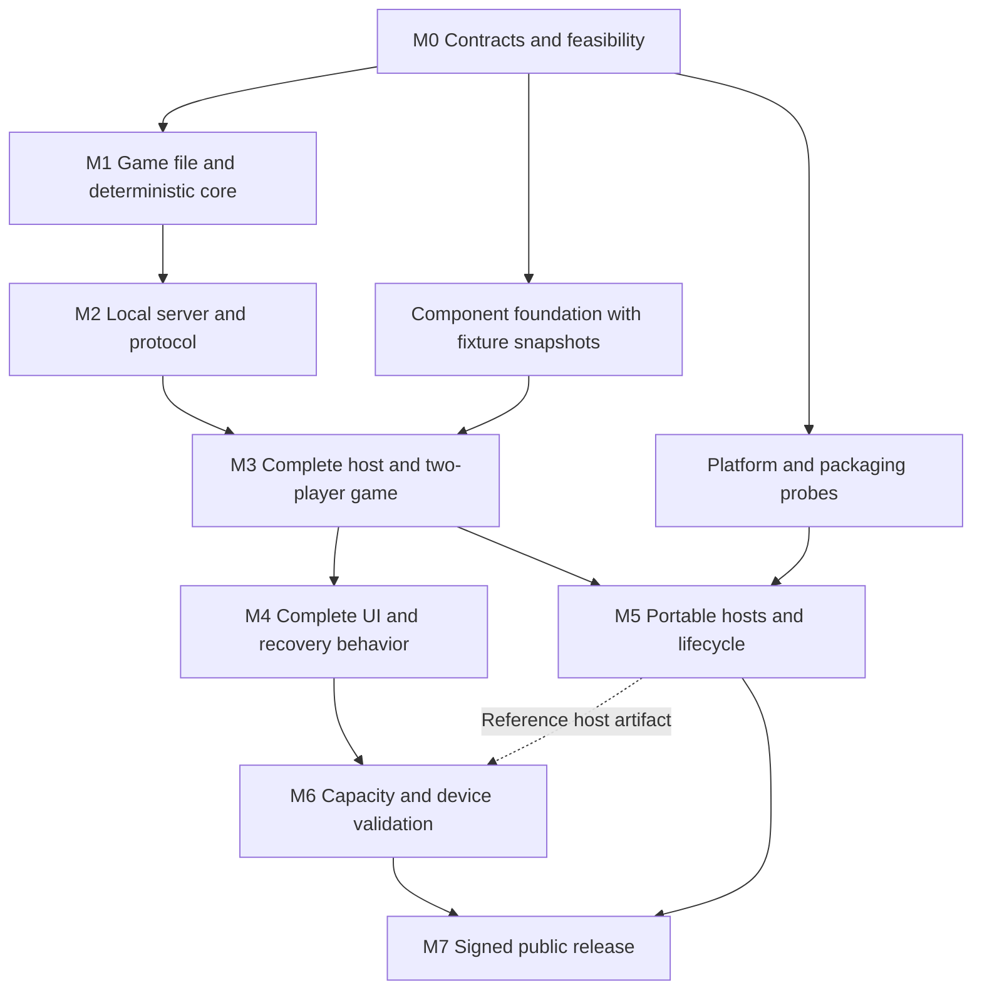

# Custom Rarity Game Development Plan

> **Npm migration planning update — November 17:** The owner selected npm distribution. [E5-N01–N06](implementation/epic-05-npm-distribution.md) replace future runtime-inclusive archive delivery with one compiled npm CLI, host-installed Node, four bundled native-helper targets and explicit pinned connector preparation/cache. Original archive passages below are historical implementation/evidence scope; this override controls future M5/M7 work. M5 now produces and tests the actual npm tarball; M7 authenticates the npm/native release and verifies installation on the four target tuples. No migration code or npm publication has occurred. Gameplay, hosting ownership and unresolved capacity/device evidence remain unchanged.

This plan derives an implementation sequence from the accepted [PRD](PRD.md), [UI/UX baseline](UI-UX.md), and [architecture](ARCHITECTURE.md). The coordinated [review](REVIEW.md) records the integration findings, their accepted documentation resolutions, and remaining implementation evidence. Epic 1’s original LAN foundations, public-origin contracts and connector inventory are implemented. The [tunnel evidence](implementation/evidence/EPIC-1-TUNNEL.md) distinguishes the passing public Chrome probe from remaining native-tab, connector-interruption and event/provider checks. The approved E1-S15–S20 expansion adds managed temporary hosting sessions; their implementation and current integrated evidence are recorded in the [managed-hosting handoff](implementation/evidence/EPIC-1-MANAGED.md).

The deterministic core is now implemented and verified through [Epic 2 evidence](implementation/evidence/EPIC-2.md). Its terminal demo is independent of browser gameplay. The production protocol is now implemented through [Epic 3 evidence](implementation/evidence/EPIC-3.md); the complete browser game and available-device functional checks are delivered through [Epic 4 evidence](implementation/evidence/EPIC-4.md). Epic 5 now provides four private portable builds; available-Mac evidence and user-deferred other-platform checks are recorded in [the Epic 5 handoff](implementation/evidence/EPIC-5.md).

For detailed execution, use the [implementation plan and story backlog](IMPLEMENTATION-PLAN.md). It provides the default linear order, six epics, bounded story cards, one status tracker, dependencies, and per-criterion coverage. This document retains the high-level milestone/evidence framework; milestones gather evidence from those stories rather than adding a second task order.

The [tunnel migration report](TUNNEL-MIGRATION.md) records the access architecture decision. Game computation stays on the host laptop, with an application-managed connector exposing one public HTTPS origin for the duration of a hosting session. Existing LAN evidence remains historical. Temporary Cloudflare Quick Tunnels are the default candidate for managed hosting without account/domain setup. Provider suitability, venue egress and capacity remain validation gates; a permanent hostname is optional future scope.

## Scope and document responsibilities

The PRD defines behavior and scope, UI/UX defines presentation and interaction, and architecture defines authority, protocols, resources, platforms, and delivery. More detailed technical limits specialize broad PRD wording without changing the agreed game. Where wording conflicts, close the review item explicitly and align the documents before implementing that dependency; do not let separate workstreams make different assumptions.

Deliver one laptop-hosted game server reached through a public HTTPS tunnel with browser administration and play, manual JSON tier scoring, automatic timed rounds, reconnection and tab control, results/recaps, and one npm host distribution supporting four native OS/CPU targets. Target 100 players plus a host on an ordinary modern 8 GB laptop, subject to recorded testing. Hosts use macOS 15+ on arm64/x64, Windows 11 x64, or the Ubuntu 24.04+ x64 validation family.

Remote browser joining through the operator-owned tunnel is supported. Central game hosting for all installations, player accounts, databases, saved history, restart recovery, editors, AI judging, fuzzy matching, rematches retaining a roster, extra gameplay controls, audio, and multilingual support remain outside this prototype. A public information/download website is optional and never becomes a runtime dependency.

## Dependencies and work organization

Use the accepted workspace boundaries: `packages/contracts`, `packages/game-core`, `apps/server`, `apps/web`, `examples`, and `scripts`. The core contains deterministic rules and projections without IO. The server owns clocks, scheduler, sessions, network policy, import workers, and adapters. The web app owns display state and input only. Build and release scripts own npm tarball assembly, native payloads and release provenance; hosts install supported Node themselves.

The coordinator maintains the contract decisions and requirement coverage, checks integration at each milestone, and records evidence against the exact build. Core/server, frontend, and platform work can proceed concurrently after their shared contracts are stable. Do not parallelize incompatible versions of the wire protocol or duplicate the validator in the browser. This describes future implementation workstreams, not additional agents running during this review.

## M0 Contracts, feasibility and managed hosting foundation

**Outcome:** one implementable contract shared by every workstream, plus small probes for the assumptions most likely to affect architecture. This milestone also implements the reusable tunnel manager, local launcher and minimal hosting dashboard. Its public connection page uses synthetic state until the later game epics. It does not wait for artwork, a permanent domain or public signing credentials.

1. Consolidate review items R1–R7 into a short decision record and corrected baseline wording. Stage/import and commit are distinct; the worker is required. Clarify current-round secrecy versus previously finalized scores.
2. Specify credential-derived membership discovery before resume, owner-role precedence, and initial/reload/reconnect tab identity. Define the single-controller lease/generation and explicit takeover sequence. Test duplicated tabs as well as ordinary new tabs. Store no answer draft across refresh.
3. Implement the documented candidate-bound host commit identities and bounded outcome records, with atomic recover-or-fence reconciliation for uncertain create/replace, Start, and removal; retain the separate answer acknowledgement/snapshot recovery flow. Define payload fingerprint checks, stale/evicted requests, authorization before cache access, and cached-result recovery before a new operation's deadline check.
4. Write concrete protocol-v1 schemas for every command, acknowledgement, event, and role/phase snapshot. Include clock units, nullability outside active rounds, revision/phase ordering, member discovery, error codes, candidate identity, and allowed actions. Use the adopted complete role-filtered view for both state events, the documented base-field/nullability/clock semantics, and at-most-50 ms readiness-only coalescing; no incremental patches are required.
5. Consolidate one file schema with existing defaults/limits, safe-integer totals, normalization, unknown-field rejection, and explicit aliases. Apply the accepted 256-code-point title ceiling after trimming outer whitespace and implement the adopted bounded pre-admission/session/page/handshake/admission-history/request storage, including non-eviction and expiry semantics. Do not introduce fixed answer-count limits.
6. Pin a supported Node 24 patch, exact dependency versions, one npm workspace lockfile, build manifest, and contributor commands. Keep installation/build network activity separate from runtime startup; startup uses the installed connector and requires internet.
7. Complete E1-S11/S12 deployment and public-origin contracts, then E1-S13 through an actual provider: public HTTPS navigation, Secure cookies, polling/upgrade, explicit proxy trust, Host/Origin rejection and same-origin tab recovery. Retain real cellular evidence and complete required transport checks. E1-S14 inventories pinned connector binaries and four-target lifecycle dependencies. Actual event-network and capacity qualification remain M6 gates.
8. Start import-worker and memory-API probes with a small pack and a representative large pack. Check peak memory including compiled-data transfer, controlled timeout/failure, and whether the adopted headroom heuristic rejects ordinary valid use. Extend these probes to every target as platform environments become available; complete target evidence before M5 exits.
9. Investigate platform launcher lifetime, idle-sleep and suspension-clock adapters, and the project-signing/resource-verification approach. Identify required CI runners and real hardware, including Intel and Apple Silicon Macs. Document any unsupported behavior immediately rather than deferring discovery until release.

10. Complete E1-S15–S20 in order: session deployment contract, reusable tunnel manager, local launcher, minimal hosting dashboard with public URL/QR and private owner handoff, interruption/cleanup, and integrated acceptance. Keep local lifecycle control isolated from the public upstream and authenticated. The session remains available through final results until explicit Finish hosting or launcher quit; browser closure does not stop it. Permanent endpoint loss requires explicit fresh-session/game recovery. The application has no probe-style ten-minute lifetime.

**Contract exit unlocking M1:** E1-S15 must settle the revised session contract on top of S11/S12. Production M2 ingress requires E1-S20, including the required S13 transport evidence. Actual venue/provider capacity qualification does not block independent core or server development. Review decisions have explicit resolutions; schema and representative fixture snapshots agree; reload/duplicate-tab and lost-commit probes are demonstrated. Platform probes start in M0 and continue in parallel with core/UI work. Record available results and outstanding target tasks; a failed probe or unavailable test machine blocks only the dependent adapter, target validation, or release gate. Missing Intel hardware does not block deterministic core development. Complete all promised platform evidence by M5/M7 as applicable. No public release or purchase is required to pass M0.

## M1 Game file and deterministic core

**Depends on:** M0 contracts.

Implement the strict game-file schema, defaults, field-path errors, normalization and canonical/alias index compiler. Provide the schema/format guide and the existing example from the same contract. Treat uploaded text as data. Keep private answer indexes out of browser types and bundles.

Implement Setup, Lobby, Reading, Answering, Results, and Finished with an injected clock/scheduler boundary. Include atomic admission/capacity, unique fixed nicknames, first-valid locking, rejected retries, manual tier scoring, valid zero-point acceptance, misses, shared ranks, canonical counts, deterministic unused examples, removal, and fresh-game replacement. Disconnected players remain eligible; removed players leave eligibility/standings but retain accepted submissions in aggregate statistics.

Separate internal scores from published finalized totals. Produce explicit host/player projections rather than serializing the engine object. Readiness counts use the nonremoved roster, while aggregate result counts retain removed submissions.

**Exit evidence:** meaningful deterministic tests cover malformed/unknown fields, aliases and normalization collisions, defaults and numeric boundaries, exact deadline equality, stale timers, early completion, zero eligible players, simultaneous final submissions/removal, once-only finalization, scoring/rank ties, unused-answer ties, and every role/phase projection. The embedded and standalone example remain equivalent.

## M2 Local server and protocol

**Depends on:** M1 and M0 tunnel/session contracts.

Serve the production React build, HTTP routes and Socket.IO from one Fastify process bound to loopback. Forward the configured public HTTPS origin through the owned connector. Validate actual upstream Host behavior and exact public Origin; trust only documented connector metadata. Configure Secure cookies from external HTTPS policy. Preserve authentication, role authorization, byte limits and bounded session-based admission. Test shared campus/carrier addresses and forwarded-header spoofing. Keep port 3210 with the agreed fallback range.

Reuse and extend the E1 private owner-handoff/authentication foundation for the production game. Implement browser session discovery, tab/control generations, admission and removal, bounded request history, and fresh snapshots. Authenticated raw file uploads go to one bounded import worker. Stage a validated candidate, then explicitly commit it; handle candidate expiry, setup generations, failed replacement, and Start-versus-import races. Add idempotency to the HTTP commit path as well as socket mutations.

The server owns all deadlines and serializes authoritative mutations. Cached accepted outcomes can be recovered without reapplying them; new late submissions never qualify. Filter information before emitting responses. Logs exclude credentials, answer text, and answer banks.

**Exit evidence:** integration tests exercise the actual production server and all routes/commands, including unauthorized callers, removal, capacity boundaries, malformed envelopes, lost replies, changed-payload request reuse, duplicate commands, late commands, candidate failure/expiry, and replacement races. Message inspection proves no current-round outcome, future prompt, full answer sheet, or another player's private recap reaches the wrong view. Real public-origin navigation and supported transports work from separate networks. Public unauthorized host operations, spoofed headers and cross-user cached responses are rejected.

## M3 Complete tunneled game with a host and two players

**Depends on:** M2 and the component foundation.

Build a small but complete browser implementation before adding every visual detail. The host uploads a multi-prompt fixture, reviews effective settings, creates a lobby, shares its public HTTPS invitation, and starts. Two distinct player sessions join, see Reading, retry an invalid answer, lock valid answers, see the reveal/standings, progress automatically, and reach their own recaps. The host receives aggregate final results. Exercise one duplicate canonical answer through an alias so frequency grouping is visible.

Use semantic HTML, the agreed tokens/type/spacing, local fonts, and original provisional art from the start. Establish reusable fields, buttons, timers, banners, dialogs, tabs, and roster/standings rows. A dialog has a labelled heading, controlled focus, keyboard dismissal, blocked background interaction, and a safe focus destination when its opener disappears.

**Exit evidence:** a host and two players, in three isolated browser contexts, complete the production-build flow without developer intervention. The flow works through the selected tunnel with players on separate networks. Assets are bundled and served by the production app. Internet loss produces defined reconnection behavior while server timers continue. Provider error pages cannot be interpreted as authoritative game outcomes. Current tier/points remain hidden through acceptance and refresh.

## M4 Complete UI and recovery behavior

**Depends on:** M3. This completes the accepted UX rather than introducing additional gameplay.

Finish file-error/summary/commit screens, copy-link fallback and enlarged QR, joining/resume states, host presentation and searchable rosters, removal confirmation, readiness counts, neutral acceptance, timeout/uncertain states, phone Answers/Standings tabs, point-ordered grouped results, personal recaps, and the host aggregate recap. Results have no answer-to-player expansion. Earlier-round browsing begins only at Finished.

Exercise loaded-page disconnection with frozen drafts, refresh clearing drafts, server restoration, new-tab takeover, explicit Take control here, removed identities, expired authorization, lost host responses, new-game invalidation, empty rosters, connector outages, same-origin recovery and public-origin replacement. A timeout does not invent a result; resynchronize before enabling another mutation. Preserve the agreed behavior when phase changes happen while a dialog is open.

Finish responsive and accessible interaction: desktop-only automatic answer focus, phone tap-to-focus and keyboard dismissal, safe areas, manual long-text scrolling, complete large scores, short-phase animation bypass, readable projection layout, silent operation, reduced motion, semantic errors/live announcements, keyboard navigation, and text zoom. Final art can be refined independently without changing these flows.

**Exit evidence:** all 35 UI criteria and the mapped PRD behaviors pass against the production build. Use Playwright for flows and actual iOS/Android keyboards, keyboard-only use, screen-reader checks, reduced-motion settings, 200% text zoom, and projection review for the behaviors automation does not establish. Test widths 320, 390, 768, 1280, and 1920 px with the architecture's browser matrix.

## M5 Portable hosts and lifecycle

**Depends on:** M3 plus the M0 platform probes; integrates M4 as it becomes available.

Build private test archives for macOS arm64, macOS x64, Windows x64, and Linux x64 with the runtime, pinned connector, production app/assets, examples, notices, and visible launcher. Locate resources relative to the package. Extraction paths containing spaces/non-ASCII text and executable permissions must work. No separate Node install, dependency download, compilation, update check, background service, or desktop game UI is added.

Package and harden the E1 launcher/manager and E3 owner authentication. Validate Open host page, one-use recovery links, authorization rotation and browser-opening failure handling in actual artifacts. Implement OS-specific idle-sleep requests, same-public-origin suspension recovery, connector reconnect with bounded backoff, public-origin-change invalidation/new joining information, and orderly shutdown. Underlying laptop IP changes preserve state if the process and public origin survive. Start requires verified tunnel readiness. Closing the browser leaves the server running; closing/quitting the launcher stops both server and connector without orphan processes. Process restart loses the game/results.

**Exit evidence:** clean-machine startup without required account/domain setup and cross-network tunneled play on all four targets, including the supported OS floors; owner recovery without game reset; platform sleep/resume and deliberate suspension; unchanged deadlines after wall-clock adjustments; changed-public-origin fresh-game behavior; idle-power cleanup and no-orphan shutdown. Failure on a target remains a tracked blocker to that target's promised release.

## M6 Capacity and device validation

**Depends on:** M4 and a reference host artifact from M5. Validation of the remaining platform targets can continue in parallel; M7 waits for both complete M5 and M6 evidence. Build the harness earlier, but measure the integrated build rather than a core-only simulation.

Record the reference laptop, OS/runtime/build, pack bytes and content sizes, venue network, provider/plan/connector version, uplink and workload. Exercise 100 admitted clients plus the host; refuse a 101st new player, retain disconnected slots, and allow valid reconnects while full. Run separate profiles for synchronized submissions, permitted invalid-answer retries, reconnection/tab churn, and repeated complete games/replacements. Use representative normal packs and a valid near-ceiling pack without adding a fixed answer-count allowance.

Measure server acknowledgement processing from application-handler receipt to handing the acknowledgement to the transport. Compare its p95 with the adopted sub-100 ms target for the declared workload. Record event-loop delay and end-to-end/network latency separately, so a favorable handler measurement cannot hide long scheduling/network delays. Report rate-limited attempts separately from eligible command processing. Import timing is measured separately because import is bounded setup work and unavailable during timed play.

Record parent/worker peak memory, transfer peaks, post-game retained state, provider egress/quotas, host uplink, polling fallback traffic and phase timing. Distinguish the handler p95 target from internet round-trip delay. Test connector crashes, quota errors, public discovery/join floods and reconnect bursts without eviction of valid players. Tune resource thresholds only with evidence and a specification update. Validate that pre-admission/session/operation records stay bounded under churn and that failures preserve the committed game.

Run a separate actual-event-network and cellular test with mixed phones, including QR/manual joining, keyboards, refresh, lost Wi-Fi, recovery, and host projection. Simulated 100-client success does not establish support for 100 physical devices on an arbitrary access point; document the actual device/network conditions and remaining limits.

**Exit evidence:** reproducible workload scripts and a report for correctness, latency, memory, outage recovery, provider limits and cross-network device results. Investigate failures and rerun affected checks after changes. Do not describe the 100-player target as proven until the applicable evidence exists.

## M7 Signed public release

**Depends on:** M6, completed public identity/license/artwork decisions, and signing infrastructure. Local implementation and private testing can proceed before credentials exist.

Produce four versioned portable artifacts with source/runtime manifests, notices, example pack, launch/network troubleshooting instructions, checksums, and manual-update guidance. Sign/notarize macOS outputs as applicable and attach the ticket for offline validation. Authenticate the Windows project launcher and resource manifest; verify covered code/resources before execution. Publish Linux archive signatures with verification instructions. A vendor-signed runtime alone does not authenticate project code.

Test the final signed artifacts on clean target machines, including extraction, signature verification, local startup without internet with an actionable unavailable status, and public gameplay after connectivity returns. Verify bundled connector integrity and cleanup. macOS offline notarization verification remains a distribution check. Match tamper evidence to the platform model: the Windows launcher rejects altered covered resources before execution, an altered Linux archive fails signature verification, and the final macOS bundle fails the relevant signature verification after covered content is altered. This does not introduce a Linux runtime resource verifier beyond the agreed signed-archive distribution model. This final check is necessary because signing/packaging can change the tested application. Missing signing/notarization or failed final-artifact checks block public downloads; private unsigned builds do not substitute for them.

Publish only when separately authorized. An optional GitHub Pages information site can link documentation, source, and releases after artifacts are ready; it has no Create game API, room directory, or runtime communication endpoint.

**Exit evidence:** all four final artifacts verified, platform/device/capacity reports tied to the release build, chosen open-source license and publisher identity, complete notices/instructions, and documented runtime provider/internet dependencies, quotas and event-network evidence. Credential setup applies only to any future optional provider configuration that requires it.

## Requirement coverage

PRD and UI numbers below refer to the existing acceptance lists. Architecture references add obligations that the numbered lists do not fully capture. Each implemented criterion needs its own evidence entry; grouped rows are ownership and milestone mappings, not permission to replace individual checks with one happy-path test.

| Requirement group | Source coverage | Milestones and evidence |
| --- | --- | --- |
| Managed session setup, private handoff, lifetime and explicit recovery | PRD 26–28; UI 32–35; architecture local control/session lifecycle | M0 implements and tests the foundation; M2/M4 integrate game state/UI; M5/M6 validate packages, devices and provider behavior. |
| Authoring, defaults, validation, stage/commit | PRD 1, 5, 18; UI 22; architecture import/resource and replacement contracts | M0–M2 schema/worker/commit tests; M3–M4 authoring UI and field errors. |
| Public joining, proxy trust boundary, tunneled runtime | PRD 2, 15, 23, 24; UI 3, 12, 29, 30; architecture tunnel/HTTP/session contracts | M0/M2 real origin and transport; M3 cross-network flow; M5/M6 deployment/device evidence. |
| Admission capacity and identity | PRD 3, 19, 25; UI 19–21, 29; architecture session/control/cache bounds | M1 atomic rules; M2/M4 reconnect/tab/error cases; M6 full-roster/churn workload. |
| Automatic phases, deadlines, input, hidden outcomes | PRD 4, 6–8, 10, 17, 21; UI 5–9, 15, 19, 20, 25, 28, 31 | M1 clock/projection tests; M2 protocol tests; M3/M4 full flows and phone input; M6 timing load. |
| Scores, frequencies, ranks, unused examples | PRD 9, 10, 16, 20; UI 7–9, 16, 17, 25–27; architecture finalized-score projections | M1 deterministic cases; M2 raw payload checks; M3/M4 visual/role results; M6 large rosters. |
| Removal, host authority and clean presentation | PRD 12, 13, 20, 21; UI 10, 13, 14, 23, 24, 27; architecture owner recovery | M1/M2 authority/races; M4 confirmation/search/presentation; M5 launcher recovery. |
| Reconnect, replacement, restart, ephemeral results | PRD 11, 14, 22; UI 6, 18–22, 29, 31; architecture interruption/recovery policies | M2/M4 lost outcomes/new game; M5 power/address/process lifetime; M6 network faults. |
| Final standings and role-specific recaps | PRD 14 plus results prose; UI 8, 16–18, 26, 27 | M1/M2 filtered records; M3/M4 player-private and host-aggregate views, empty/tied outcomes. |
| Visual identity, responsive access, motion and assets | UI 1, 2, 4, 5, 10–12, 15, 28, 31 | M3 foundation; M4 full UI/real-device/accessibility checks; M5/M7 self-contained package and asset notices. |
| Portable platforms, lifecycle and authenticated downloads | PRD audience/scope and host-experience prose; UI implementation handoff; architecture platform/release contract | M0 feasibility; M5 four-target/lifecycle evidence; M7 signed final-artifact validation. |

## Risks and decision ownership

| Risk | Responsible workstream | Control and blocking point |
| --- | --- | --- |
| Session discovery or tab behavior differs between implementations | Coordinator and contracts/server | Close R1/R3 in M0; dependent protocol/UI work waits. |
| Lost response repeats a host mutation or misreports an answer | Core/server and frontend | Close R2/R4, use operation identities and authoritative reconciliation; M2/M4 fault tests. |
| Memory heuristic rejects normal hosts or permits damaging peaks | Import/server and platform | M0 probe and M2/M6 measurements; controlled failure, no fixed answer-count redesign. |
| Sleep, origin policy, or launcher closure behaves differently by OS/browser | Platform and server | Start probes in M0; M5 target-specific evidence, explicit public-origin configuration and loopback-only upstream. |
| Imported/serialized data reveals hidden outcomes | Core projections and contracts/server | Explicit schemas and raw message assertions in M1/M2, repeated for new response types. |
| Provider, uplink or host fails the declared capacity workload | Validation and server | Named conditions and separate simulated/real-device reports; fix and remeasure before capacity claims. |
| Credentials, publisher/license, hardware, or signing pipeline unavailable | Release workstream and project owner | Track prerequisites early; block M7 publication without blocking local functional development. |
| Visual work delays discovery of a functional integration issue | Coordinator and frontend | Complete M3 before full art polish; preserve accessibility and local assets from the foundation. |

## Completion and handoff

The managed S15–S20 implementation and G1 are complete. E2-S01 is the next eligible story when authorized. Original S01–S14 evidence remains dated and does not prove the expanded hosting feature. S13 is reconciled with actual managed-session/native-tab follow-up evidence; actual venue/provider capacity qualification belongs to E6. E2 may start after S15 settles the revised contract; E3 integrates only after S20 and its core prerequisites. M3 supplies the complete browser game, M4 the accepted UX, M5 portable connector lifecycle and M6 measured provider/device capacity. Public distribution requires M7 and all four target artifacts.

Maintain one milestone checklist and evidence index tied to source revisions. Capture decisions, fixtures, commands, test results, manual-review notes, hardware/network conditions, and release manifests as the implementation proceeds. A milestone completes only when its exit evidence exists; this plan does not mark future tests or distribution work as already passed.
