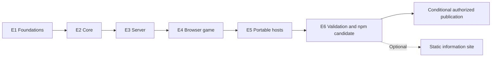

# Implementation Plan and Story Backlog

Status on November 16, 2026: the original foundations and managed hosting implementation are available. S13's feasibility report is reconciled with native-tab and actual connector follow-up evidence. S15–S20 are implemented and verified; all 20 Epic 1 stories are complete. [Managed hosting handoff](implementation/evidence/EPIC-1-MANAGED.md) · [Historical tunnel evidence](implementation/evidence/EPIC-1-TUNNEL.md).

The original backlog contains **six epics and 77 stories**: 75 implementation, validation, and release-preparation stories, one conditional publication story, and one optional information-site story. Extensions add eight E6 networking stories and six E5 npm migration stories (91 story entries total); original IDs/evidence are retained. Epic 1 and its managed-hosting gate G1 are **complete**. All nine Epic 2 stories and deterministic core gate G2 are complete. All 13 Epic 3 stories and production protocol gate G3 are complete. All 12 Epic 4 stories and browser-game gate G4 are complete. [Epic 4 handoff](implementation/evidence/EPIC-4.md). Epic 5's original implementation and four private archives are historical deliverables; the new local npm candidate, installed-Mac checks and installed-package 100-player mixed-transport game are delivered in the [npm handoff](implementation/evidence/EPIC-5-NPM.md). The owner marked Epic 5 complete on November 18 and accepted G5 for progression to Epic 6, deferring remaining manual/platform checks to their own schedule. This is project closure, not a claim of unexecuted compatibility certification. The [original Epic 5 handoff](implementation/evidence/EPIC-5.md) retains the earlier archive evidence. [Epic 3 handoff](implementation/evidence/EPIC-3.md). [Epic 2 handoff](implementation/evidence/EPIC-2.md). E3 still requires the deterministic core gate G2 as well as managed-hosting G1.

## What we are building

Build an open-source, custom Krillion-inspired game for the owner's use and others' local hosting. A host runs an authoritative local server and administers it through a browser. The implemented local npm candidate contains a compiled CLI, bundled small native prebuilds and explicit verified connector preparation; hosts install supported Node. The `niche-out@0.1.0` package is published; exact-package verification and scoped Apple Silicon Mac readiness are recorded in the [S10/S11 handoff](implementation/evidence/E6-S10-S11.md). Publisher authentication is optional follow-up. Up to 100 players join through one verified public HTTPS origin for the hosting session using a link/QR or that instance’s address plus six-digit code. An application-managed tunnel connector forwards traffic to the laptop’s loopback listener; host and player browsers use the same origin.

The game author uploads 1–20 ordered prompts with accepted answers, aliases, custom tiers/points, and shared timers. The first accepted in-time answer locks. Points come from the JSON; frequencies are descriptive counts. The server advances Reading, Answering, Results, and Finished, handles tied ranks and recaps, and keeps current-round outcomes hidden until reveal.

Application assets are bundled and served through the host-owned tunnel. Internet access and the provider are required during play. The project maintainer runs no shared game service or relay account for all installations. The information/download site stays separate. The game has no global room lookup, database, player accounts, saved history or restart recovery. The first release supports tunnel hosting; selectable LAN hosting is deferred. Host gameplay controls remain Start and Remove Player; setup, recovery, and presentation actions do not add pause/skip/end/adjudication.

## Document responsibilities and reading order

| Document | Purpose |
| --- | --- |
| [PRD](PRD.md) | Product behavior, scope, file shape, and 28 acceptance criteria. |
| [UI/UX](UI-UX.md) | Screens, interaction, identity/fault feedback, visual direction, and 35 acceptance criteria. |
| [Architecture](ARCHITECTURE.md) | Authoritative technical contracts, limits, platforms, protocol, timing, and packaging. |
| [Resolved review](REVIEW.md) | Why recovery/identity/validation decisions exist and which evidence remains. |
| [Development milestones](DEVELOPMENT-PLAN.md) | High-level M0–M7 delivery/evidence framework. |
| This document | Detailed story order, scheduling, status, handoff, and completion rules. |
| [Coverage map](implementation/coverage.md) | Every numbered criterion and additional architecture obligation mapped to implementing and verifying stories. |
| Epic files below | Bounded work, direct dependencies, planned areas, acceptance, and verification for each story. |

On a fresh agent handoff, read this document's current tracker, the active epic introduction, the selected story, and its linked baseline sections. Check the actual workspace, applicable AGENTS.md instructions, and existing changes before editing. Read more baseline sections whenever a story touches their contracts. Do not assume that the repo still matches a prior chat or that a passing fixture proves an implemented feature.

The three baselines remain authoritative for product and technical behavior. This backlog owns the detailed execution order; it refines the earlier milestone plan. If implementation evidence requires a change, update the affected contract and story/dependencies explicitly. Story text is not permission to quietly change gameplay, platform support, or local hosting.

## Lean initial-release policy — November 19, 2026

The owner authorized a complete Epic 6 review to remove unnecessary pre-release steps from the npm path. See [the active Epic 6 policy](implementation/epic-06-validation-release.md#active-lean-npm-release-policy--november-19-2026) and [review report](implementation/evidence/E6-LEAN-RELEASE.md). This explicit scope change supersedes prior mandatory paid signing, native publisher-authentication and four-target-before-any-release wording; it does not change recorded test outcomes.

Release dependency path: **S06 → S10 → S11 → separately authorized S12**, now completed for the scoped `0.1.0` initial release. Review the existing S01–S05/N08 evidence and material failures; repeat affected checks after relevant changes. S07 Apple signing/notarization, S08 Windows Authenticode, S09 detached publisher signatures and S13 information site are optional follow-ups. Trusted-publisher/provenance automation, separate candidate-to-stable promotion, cosmetic polish, extra stress/hardware campaigns and owner-deferred universal browser/device/host matrices do not hold up the initial limited-scope release solely because they are absent.

Keep exact tarball/source/lock/native/connector/notice inventory, package/component corruption detection, required/ad-hoc platform signatures, secure npm authentication, actual installed Mac behavior, essential game/privacy/security/recovery/accessibility correctness, accurate installation/network limitations and explicit publication approval. Preserve any unresolved material defect within the advertised scope as a release issue. Do not disable OS security or infer four-platform compatibility from cross-builds. Intel/Windows/Linux and broader physical testing stay owner-deferred and labelled unverified; Mac-qualified initial publication can proceed with those limits stated.

## Epic sequence

| Gate | Epic and detailed stories | Concrete result |
| --- | --- | --- |
| G1 | [E1 Foundations and shared contracts](implementation/epic-01-foundations.md) — 20 stories | Historical foundations plus an implemented managed hosting session, public-origin contracts, real tunnel evidence and connector inventory. |
| G2 | [E2 Deterministic game rules](implementation/epic-02-game-core.md) — 9 stories | Complete tested game logic and private projections without browser/network dependencies. |
| G3 | [E3 Local server and reliable protocol](implementation/epic-03-local-server.md) — 13 stories | Restricted production server, worker import, identity/control, idempotent operations, and protocol game. |
| G4 | [E4 Complete browser game](implementation/epic-04-browser-game.md) — 12 stories | Working host/player browser flows, results/recaps, presentation, and recovery. |
| G5 | [E5 Portable hosting and machine lifecycle](implementation/epic-05-portable-hosting.md) — 10 historical stories + 6 npm migration stories | One installable npm CLI across four native targets, with lifecycle evidence; original private archives remain historical. |
| G6 | [E6 Validation and npm release](implementation/epic-06-validation-release.md) — 8 evidence/preparation stories + 3 optional signing enhancements | Exact integrity-checked npm candidate, installed evidence for the declared scope and honest defect/limitation review; paid signing and unexecuted wider matrices are not prerequisites. |

E6-S12 publishes the separately authorized release after G6. E6-S13 optionally supplies a static information website. Neither is needed to complete private release preparation, and the website never becomes a gameplay dependency.

The default order is the table order and increasing story number within each epic, skipping optional stories unless explicitly selected. Epic 6 now follows S06 → S10 → S11 → separately authorized S12; S07–S09/S13 do not block it. E2 has an explicit contract-gate exception after E1-S15 while managed-hosting implementation continues; E3-S01 requires E1-S20 and G2. Direct story dependencies can be narrower than that linear order; they support a safe same-epic substitution when a story is externally blocked or an explicitly requested parallel pair. They do not create an automatic reason to open a future epic.

## One agent and one story by default

1. Identify the active epic and earliest eligible TODO story. Its direct prerequisites and previous epic gate must be satisfied.
2. Confirm that the user's current request authorizes that work. Use the current request to determine the authorized epic or story.
3. Read the story and relevant baseline sections, inspect the current implementation, and state its bounded scope.
4. Implement that story and its directly relevant verification. Keep one reviewable diff; do not prebuild later stories.
5. Fix failed owned criteria, self-review the change, and record actual evidence. Use REVIEW while checks or review are incomplete.
6. Update this single tracker and leave a handoff. Stop after the authorized story; if the user explicitly authorized the whole epic, continue eligible stories through its gate.
7. At the epic gate, demonstrate the result and check the coverage/evidence owned by that epic. Proceed further only within the user's authorized scope.

Review may be performed by the same agent and the user; another agent is optional. There is no required second-agent ceremony, sprint system, external issue tracker, or installed BMAD toolchain.

If an external input blocks completion, prepare the concrete independent work first, record what is missing, and select another eligible story **inside the current epic**. Do not mark the blocked story Done or certify its device/platform. If the whole epic is blocked, provide the exact missing input and available evidence rather than silently starting a later epic.

## Story sizing and splitting

Sizes are relative planning units, **not hour estimates or a delivery schedule**.

| Size | Bounded shape |
| --- | --- |
| 1 | One narrow module, fixture/report, or packaging/evidence concern with a focused verification family. |
| 2 | One cohesive feature/integration concern joining existing boundaries, with explicit success/failure cases. |
| Larger | Split before starting; no planned story exceeds 2. |

Every story has an outcome, direct prerequisites, planned areas, three work items, at least three acceptance checks, and a verification instruction. Planned paths name future areas, not files claimed to exist today.

If a story introduces several unrelated concerns, changes multiple unsettled contracts, or cannot be explained as one reviewable result, stop and split it. Preserve its ID and introduce suffix children such as E3-S11-A/B with the original prerequisites. Keep the original parent unfinished until its criteria are covered, and keep downstream dependencies on the parent; children must not depend on that unfinished parent. Update the tracker/dependency map when doing this. A context limit is a reason to hand off progress, not a reason to mark partial work Done.

Probes have a different deliverable from features: a completed feasibility report may contain FAIL or NOT RUN. It must name the dependent implementation/validation gate that remains blocked. A report's completion never certifies that missing feature or platform. Hardware/credential investigation in E1 does not hold up unrelated deterministic core work.

## Readiness and completion

A story is ready when its direct stories are Done, the current epic's entry gate is satisfied, relevant contracts are stable, and its independent work is authorized. External evidence/decisions can be gathered after preparing the concrete work; they must exist before the story's required criteria pass.

Done requires:

- The bounded implementation/artifact exists and matches the accepted baselines.
- Every acceptance check owned by the story has evidence; a test script alone is not a passing result.
- Relevant checks actually ran and their commands, build/environment, results, and omissions are recorded.
- The diff was reviewed for regressions, secrets/data boundaries, and unintended scope.
- Documentation/contracts and downstream dependencies reflect the final result.
- The tracker and handoff are updated, with externally owned checks mapped to their later story.

Run meaningful checks appropriate to the change. A configuration scaffold does not need tests that merely restate its files. Core/identity/timing/recovery changes do require their functional boundary/race checks. Run the relevant wider integration suite when a shared contract changes. Repeat broad validation only for a new build/change, failure, or unresolved concern that justifies it.

A discovered bug that violates the current story's criterion keeps that story unfinished until fixed or formally split with coverage retained. Bugs outside its scope get a small stable follow-up ID, clear reproduction, and dependencies. Mandatory downstream gates remain blocked until those defects are resolved; do not reclassify required behavior as optional to close an epic.

## Evidence and handoff

This tracker is the **only story-status source**. Epic cards contain definitions and dependencies, not duplicate mutable status. Use TODO, DOING, REVIEW, DONE, or BLOCKED. Exactly one story is DOING by default. A requested parallel pair may have two; record both and their ownership.

When implementation begins, create a small evidence note only for the story being worked, for example `outputs/implementation/evidence/E2-S05.md`. Do not generate dozens of empty evidence files now. Store only small human-readable evidence here; runtime/build outputs and large test artifacts use the implementation's appropriate work/build locations. Do not store secrets in evidence.

Use this handoff format:

> **Story and status:** ID; current state; exact remaining criteria.  
> **Build/context:** revision or working-tree description; runtime; relevant device/OS.  
> **Changed areas:** files/modules and why.  
> **Verified:** actual commands/manual steps, outcomes, and evidence paths.  
> **Not verified:** named reason and owning later story/external input.  
> **Decisions/defects:** contract updates, reproductions, and blocking follow-ups.  
> **Next:** earliest eligible story, prerequisites, and any required input.

At an epic gate, add one concise epic evidence summary linking its story notes and demo results. Do not needlessly rerun already adequate checks against an unchanged build.

## Optional same-epic parallel work

Parallel execution is optional future scheduling, not active work authorized by this plan. The complete backlog works with one agent. Normally use at most two implementing agents inside the active epic. For the explicitly authorized Epic 2, Epic 3, and Epic 4 runs, three contributors own separate modules and tests, with one coordinator; no shared file has multiple owners.

| Eligible pair or pool | Must already be stable | Separate ownership and integration point |
| --- | --- | --- |
| E1-S02 with E1-S04 | E1-S01 | Pack schemas versus protocol input schemas; one designated owner integrates shared exports. |
| E1-S13 with E1-S14 | E1-S11/S12 stable | Real tunnel probe versus connector inventory; one owner integrates shared configuration and manifests. |
| E4-S01 with E4-S02 | G3 and response contracts | Visual components/assets versus connection/session client; E4-S03 integrates them. |
| Any two of E5-S02/S03/S04 | E5-S01 adapter interface | Separate OS adapters and tests; E5-S05 integrates all results. |
| Any two of E5-S06/S07/S08/S09 | E5-S05 and frozen common app build | Separate platform recipes/staging directories; E5-S10 consolidates evidence. |
| Any two of optional E6-S07/S08/S09 | E6-S06, frozen candidate and later owner selection | Separate optional signing outputs; changed final bytes require affected S10 revalidation. These tasks are outside the initial release path. |

Do not concurrently edit a shared manifest, lockfile, contract export, common adapter, router/store, or artifact staging directory. Freeze shared inputs first and name the one integrator. If isolation is unclear, use the normal sequential order. Logical independence is not enough when two tasks write the same files.

## Relationship to the existing milestones

| Existing milestone | Detailed work and evidence |
| --- | --- |
| M0 Contracts/feasibility | E1 establishes schemas/reports and the tunnel supplement; E3 proves production session/replay/transport behavior; target evidence continues in E5/E6. |
| M1 Core | File shape starts in E1; E2 completes matching/rules/scoring/projections. |
| M2 Server | E3 implements and validates the restricted local protocol. |
| M3 Complete game | The first full browser loop is available after E4-S09 with the shared prompt/timer foundation; E4-S12 records the complete built cross-network demonstration. |
| M4 UI/recovery | E4 implements the UX; formal device/accessibility criteria close with E6-S04/S05. |
| M5 Portable host | E5 produces four private validated artifacts and lifecycle evidence. |
| M6 Capacity/devices | E6-S01 through E6-S05 supply measured and actual-device evidence. |
| M7 Public release | E6-S06 → S10 → S11 prepare/review one exact npm candidate; S12 is separately authorized publication. Optional signing/site/promotion work is outside the gate. |

Milestones can collect evidence from multiple epics. They are completeness labels, not extra prerequisite nodes. In particular, do not require every M0 production/platform check before beginning the independent E2 core. Use the explicit story graph and gates.

## External inputs

These are implementation/validation or publication inputs, not new gameplay questions. Availability has not been assumed. Under the lean initial-release policy, unavailable wider hardware/device inputs limit the claims that can be made; they do not block an available-Mac-qualified release with those combinations labelled unverified. Optional signing inputs apply only if that enhancement is later selected.

| Input | Needed for | Completion rule |
| --- | --- | --- |
| X-MAC-ANY | E5-S02 | An available supported Mac for initial adapter measurements. Both CPU artifacts still have separate final gates. |
| X-MAC-ARM | E5-S06, E6 Mac/final validation | Actual supported Apple Silicon environment and artifact evidence. |
| X-MAC-INTEL | E5-S07, E6 Mac/final validation | Actual supported Intel Mac; arm64/emulation evidence is not substituted. |
| X-WINDOWS | E5-S03/S08, E6 Windows/final validation | Clean Windows 11 x64 target plus required lifecycle measurements. |
| X-LINUX | E5-S04/S09, E6 Linux/final validation | Clean supported Ubuntu x64 target and environment/prerequisite record. |
| X-REFERENCE-HOST | E6-S02 | Named modern laptop in the target class with runtime/build and resource measurements. |
| X-IOS / X-ANDROID | E6-S04 | Actual required phone/browser versions and keyboards; emulated viewports do not satisfy this input. |
| X-DESKTOP-BROWSERS | E6-S04 | Recorded Chrome/Edge/Firefox/Safari smoke matrix. |
| X-EVENT-NETWORK | E6-S04 | Actual venue uplink and permission/connectivity for the chosen outbound connector. |
| X-CELLULAR | E1-S13/S20, E6-S04 | A real phone using a separate cellular connection for public joining and recovery. |
| X-TUNNEL-PROVIDER | E1-S15/S16/S20, E5/E6 | Managed temporary Cloudflare tunnels are the default session candidate; cloudflared 2026.11.0 is pinned. No account/domain is required for this path. Provider availability, limits and actual event suitability need evidence; named setup is optional future support. |
| X-ACCESSIBILITY-REVIEW | E6-S05 | Actual keyboard/screen-reader/zoom/motion/contrast checks, performed by the agent where possible or with user assistance. |
| X-PROJECT-DECISIONS | E6-S06 | Recorded license, publisher/product identity, artwork/notices choices needed for publication. Prepare concrete choices before asking. |
| X-MAC-SIGNING / X-WINDOWS-SIGNING / X-LINUX-SIGNING | Optional E6-S07/S08/S09 only if later selected | Approved optional signing identity/infrastructure. No enrollment, payment, key setup or initial-release dependency is implied. |
| X-PUBLICATION-AUTH | E6-S12 | Explicit authorization for the concrete reviewed release and destination. |
| X-SITE-AUTH | E6-S13 | Authorization for the concrete information site and deployment destination. |

Signing services are dependencies only of later-selected optional signing work. The selected tunnel provider and host/player internet connections are runtime dependencies. Missing credentials or hardware remain visible blockers only to their dependent work. The plan does not purchase services, request private keys, publish artifacts, or launch agents.

## Story tracker

Current handoff: **E6-S12 public npm release, November 19.** The owner authorized the reviewed `niche-out@0.1.0` tarball and completed npm account verification. Public registry metadata confirms publisher/maintainer `hongkian03` and latest `0.1.0`. Independent download matches the reviewed SHA-256 and npm integrity. Eight public-registry installation/worker/native/launcher checks passed; all 263 installed files match. See the [S12 report](implementation/evidence/E6-S12.md) for exact bytes, commands, the initial registry-availability delay and retained limits. S12 is DONE. No additional version or repository push occurred. The initial release path is complete; optional S07–S09/S13 and explicit platform/device/network qualification follow-ups remain outside that closure. Historical candidate configurations/reports retain their dated prepublication state.

Previous preparation handoff: **E6-S10/S11 exact npm verification and scoped readiness, November 19.** Parallel package, recovery/privacy and requirement-claim reviews were integrated with fresh testing of an actual installed npm candidate. The [execution report](implementation/evidence/E6-S10-S11.md) records 485 application tests across 37 files, 35 standalone checks, installation/native/worker/component-corruption checks, a real-tunnel two-player browser game, lost-public-cookie owner recovery, phone-sized layouts and forced npm-wrapper cleanup. The final documentation-only freeze receives fresh audit/install/native/component checks and an explicit runtime-byte comparison to the game-tested candidate. G6 release preparation is complete for the recorded Apple Silicon Mac/macOS/Node tuple; this is not universal platform, venue or all-polling qualification. S10/S11 are DONE; S12 remains TODO and publication is not authorized. Optional S07–S09/S13 and owner-deferred platform/device work remain visible follow-ups.

S06 metadata/notice handoff remains in the [S06 report](implementation/evidence/E6-S06-NPM.md) and [notice follow-up](implementation/evidence/NOTICE-REVIEW.md). The owner selected `niche-out`, npm account `hongkian03`, publisher display name `Kian Hong Tan` and MIT distribution of original artwork/examples. November 19 registry login/name preflight passed; name availability/access must be rechecked at publication. No registry upload, signing enrollment or service publication was performed. Exact artifact hashes and the readiness decision are in the S10/S11 execution record.
Previous handoff: **Epic 5 npm distribution implementation, November 18.** The [six-story migration](implementation/epic-05-npm-distribution.md) now delivers an unpublished local tarball, lightweight runtime/OS preflight, four bundled native builds, verified per-user connector preparation, installed launcher integration and compatibility/CI tooling. N01/N03/N04 are DONE. All six npm stories are DONE by owner-directed closure; actual Intel Mac/Windows/Linux execution and physical terminal/power lifecycle checks remain owner-deferred evidence for final release qualification. Available-Mac installed-package checks and a 100-player mixed-transport game through the package-owned Quick Tunnel passed; see the [npm implementation and test report](implementation/evidence/EPIC-5-NPM.md) for exact candidate identity, checks and omissions. Prepared CI is not an executed platform pass. No package was published or publicly authenticated. The earlier [S02/S03 follow-up](implementation/evidence/EPIC-6-S02-S03-FOLLOWUP.md) retains its dated polling/hardware/physical-network acceptance gaps; this npm handoff does not close them.

Historical implementation handoff below: **the former broad G6 gate was open.** Its dated results and limits remain evidence; current scoped release-preparation readiness is recorded above.
Previous S02/S03 work: **Implementation and verification delivered; acceptance remains REVIEW.** See the [follow-up report](implementation/evidence/EPIC-6-S02-S03-FOLLOWUP.md). Typecheck/build, 456 application tests and 16 harness checks passed. Final bounds/import workloads and 100-player combined recovery passed; actual owned connector death was verified. A 30-game/300-round local run plus ten minutes idle passed with stable bounded metadata. Shutdown now clears pinned ledger outcomes; private diagnostics correlate polling commands. Both public polling investigations failed after 17 verified rounds through distinct traced boundaries, so polling-only qualification remains open. An actual 8 GiB host, physical OS/venue outage coverage and deferred platforms remain unverified; under the current lean policy they limit corresponding claims rather than automatically blocking a Mac-qualified initial release. Optional signing has not been performed. No public release occurred.

Historical E5 S stories in REVIEW have implemented deliverables; their remaining original acceptance items are manual/platform evidence, not missing implementation. S01 and S05 automated integration criteria are complete. Original archive certification is not asserted and does not determine the new npm gate. The user authorized Epic 6 on the reference build and explicitly deferred other-platform testing; the corresponding npm manual checks are deferred by the owner and remain visible for final E6 qualification.

### Epic 1

Entry: S01–S10 retain their historical completion. S11–S14 retain their recorded initial migration scope; S15–S20 implement managed temporary hosting. Historical named-tunnel assumptions are superseded explicitly by S15.

| Story | Outcome | Size | Direct story prerequisites | Status |
| --- | --- | --- | --- | --- |
| [E1-S01](implementation/epic-01-foundations.md#e1-s01-workspace-and-pinned-toolchain) | Workspace and pinned toolchain | 1 | None | DONE |
| [E1-S02](implementation/epic-01-foundations.md#e1-s02-game-file-shape-and-numeric-limits) | Game file shape and numeric limits | 2 | E1-S01 | DONE |
| [E1-S03](implementation/epic-01-foundations.md#e1-s03-deterministic-text-normalization) | Deterministic text normalization | 1 | E1-S01 | DONE |
| [E1-S04](implementation/epic-01-foundations.md#e1-s04-request-and-outcome-contracts) | Request and outcome contracts | 2 | E1-S01 | DONE |
| [E1-S05](implementation/epic-01-foundations.md#e1-s05-session-and-complete-view-contracts) | Session and complete view contracts | 2 | E1-S04 | DONE |
| [E1-S06](implementation/epic-01-foundations.md#e1-s06-fixtures-and-deterministic-test-harness) | Fixtures and deterministic test harness | 1 | E1-S02, E1-S03, E1-S04, E1-S05 | DONE |
| [E1-S07](implementation/epic-01-foundations.md#e1-s07-selected-lan-origin-feasibility-probe) | Selected LAN origin feasibility probe | 1 | E1-S04, E1-S05 | DONE |
| [E1-S08](implementation/epic-01-foundations.md#e1-s08-tab-continuation-feasibility-probe) | Tab continuation feasibility probe | 2 | E1-S04, E1-S05 | DONE |
| [E1-S09](implementation/epic-01-foundations.md#e1-s09-import-worker-and-memory-feasibility-probe) | Import worker and memory feasibility probe | 1 | E1-S02, E1-S06 | DONE |
| [E1-S10](implementation/epic-01-foundations.md#e1-s10-platform-and-release-feasibility-inventory) | Platform and release feasibility inventory | 1 | E1-S01, E1-S05 | DONE |
| [E1-S11](implementation/epic-01-foundations.md#e1-s11-tunnel-deployment-configuration-contract) | Tunnel deployment configuration contract | 2 | E1-S04, E1-S05, E1-S10 | DONE |
| [E1-S12](implementation/epic-01-foundations.md#e1-s12-public-origin-contracts-and-fixtures) | Public origin contracts and fixtures | 2 | E1-S11, E1-S04, E1-S05, E1-S06 | DONE |
| [E1-S13](implementation/epic-01-foundations.md#e1-s13-real-tunnel-feasibility-probe) | Real tunnel feasibility probe | 2 | E1-S12 | DONE |
| [E1-S14](implementation/epic-01-foundations.md#e1-s14-tunnel-connector-platform-inventory) | Tunnel connector platform inventory | 1 | E1-S11 | DONE |
| [E1-S15](implementation/epic-01-foundations.md#e1-s15-session-hosting-contract) | Session hosting contract | 2 | E1-S11, E1-S12, E1-S14 | DONE |
| [E1-S16](implementation/epic-01-foundations.md#e1-s16-reusable-tunnel-manager) | Reusable tunnel manager | 2 | E1-S15 | DONE |
| [E1-S17](implementation/epic-01-foundations.md#e1-s17-local-hosting-launcher) | Local hosting launcher | 2 | E1-S16 | DONE |
| [E1-S18](implementation/epic-01-foundations.md#e1-s18-hosting-dashboard-and-invitations) | Hosting dashboard and invitations | 2 | E1-S17 | DONE |
| [E1-S19](implementation/epic-01-foundations.md#e1-s19-hosting-interruption-and-shutdown) | Hosting interruption and shutdown | 2 | E1-S18 | DONE |
| [E1-S20](implementation/epic-01-foundations.md#e1-s20-managed-hosting-acceptance) | Managed hosting acceptance | 2 | E1-S19, E1-S13 | DONE |

### Epic 2

Entry: historical foundations plus E1-S15. Deterministic work can proceed while E1-S16–S20 are being completed. Direct story prerequisites are listed below; this entry gate applies to every story in the epic.

| Story | Outcome | Size | Direct story prerequisites | Status |
| --- | --- | --- | --- | --- |
| [E2-S01](implementation/epic-02-game-core.md#e2-s01-compile-canonical-answer-indexes) | Compile canonical answer indexes | 2 | E1-S02, E1-S03, E1-S06 | DONE |
| [E2-S02](implementation/epic-02-game-core.md#e2-s02-game-identity-and-committed-lobby-state) | Game identity and committed lobby state | 1 | E2-S01 | DONE |
| [E2-S03](implementation/epic-02-game-core.md#e2-s03-admission-and-roster-invariants) | Admission and roster invariants | 2 | E2-S02, E1-S03 | DONE |
| [E2-S04](implementation/epic-02-game-core.md#e2-s04-phase-scheduler-and-deadline-state) | Phase scheduler and deadline state | 2 | E2-S03, E1-S06 | DONE |
| [E2-S05](implementation/epic-02-game-core.md#e2-s05-answer-acceptance-and-early-completion) | Answer acceptance and early completion | 2 | E2-S04, E2-S01 | DONE |
| [E2-S06](implementation/epic-02-game-core.md#e2-s06-round-scoring-and-grouped-results) | Round scoring and grouped results | 2 | E2-S05 | DONE |
| [E2-S07](implementation/epic-02-game-core.md#e2-s07-disconnect-and-removal-effects) | Disconnect and removal effects | 2 | E2-S06 | DONE |
| [E2-S08](implementation/epic-02-game-core.md#e2-s08-live-host-and-player-projections) | Live host and player projections | 2 | E2-S07, E1-S05, E1-S12, E1-S15 | DONE |
| [E2-S09](implementation/epic-02-game-core.md#e2-s09-final-recaps-and-core-integration-gate) | Final recaps and core integration gate | 2 | E2-S08 | DONE |

### Epic 3

Entry: G2. Direct story prerequisites are listed below; this entry gate applies to every story in the epic.

| Story | Outcome | Size | Direct story prerequisites | Status |
| --- | --- | --- | --- | --- |
| [E3-S01](implementation/epic-03-local-server.md#e3-s01-restricted-production-listener-and-assets) | Restricted production listener and assets | 2 | E2-S09, E1-S20 | DONE |
| [E3-S02](implementation/epic-03-local-server.md#e3-s02-owner-authorization-and-guest-sessions) | Owner authorization and guest sessions | 2 | E3-S01, E1-S04, E1-S18 | DONE |
| [E3-S03](implementation/epic-03-local-server.md#e3-s03-discovery-and-bounded-page-registration) | Discovery and bounded page registration | 2 | E3-S02, E1-S05 | DONE |
| [E3-S04](implementation/epic-03-local-server.md#e3-s04-controller-continuation-service) | Controller continuation service | 2 | E3-S03, E1-S08, E1-S13 | DONE |
| [E3-S05](implementation/epic-03-local-server.md#e3-s05-authenticated-socket-transport-and-clock-samples) | Authenticated socket transport and clock samples | 2 | E3-S03, E1-S04, E1-S05 | DONE |
| [E3-S06](implementation/epic-03-local-server.md#e3-s06-admission-and-control-commands) | Admission and control commands | 2 | E3-S04, E3-S05 | DONE |
| [E3-S07](implementation/epic-03-local-server.md#e3-s07-request-ledger-and-replay-fencing) | Request ledger and replay fencing | 2 | E3-S05, E3-S06 | DONE |
| [E3-S08](implementation/epic-03-local-server.md#e3-s08-bounded-worker-import-and-staging) | Bounded worker import and staging | 2 | E3-S02, E2-S01, E1-S09 | DONE |
| [E3-S09](implementation/epic-03-local-server.md#e3-s09-idempotent-candidate-commit-and-replacement) | Idempotent candidate commit and replacement | 2 | E3-S07, E3-S08 | DONE |
| [E3-S10](implementation/epic-03-local-server.md#e3-s10-start-answer-and-removal-dispatch) | Start answer and removal dispatch | 2 | E3-S07, E3-S09 | DONE |
| [E3-S11](implementation/epic-03-local-server.md#e3-s11-atomic-uncertain-operation-resolution) | Atomic uncertain-operation resolution | 2 | E3-S09, E3-S10 | DONE |
| [E3-S12](implementation/epic-03-local-server.md#e3-s12-complete-view-publication-and-redaction) | Complete view publication and redaction | 2 | E3-S10, E3-S11, E2-S08, E2-S09 | DONE |
| [E3-S13](implementation/epic-03-local-server.md#e3-s13-server-protocol-integration-gate) | Server protocol integration gate | 2 | E3-S12 | DONE |

### Epic 4

Entry: G3. Direct story prerequisites are listed below; this entry gate applies to every story in the epic.

| Story | Outcome | Size | Direct story prerequisites | Status |
| --- | --- | --- | --- | --- |
| [E4-S01](implementation/epic-04-browser-game.md#e4-s01-local-visual-and-component-foundation) | Local visual and component foundation | 2 | E3-S13, E1-S05 | DONE |
| [E4-S02](implementation/epic-04-browser-game.md#e4-s02-authoritative-browser-connection-client) | Authoritative browser connection client | 2 | E3-S13, E1-S05 | DONE |
| [E4-S03](implementation/epic-04-browser-game.md#e4-s03-host-upload-summary-and-explicit-commit) | Host upload summary and explicit commit | 2 | E4-S01, E4-S02 | DONE |
| [E4-S04](implementation/epic-04-browser-game.md#e4-s04-public-invitations-and-player-admission) | Public invitations and player admission | 2 | E4-S03 | DONE |
| [E4-S05](implementation/epic-04-browser-game.md#e4-s05-lobby-roster-and-host-controls) | Lobby roster and host controls | 2 | E4-S04 | DONE |
| [E4-S06](implementation/epic-04-browser-game.md#e4-s06-reading-and-answer-composer) | Reading and answer composer | 2 | E4-S05 | DONE |
| [E4-S07](implementation/epic-04-browser-game.md#e4-s07-locked-pending-and-timeout-player-states) | Locked pending and timeout player states | 2 | E4-S06 | DONE |
| [E4-S08](implementation/epic-04-browser-game.md#e4-s08-round-results-and-phone-navigation) | Round results and phone navigation | 2 | E4-S07 | DONE |
| [E4-S09](implementation/epic-04-browser-game.md#e4-s09-player-and-host-final-recaps) | Player and host final recaps | 2 | E4-S08 | DONE |
| [E4-S10](implementation/epic-04-browser-game.md#e4-s10-clean-host-presentation-and-management-overlay) | Clean host presentation and management overlay | 2 | E4-S05, E4-S08, E4-S09 | DONE |
| [E4-S11](implementation/epic-04-browser-game.md#e4-s11-browser-recovery-and-exception-integration) | Browser recovery and exception integration | 2 | E4-S09, E4-S10 | DONE |
| [E4-S12](implementation/epic-04-browser-game.md#e4-s12-built-browser-game-across-networks) | Built browser game across networks | 2 | E4-S11 | DONE |

### Epic 5

The S01–S10 rows below retain historical portable-archive scope/status. Current npm migration is tracked separately in E5-N01–N06; neither old archive passes nor old archive-only blockers determine npm readiness.

Entry: G4. Direct story prerequisites are listed below; this entry gate applies to every story in the epic.

| Story | Outcome | Size | Direct story prerequisites | Status |
| --- | --- | --- | --- | --- |
| [E5-S01](implementation/epic-05-portable-hosting.md#e5-s01-packaged-launcher-integration) | Packaged launcher integration | 2 | E4-S12, E1-S10, E1-S14, E1-S20 | DONE |
| [E5-S02](implementation/epic-05-portable-hosting.md#e5-s02-macos-power-clock-and-shutdown-adapter) | macOS power clock and shutdown adapter | 2 | E5-S01 | REVIEW |
| [E5-S03](implementation/epic-05-portable-hosting.md#e5-s03-windows-power-clock-and-shutdown-adapter) | Windows power clock and shutdown adapter | 2 | E5-S01 | REVIEW |
| [E5-S04](implementation/epic-05-portable-hosting.md#e5-s04-linux-power-clock-and-shutdown-adapter) | Linux power clock and shutdown adapter | 2 | E5-S01 | REVIEW |
| [E5-S05](implementation/epic-05-portable-hosting.md#e5-s05-public-origin-continuity-and-interruption-integration) | Public origin continuity and interruption integration | 2 | E5-S02, E5-S03, E5-S04 | DONE |
| [E5-S06](implementation/epic-05-portable-hosting.md#e5-s06-macos-apple-silicon-portable-artifact) | macOS Apple Silicon portable artifact | 2 | E5-S05 | REVIEW |
| [E5-S07](implementation/epic-05-portable-hosting.md#e5-s07-macos-intel-portable-artifact) | macOS Intel portable artifact | 2 | E5-S05 | REVIEW |
| [E5-S08](implementation/epic-05-portable-hosting.md#e5-s08-windows-portable-artifact) | Windows portable artifact | 2 | E5-S05 | REVIEW |
| [E5-S09](implementation/epic-05-portable-hosting.md#e5-s09-linux-portable-artifact) | Linux portable artifact | 2 | E5-S05 | REVIEW |
| [E5-S10](implementation/epic-05-portable-hosting.md#e5-s10-four-target-hosting-evidence-gate) | Four-target hosting evidence gate | 1 | E5-S06, E5-S07, E5-S08, E5-S09 | REVIEW |

## Epic 5 npm distribution extension

**Complete by owner instruction, November 18, 2026.** Outstanding manual/platform checks are deferred to the owner and retained in the evidence report for release qualification.

The owner selected npm distribution and authorized parallel implementation. See [the detailed migration stories](implementation/epic-05-npm-distribution.md) and [delivered npm evidence](implementation/evidence/EPIC-5-NPM.md). The local candidate reuses working game/network/lifecycle code. Existing archive deliverables stay historical; applicable power/clock/process behavior is reused. Exact-package verification, readiness review and separately authorized npm publication remain Epic 6 work. Publisher signing/native authentication is optional under the active lean policy.

| Story | Outcome | Size | Direct prerequisites | Status |
| --- | --- | --- | --- | --- |
| [E5-N01](implementation/epic-05-npm-distribution.md#e5-n01-runtime-cli-and-resource-contract) | Runtime, CLI and resource contract | 1 | G4, existing launcher/core | DONE |
| [E5-N02](implementation/epic-05-npm-distribution.md#e5-n02-four-native-prebuilds-and-component-selection) | Four native prebuilds and exact target selection | 2 | E5-N01 | DONE |
| [E5-N03](implementation/epic-05-npm-distribution.md#e5-n03-verified-connector-preparation-and-cache) | Verified per-user connector preparation/cache | 2 | E5-N01 | DONE |
| [E5-N04](implementation/epic-05-npm-distribution.md#e5-n04-independent-npm-tarball-assembly) | Independent npm tarball, worker/assets/dependency closure | 2 | E5-N02, E5-N03 | DONE |
| [E5-N05](implementation/epic-05-npm-distribution.md#e5-n05-hosting-setup-lifecycle-and-version-changes) | Existing hosting lifecycle through npm plus safe version changes | 2 | E5-N04 | DONE |
| [E5-N06](implementation/epic-05-npm-distribution.md#e5-n06-packed-install-platform-gate-and-release-handoff) | Actual tarball installation matrix and release handoff | 2 | E5-N05 | DONE |

Linear default: N01 → N02 → N03 → N04 → N05 → N06. The owner-authorized parallel run delivered implementation, and the owner subsequently closed Epic 5 while deferring remaining manual checks; that is not full target certification. N02 still needs actual Intel/Windows/Linux native/runtime and physical power/process evidence. N05's available-Mac installed CLI signal/kill, active wrapper death and stopped-host version-change checks passed; physical terminal closure and corresponding other-target lifecycle cases remain. N06 has delivered the qualification tooling; the owner will run the remaining exact-target installation/gameplay matrix later. All six npm stories and Epic 5 are closed by owner instruction; G5 permits Epic 6 progression with deferred evidence recorded, without asserting full target certification. G6 consumes that package candidate, existing capacity/device/accessibility evidence and material failures under the declared release scope, using the lean S06/S10/S11 path; optional signing and deferred broader matrices are outside the initial gate. S12 publication remains separately authorized.

### Epic 6

Entry: G5, closed by owner instruction. Required dependency sequence is S06 → S10 → S11 → separately authorized S12. S06/S10/S11/S12 are delivered for the scoped initial npm release. Optional S07–S09/S13 are skipped until selected. REVIEW rows retain actual missing evidence; no new pass is asserted.

| Story | Outcome | Size | Direct story prerequisites | Status |
| --- | --- | --- | --- | --- |
| [E6-S01](implementation/epic-06-validation-release.md#e6-s01-reproducible-load-and-metric-harness) | Reproducible load and metric harness | 2 | E5-S10 | DONE |
| [E6-S02](implementation/epic-06-validation-release.md#e6-s02-reference-capacity-and-import-measurements) | Reference capacity and import measurements | 2 | E6-S01 | REVIEW |
| [E6-S03](implementation/epic-06-validation-release.md#e6-s03-recovery-churn-and-bounded-state-endurance) | Recovery churn and bounded-state endurance | 2 | E6-S02 | REVIEW |
| [E6-S04](implementation/epic-06-validation-release.md#e6-s04-event-networks-and-browser-device-matrix) | Event networks and browser device matrix | 2 | E6-S03 | REVIEW |
| [E6-S05](implementation/epic-06-validation-release.md#e6-s05-accessibility-and-visual-completion-review) | Accessibility and visual completion review | 2 | E6-S04 | REVIEW |
| [E6-S06](implementation/epic-06-validation-release.md#e6-s06-release-identity-metadata-and-documentation) | npm release identity, metadata and documentation | 2 | Review existing E6-S01–S05 evidence | DONE |
| [E6-S07](implementation/epic-06-validation-release.md#e6-s07-macos-signed-and-notarized-outputs) | Optional Mac publisher signing/notarization | 2 | E6-S06; later owner selection | TODO |
| [E6-S08](implementation/epic-06-validation-release.md#e6-s08-windows-authenticated-project-artifact) | Optional Windows Authenticode/timestamping | 2 | E6-S06; later owner selection | TODO |
| [E6-S09](implementation/epic-06-validation-release.md#e6-s09-linux-signed-archive-and-verification) | Optional detached publisher signatures | 1 | E6-S06; later owner selection | TODO |
| [E6-S10](implementation/epic-06-validation-release.md#e6-s10-final-signed-artifact-clean-target-validation) | Exact npm clean-install verification for declared initial-release scope | 2 | E6-S06 | DONE |
| [E6-S11](implementation/epic-06-validation-release.md#e6-s11-release-readiness-and-requirement-coverage-gate) | Release readiness and requirement coverage gate | 1 | E6-S10 | DONE |
| [E6-S12](implementation/epic-06-validation-release.md#e6-s12-publish-the-authorized-release) | Publish one reviewed exact npm release — separately authorized | 1 | E6-S11 | DONE |
| [E6-S13](implementation/epic-06-validation-release.md#e6-s13-optional-static-information-website) | Optional static information website — optional | 2 | E6-S11 | TODO |

## Epic 6 networking improvement extension

Implementation update, November 17, 2026. The owner authorized parallel implementation and coordinated tests. E6-N01–N07 are delivered; see the [implementation and test report](implementation/evidence/NETWORK-IMPROVEMENTS.md). N08 execution/reporting is delivered; its acceptance remains REVIEW because polling-only qualification remains open. Retain the 100-player limit and account/domain-free Quick Tunnels; the cancelled 200-player extension is excluded.

| Story | Outcome | Size | Direct prerequisites | Status |
| --- | --- | --- | --- | --- |
| [E6-N01](implementation/epic-06-network-improvements.md#e6-n01-remove-observer-induced-snapshots) | Remove observer-induced snapshots and calibrate diagnostics | 1 | E6-S01, retained baseline | DONE |
| [E6-N02](implementation/epic-06-network-improvements.md#e6-n02-reuse-snapshots-within-read-scopes) | Reuse immutable snapshots within synchronous read scopes | 2 | E6-N01 | DONE |
| [E6-N03](implementation/epic-06-network-improvements.md#e6-n03-coalesce-redundant-global-publications) | Coalesce redundant roster/readiness publications | 2 | E6-N02 | DONE |
| [E6-N04](implementation/epic-06-network-improvements.md#e6-n04-remove-unused-live-player-standings) | Reduce live player payloads with coordinated wire migration | 2 | E6-N03 | DONE |
| [E6-N05](implementation/epic-06-network-improvements.md#e6-n05-bounded-randomized-reconnect-waits) | Randomize bounded reconnect waits | 1 | E6-N04 | DONE |
| [E6-N06](implementation/epic-06-network-improvements.md#e6-n06-websocket-first-opening-with-bounded-fallback) | Prefer WebSocket with reliable bounded polling fallback | 2 | E6-N05 | DONE |
| [E6-N07](implementation/epic-06-network-improvements.md#e6-n07-stagger-clock-sampling) | Spread clock samples while preserving countdown accuracy | 1 | E6-N06 | DONE |
| [E6-N08](implementation/epic-06-network-improvements.md#e6-n08-regression-comparison-and-handoff-gate) | Matched capacity/browser regression and candidate handoff | 2 | E6-N01–N07 | REVIEW |

Use one story at a time. Review its correctness and focused measurements before continuing; split a story if it becomes too broad. Existing N08 evidence feeds S02/S03 and the S10/S11 review. A fresh matched capacity campaign is needed only for relevant changes or an unresolved owned failure that warrants it, not as a mandatory repeat before every candidate freeze. Original story IDs and dated test findings remain intact. The owner deferred wider device/host matrices; optional publisher signing no longer blocks the initial release. N08 review and known polling failures must inform the advertised scope, not imply an all-polling pass. Historical provider research is retained as evidence; a provider migration is not part of this extension. Implementation is authorized; publication remains separately authorized.

## Networking baseline investigation — November 16

The owner authorized the baseline chunk with parallel agents. [Baseline measurements](implementation/evidence/NETWORK-BASELINE.md) now include nine serial jobs, one light public-polling follow-up and a five-check actual-browser recovery probe. All 433 application regressions passed. Detailed diagnostics added about 30% local application CPU in a two-repetition comparison, so their costs are explicitly qualified. Mixed public gameplay passed with 162 polling ACK retries; both detailed and light polling-only runs exhausted ACK budgets without completing. The light run recovered one reconnect 429 before its later failure. The same 100-player target remains open.

The baseline confirms thousands of reconnect-triggered views and identifies repeated accumulated-history snapshot construction as a strong source candidate. It adds diagnostic/harness tooling only. At the time of that baseline, retry/transport and snapshot/broadcast optimizations were not implemented. E6-N01–N07 now deliver those application improvements; the retained baseline remains the before measurement. No provider migration is planned. Keep DNS/provider accounting, server queueing and browser recovery distinct.

## Epic 6 outstanding qualification and follow-ups

The [S02/S03 follow-up](implementation/evidence/EPIC-6-S02-S03-FOLLOWUP.md) adds actual runtime limits, connector-crash/combined recovery, refreshed import peaks, longer local endurance and correlated polling failures. S02/S03 retain REVIEW for the explicit unverified conditions; the work is not merely proposed.

The owner authorized parallel execution on the available Mac and later requested provider/transport alternatives. The [alternatives report](implementation/evidence/EPIC-6-ALTERNATIVES.md) proposes small follow-up chunks; none changes the baseline until selected. The November 19 owner-directed lean policy explicitly changes signing/matrix release gates while preserving material correctness requirements and historical measurements.

| ID | Scope and next action | Impact |
| --- | --- | --- |
| E6-F01 | Retain polling/hardware/outage findings and known limits; run expanded qualification before advertising those guarantees | S02/S03 remain REVIEW. Existing mixed gameplay, bounds, recovery and endurance evidence remains; unresolved polling-only/8 GiB/venue guarantees are not claimed by the initial release. |
| E6-F02 | Investigate full-view traffic and 2.8-second event-loop tail; consider retry jitter, tested WebSocket-first fallback, unused live standings and coalesced presence updates | E6-N01–N07 implemented and measured; see the new report. Full permitted views, private state, acknowledgement rules and the 50 ms batching bound are preserved. |
| E6-F03 | Owner-deferred expanded physical device/browser/assistive-technology/venue/host-platform checks; fix essential usability/accessibility defects in claimed scope | S04/S05 REVIEW retains missing evidence; emulation/cross-builds do not substitute for actual execution. Honest unverified labels permit a limited initial release. |
| E6-F04 | Optional Mac/Windows publisher signing and detached signatures if later selected | S06 metadata/notices are DONE. S07–S09 are optional TODO, not blocked prerequisites. Preserve platform-required/ad-hoc signing and ordinary integrity checks. |
| E6-F05 | Verify exact final npm bytes on available qualified target, review material defects/known limits and request authorization for that scope | S10/S11 are DONE for the [recorded scoped candidate](implementation/evidence/E6-S10-S11.md). Fresh exact-package checks and runtime-byte bindings support that decision; S12 subsequently published and verified those bytes with owner authorization. |

E6-S01 is DONE: reproducible production workloads, calibrated counters and measured boundaries are available. E6-S03 has actual 30-game churn, bounded metadata pressure, simultaneous reconnects and short connector suspension evidence; full network/process-failure and longer endurance qualification remain visible. E6-S12 publication is complete for `0.1.0`; E6-S13 optional site remains unstarted and separately authorized.

## Requirement traceability

The [coverage map](implementation/coverage.md) assigns each of the 28 PRD and 35 UI acceptance criteria to implementation and verification stories, plus additional architecture/review obligations. A story's local checks can contribute evidence; deferred real-device and optional signing claims stay unverified until actually tested. G6 uses the owner-approved declared initial-release scope and does not treat those unclaimed guarantees as universal prerequisites.

## Planning reference

The epic/story organization takes inspiration from BMAD's stable entries, prerequisite tracking, verification, and retained completion evidence. This project's lightweight execution structure is the Markdown backlog defined here. [BMAD planning guidance](https://docs.bmad-method.org/plan/break-work-into-stories-and-track-it/)

