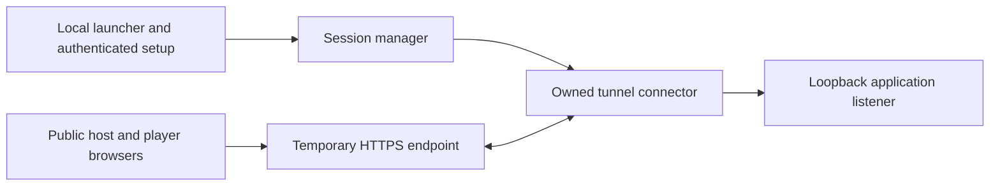

# Managed tunnel per hosting session

Approved direction, November 14, 2026. This decision supersedes the earlier requirement for a named tunnel and permanent hostname. It also moves common launcher/tunnel management from Epic 5 into **Epic 1, stories E1-S15–S20**. The [PRD](PRD.md), [UI/UX](UI-UX.md), [architecture](ARCHITECTURE.md) and [master backlog](IMPLEMENTATION-PLAN.md) contain the governing requirements and execution details.

The managed-hosting expansion has since been implemented; [its handoff](implementation/evidence/EPIC-1-MANAGED.md) records verification. The executable deployment schema now accepts event-purpose Quick Tunnels. The public page remains a synthetic connection check until E2–E4 add gameplay. The sequence below records the approved responsibility split; the master tracker owns actual completion status.

## Hosting experience

The host launches the application, opens its local setup interface and chooses **Start hosting**. The application starts its loopback application listener and verified connector, obtains a temporary public HTTPS endpoint, verifies reachability and then shows a public link and QR code. A separate private action opens the host page. Hosts do not need connector commands, a provider account or a domain for the default flow.

A hosting session owns one server/connector lifetime and one public origin. It stays alive through setup, lobby, timed play and final results. Closing a browser leaves it running. Explicit **Finish hosting** or launcher quit closes it and clears its in-memory state; shutdown that discards a game/results requires clear confirmation in the application interface. This is application lifecycle control, separate from gameplay's Start and Remove Player. There is no new pause, skip or in-game end command.

A new game created within a surviving hosting session still creates a fresh lobby/code and requires players to rejoin. It can reuse that session's public origin. A new hosting session obtains a new endpoint and fresh identities. No permanent address between hosting sessions is required. The probe's ten-minute expiry does not apply to the eventual application.

## Authority and data flow

The local setup/control surface is isolated from the public tunnel upstream. Its mutations require local control authentication and exact Host/Origin protection; merely arriving from loopback does not grant authority. Public visitors cannot start/stop hosting or mint owner credentials. The private owner handoff uses the existing one-use secret/exchange model and retains the prohibition on converting an admitted player browser into a host. Shared links and QR codes contain no owner secret.

The host's game administration and player pages continue using the same public origin. Their cookies remain Secure, HttpOnly and host-only. The public listener checks actual loopback peer, configured upstream Host and permitted public Origin, plus route/session/role authorization. Forwarded metadata cannot establish ownership. Local lifecycle control and public game administration are different interfaces with distinct authority.

Game computation and authoritative state stay on the host laptop. Internet access and the tunnel provider are runtime dependencies. The project maintainer runs no shared game server, room directory or provider account for all installations. Runtime assets are bundled. Six-digit game codes remain scoped to one instance; a code alone cannot discover an arbitrary temporary URL.

## Session continuity

Before readiness, show progress and bounded failure/retry options; do not publish an unverified invitation. Once ready, monitor actual reachability and connector status. A same-origin interruption preserves in-memory game identity, scores and accepted answers, with game timers continuing while the server is awake. Clients restore authoritative state before resuming commands. OS suspension keeps the previously accepted one-expired-phase recovery policy.

A connector crash or permanent endpoint loss cannot be assumed to preserve a Quick Tunnel URL. Never silently rotate the public URL under an admitted game. Mark the session unavailable and offer explicit fresh-session recovery with a clear loss/rejoin warning. A new endpoint means a fresh session/game and new invitations. Production game-state integration belongs to E3/E4; E1 tests the lifecycle with synthetic state.

Stopping during startup must cancel readiness attempts and clean up partial resources. Repeated Start/Finish actions must be idempotent and cannot create competing connectors. Normal shutdown closes listener, sockets and owned connector with bounded escalation. Abrupt parent death, process-tree ownership and platform-specific power handling receive actual-target validation in E5.

## Provider choice and qualification

Cloudflare Quick Tunnel is the default implementation candidate for this session-based experience. It provides a generated temporary endpoint without mandatory account/domain setup. Cloudflare documents Quick Tunnels for development/testing, with no uptime guarantee and a 200 in-flight request limit. That is not a player count. The product preference for a temporary session does not itself establish provider suitability for a 100-player event. Measure polling, WebSocket, synchronized joins, uploads and reconnect bursts against the intended workload. [Cloudflare Quick Tunnels](https://developers.cloudflare.com/tunnel/get-started/quick-tunnels/)

The initial implementation can use the pinned connector already inventoried. Named endpoints remain optional future configuration, not a prerequisite or hidden fallback. If the temporary provider cannot satisfy measured requirements, record a provider decision before claiming event readiness; do not silently add account/domain requirements or a maintainer-funded relay. No purchase or publication is authorized by this documentation update.

## Epic 1 delivery sequence

| Story | Bounded outcome | Direct new-sequence dependency |
| --- | --- | --- |
| E1-S15 | Revised session configuration/lifecycle contract and tests | Existing S11/S12/S14 |
| E1-S16 | Reusable verified connector manager with bounded startup/readiness | S15 |
| E1-S17 | Local launcher/setup control with protected lifecycle actions | S16 |
| E1-S18 | Minimal dashboard, public link/QR and private host access | S17 |
| E1-S19 | Interruption, explicit endpoint-loss recovery and cleanup | S18 |
| E1-S20 | Integrated hosting acceptance and reproducible operator guide | S19 plus required S13 evidence |

E1's shared public page is a connection demonstration. It does not pretend that game-code admission, scoring or the complete game interface already exist. E1 must implement the narrow security needed by its actual setup and host-handoff surfaces; E3 extends that foundation rather than building a competing identity mechanism.

## Changes across the six epics

| Epic | Responsibility after this decision |
| --- | --- |
| E1 | Existing contracts/probes plus six managed-hosting stories. S13's unresolved transport checks feed S20. |
| E2 | Deterministic rules/projections consume the revised S15 contract. No provider I/O enters the game core. |
| E3 | After S20 and core prerequisites, integrate the real server with the manager, reuse private host-access foundations and complete game authentication/protocol/import/rate limits. |
| E4 | Integrate the E1 setup/dashboard with game authoring, actual join-code/QR admission, presentation and gameplay/recovery screens. |
| E5 | Package and harden the existing manager/launcher, implement OS ownership/power adapters and validate four runtime-inclusive artifacts. Common hosting behavior is no longer postponed here. |
| E6 | Measure 100-player capacity, provider behavior and actual venue/device suitability; complete accessibility, signing and release gates. |

The backlog grows from 71 to **77 stories**, with **20 in Epic 1**. Existing S01–S14 evidence and status are retained; S15–S20 now have implementation/evidence notes. See the tracker for acceptance status and the next eligible unit. E2's contract exception now requires S15; E3 requires S20 and its core dependencies. Actual venue access, a permanent domain and provider credentials are not prerequisites to deterministic core or managed-hosting implementation. Actual venue/provider validation remains mandatory before event-readiness claims.

## Verification and traceability

Keep previous successful Chrome and iPhone iOS 27.0.1 cellular/recovery evidence as dated probe results. Do not use them as proof of the new launcher/dashboard or revised event configuration. S20 repeats the managed application flow with a public browser and off-network phone, including readiness, link/QR, private host access, refresh, reconnection, shutdown and a fresh session. Native browser duplication and real connector interruption evidence must be tracked explicitly rather than inferred from synthetic copies or client reconnect buttons.

The [coverage map](implementation/coverage.md) maps the 28 PRD and 35 UI criteria plus architecture obligations to implementation and validation stories. The [master tracker](IMPLEMENTATION-PLAN.md) remains the sole mutable story-status source. Historical evidence notes have an applicability notice so old named-tunnel assumptions cannot override this decision.
