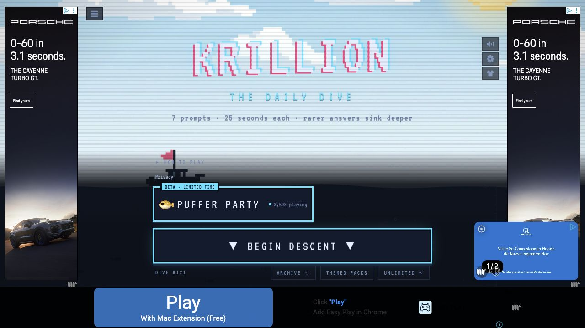

# Custom Rarity Game UI UX Baseline

Status: Accepted UI and interaction implementation baseline after review rounds 1–6, updated for managed per-session tunnel hosting November 14, 2026. Product behavior follows the agreed [PRD Version 2](PRD.md) and [architecture contract](ARCHITECTURE.md). The host and player flows, feedback states, responsive behavior, and accessibility requirements below are settled for the prototype. Product naming, final artwork, and visual refinement remain implementation or publication work.

## npm distribution planning update

The owner has selected npm distribution; the [Epic 5 migration plan](implementation/epic-05-npm-distribution.md) defines the implementation. **These setup changes are planned, not implemented.** Hosts install supported Node and launch one npm CLI; players still use only browsers. The CLI ships prebuilt application/browser assets and small native helpers, so hosts do not compile code. Local setup opens without connector downloads; only explicit Start hosting or prepare can download the pinned hosting tool into its verified per-user cache. Earlier portable-archive instructions are historical where they conflict with this update.

## Design direction

The prototype targets English-language game content and English application labels. Preserve normal UTF-8 text handling, including typographic punctuation and accented names, without promising multilingual layouts or localization in this release.

Build a pixel-art ocean expedition with a compact game console layered over it. The graphics should be as close as possible to Krillion while having their own unique take. Keep the atmospheric water, chunky terminal lettering, stepped frames, bright outlines, and prominent prompt and timer. Give our game an original research-submarine identity and a clear emphasis on the crew playing together.

Game host and player experiences are websites served by the laptop game server through the same public HTTPS origin discovered for the hosting session. The local hosting setup/control interface is a separate loopback-only surface and is never exposed through that tunnel. The visual treatment should feel like a small arcade game throughout setup, joining, play, and results.

## Original Krillion visual breakdown

Reference: [original Krillion](https://krillion.io/). Inspected at 1280 × 720 and 390 × 844. Images show the reference UI.

| Element | Observed treatment |
| --- | --- |
| World | Daylight, clouds, boat; underwater fish, plants, bubbles, light shafts, and deeper darkness. |
| Type | VT323, spaced uppercase labels, oversized wordmark with cyan/pink offsets. |
| Layout | Top scores and progress; central prompt; bottom answer controls. |
| Controls | Stepped dark frames, cyan outlines, pink accents. |
| Timer | Circular countdown and horizontal time bar. |
| Feedback | Inline rejection; central rarity, answer, and points. |
| Menu | Framed overlay containing icon tiles. |
| Recap | Large total, distribution and round charts, expandable details. |

Measured examples: text #E8F1FF, muted #7D93B8, button fill #101D33; desktop entry action 600 px wide.

References: [prompt](krillion-reference/02-original-prompt.jpg), [phone](krillion-reference/04-original-mobile-prompt.jpg), [retry](krillion-reference/06-original-rejection.jpg), [rarity](krillion-reference/07-original-rare-result.jpg), [menu](krillion-reference/09-original-menu.jpg), [recap](krillion-reference/08-original-mobile-summary.jpg).

## Our visual identity

Use an original small research submarine, a surface buoy, and sonar-style signals as the recurring artwork. The submarine serves as a shared expedition marker; individual players remain identifiable by nickname. Character selection and cosmetic unlocks are outside this prototype.

Retain the surface-to-deep-water progression. Move the ambient scene down after each completed round so the whole room shares the same journey. Use round markers along the scene edge. Scores remain points: custom point values and game lengths do not imply a fixed points-to-metres conversion or a fixed maximum score.

Use cyan for framing and focus, pale lime for primary actions and accepted states, and coral for errors and urgent time states. Give the wordmark a subtle cyan-and-lime offset. Draw original clouds, water, plants, submarine, and icons. The source screenshots are reference material; production artwork belongs to this project's own visual system.

Keep the ocean visible around the game content. Darken the immediate area behind text. Use texture on the scenery and frame edges; text, inputs, QR codes, and standings stay crisp.

## Colour system

These baseline tokens define our palette independently of the reference colour samples.

| Token | Value | Use |
| --- | --- | --- |
| Background | #08121E | Deep water and page base |
| Panel | #101F31 | Prompt, form, and result surfaces |
| Raised panel | #172D42 | Selected rows and secondary panels |
| Border | #547C90 | Visible field and control boundaries |
| Text | #EAF6F5 | Primary text and scores |
| Muted text | #A7BEC8 | Supporting instructions and labels |
| Cyan | #69E1E8 | Frames, focus, timer, and navigation |
| Lime | #D6F36A | Primary action and acceptance confirmation |
| Coral | #FF8C91 | Rejection, removal, and urgent time |
| Amber | #FFD078 | Warnings and explanatory feedback |

Use dark text on filled lime buttons. Use light text on dark panels. Representative flat-colour contrast ratios are 15.05:1 for primary text on Panel, 8.59:1 for muted text on Panel, 15.14:1 for dark text on Lime, and 3.69:1 for Border on Panel. Recheck composited colours when translucent surfaces and scenery are implemented.

Tier labels and points come from the JSON. Order visual emphasis by numeric point value rather than tier name or file order. Equal point values receive equal emphasis. Use a restrained sequence of neutral, blue, cyan, lime, and gold accents; colours may repeat when there are many tiers. Always show the actual tier name and points. A valid zero-point tier receives an accepted-answer badge and remains visually distinct from a miss.

## Typography and geometry

Bundle fonts with the host application and serve them through the public game origin, with no separate font-service request. Use VT323 for the wordmark, prompts, timer numerals, score numerals, and short action labels. Use a locally available system sans-serif for long instructions, validation errors, and dense rosters. The font fallback must preserve readable sizing.

| Element | Phone | Desktop or shared display |
| --- | --- | --- |
| Entry wordmark | 48–64 px | 80–112 px |
| Prompt | 28–34 px | 36–44 px; 48–64 px when projected |
| Timer | 32–40 px | 48–64 px |
| Score or rank hero | 48–64 px | 72–96 px |
| Button label | 24–28 px | 24–32 px |
| Supporting text | 16–18 px | 18–24 px |
| Short status label | 16 px minimum | 18–20 px |

Use compact line heights for display numerals and 1.25–1.4 for prompts. Body instructions use approximately 1.5. Apply wide tracking to short uppercase labels, not to paragraphs, player names, or long answers. Allow complete prompts, names, answers, and custom tier labels to wrap.

Use a 4 px spacing base, with 8, 12, 16, 24, 32, and 48 px intervals. Player content has a maximum width of about 640 px. Forms use 24 px internal padding on desktop and 16 px on phones. Host layouts can extend to about 1440 px.

Panels have square corners with small stepped corner details. Use thin inner borders and a stronger outer accent for important controls. Focus outlines sit outside the decorative frame and remain fully visible. Keep all interactive targets at least 44 × 44 px, with primary fields and buttons preferably 52–56 px tall.

## Component treatments

| Component | Visual and interaction treatment |
| --- | --- |
| Primary action | Lime fill, dark label, stepped dark lower edge. Hover brightens the edge; pressing reduces the apparent depth. A separate cyan focus outline remains visible. |
| Secondary action | Dark panel with a cyan outline and light label. Preserve the same target height as primary actions. |
| Remove action | Coral label on a quiet dark surface within the player's row. Opens a confirmation naming that player. Use a stable, clearly labelled target; roster updates must not shift a different player under the pointer. |
| Answer field | Dark fill, 2 px boundary, visible label. Focus uses cyan; rejection adds a coral edge and text feedback. Pending submission preserves the field width and content. |
| Prompt panel | Opaque dark reading area, stepped outer frame, small round label above the full prompt. Background texture stays outside the text area. |
| Tier badge | Original small geometric or marine symbol, JSON label, and points. Shape and text carry meaning alongside colour. |
| Standings row | Aligned rank and tabular points, wrapping nickname, subtle divider. The current player has a cyan side marker and a visible You label. |
| Unavailable control | Muted panel and label, with its disabled state conveyed programmatically. Keep the reason nearby when it is not obvious. |

The local game uses the full available viewport for scenery and game content. Advertising space and public commercial navigation do not occupy the play layout.

## Screen structure

| Screen | Primary purpose | Main contents |
| --- | --- | --- |
| Local hosting setup | Start and manage hosting | Start hosting, status, public connection link/QR when ready, Open host page, Finish hosting |
| Host game setup | Load a game | JSON upload, sample file, validation feedback, game summary |
| Public join page | Enter a game | Game code, nickname, Join game |
| Host lobby | Assemble the room | Public game link, code, QR, roster, Start, Remove |
| Player lobby | Confirm admission | Nickname, game title, player count, waiting state |
| Reading phase | Read the next prompt | Round progress, prompt, reading countdown |
| Answer phase | Submit one valid answer | Prompt, answer field, timer, Submit, feedback |
| Accepted state | Wait for the room | Locked answer, neutral acceptance message, remaining time |
| Round results | Reveal outcomes | Own answer result, frequencies, unused answer example, standings |
| Final results | Review the game | Winners and full standings; player personal result/recap or host aggregate round recap |

The optional information website explains laptop hosting through a tunnel and distributes software. Host and player browsers reach the laptop through one public HTTPS origin. Show the discovered public connection URL in local hosting setup and the code-prefilled invitation in the lobby. Game codes are scoped to that instance; there is no global lookup.

Provide a small How to play link on setup, joining, and lobby screens. Open instructions in a stepped, dark framed overlay, with a clearly labelled close control and focus returned to the opener. Explain accepted-answer retries, locking, timed submission, and the delayed tier reveal. Keep this help concise and secondary to joining or starting. If the game starts while pregame help or the enlarged lobby QR view is open, close that overlay and show the current phase. During timed play, keep the prompt and composer as the dominant navigation path.

## Host setup and lobby

### Starting and finishing hosting

Launching the application opens a local setup dashboard. The default flow asks for no provider account, domain, token or manually entered tunnel URL. A short explanation says that internet access is required and that the address lasts for this hosting session. Start hosting is the primary action. While startup is pending, disable repeat starts, show useful progress states without invented percentages, and allow cancellation that cleans up any started processes.

For the planned npm flow, explain first-use preparation beside Start hosting: hosting may download a verified hosting tool and requires internet; later starts reuse the valid cache. Keep implementation details out of the primary game interface. While preparing, show factual stages such as Checking hosting tools, Downloading hosting tools and Verifying hosting tools, then Starting server and Connecting tunnel. Do not invent percentages. Repeated actions join the existing preparation/start operation; Cancel stops that caller’s startup and owned partial work without deleting an already valid cache entry or another caller’s preparation.

Preparation failure preserves the local dashboard and offers an actionable Retry/Cancel. Distinguish unavailable download/connectivity, integrity mismatch, unsupported platform/runtime and unwritable cache; do not describe any of these as invalid game JSON or a full lobby. Keep raw provider errors, local paths and native diagnostics secondary/private. Never show an active share link/QR, Open host page or game-start readiness until the required helper/connector checks and public endpoint health checks succeed. Native-helper/runtime failures before the dashboard opens must have concise terminal guidance; they must not silently weaken timing/process ownership. npm updates are host-initiated between sessions, with no mid-game update prompt or automatic replacement.

After public readiness is verified, display the current public link and a locally generated QR, with Copy link, Enlarge QR and Open host page actions. Use the same clipboard fallback and QR accessibility treatment as lobby sharing. Distinguish this hosting connection link from the later code-prefilled game invitation. Never place local setup URLs or private owner-recovery secrets in either sharing control. The local setup surface remains reachable if public hosting fails; its local authorization is required for all control actions, and public pages cannot start/stop a session or issue host links.

Finish hosting is a secondary lifecycle action on the local dashboard. If a game/lobby or saved-in-memory results exist, confirm: Finish hosting? This disconnects everyone and clears this session's game and results. Cancel leaves hosting running. During an active game, explicitly say the game will stop and cannot be resumed. Use the same confirmation for deliberate launcher quit when a game exists; an abrupt process/OS termination cannot guarantee a dialog. While stopping, disable duplicate actions and show Stopping hosting…; report completion only after owned processes have stopped. Closing a browser leaves hosting running. The application keeps the tunnel open on the final results screen until the host finishes hosting or quits the launcher. It has no ten-minute application expiry.

This lifecycle control is separate from the in-game Start and Remove Player controls and does not introduce pause, skip or adjudication. A new game within a healthy hosting session may retain the public origin while issuing a fresh game code. A fresh hosting session has fresh state and a newly discovered URL.

### Loading the game

The visible launcher or console offers Open host page to reopen administration or restore access after browser credentials are lost. Recovery preserves the running game and is never included in the player QR or join page. If the recovery link is opened in a browser already admitted as a nonremoved player, show This browser is playing as {nickname}. Open the host link in a separate browser profile or private window. Keep the player in the game and do not silently switch roles; the launcher can issue a fresh link if the original expires.

After Start hosting succeeds, Open host page opens private administration at the current public game origin. The planned npm CLI launches the local dashboard; the host does not manually build the app, compile native helpers or run the tunnel command. Keep the setup composition centred: compact wordmark above a dark upload panel, a subdued surface scene behind it, and one prominent Choose JSON file action. Provide a normal file picker as well as a drop target. Include a link to the [example JSON](game.example.json) and concise file-format help.

Validate the complete file before creating a lobby. While validation runs, show Checking game file… without invented percentage progress; prevent duplicate uploads and creation requests. Show the filename, game title, prompt count, tier count, each tier's name and points, and effective durations after success. This tier catalogue is host-only setup information; it does not reveal current player outcomes or permit sending answer-to-tier mappings to players. Keep accepted-answer lists and future prompts out of this summary and the presentation surface. Configuration remains in the JSON; the prototype has no visual prompt editor or timer-editing form.

Require an explicit Create lobby action after the initial summary. For a replacement in Lobby or Finished, label the action Replace game and place a clear warning beside it: this creates a new code, everyone must rejoin, and previous results will be cleared. The summary and this action serve as the confirmation; do not add another identical dialog. Before commit is requested, keep the current lobby, memberships, or finished results intact. Offer Back to the current lobby/results without committing. A pending commit disables repeated clicks and conflicting setup/Start actions. A confirmed rejection leaves the current game available; a lost response is an uncertain outcome and must follow the reconciliation flow below rather than claiming that no change happened. If the validated candidate expires, explain that the file must be validated again before committing.

For invalid files, show a summary and a readable list with field paths, such as prompts[2].answers[1].tierId. Explain the problem in plain language and retain Choose another file. A bad file must not produce a partially playable lobby.

### Assembling the room

If the host replaces the pack before Start, explain that this creates a fresh game code and everyone must rejoin. Keep the old lobby intact on validation failure. On successful replacement, show the new code and QR and tell connected players their previous lobby has closed.

Make the game code the largest lobby element. Place the public HTTPS join address and a high-contrast QR code immediately beside or beneath it. The QR uses the configured public game origin and prefills the code. Offer Copy join link and Enlarge QR. Copy only the player invitation URL, never the private host-recovery link. Show Copied only after success; if clipboard access is unavailable or fails, expose the complete selectable URL with manual-copy instructions. Enlarge QR opens a labelled overlay with the public URL and code, a crisp high-contrast QR with a clear margin, and a Close action. Generate both QR sizes locally, without a public QR service. Return focus to the opening control when closed. Display the instruction Open this link or scan the QR code. Internet required.

Below the join panel, show admitted players and the count out of 100. Mark disconnected players clearly; they retain their places. Start becomes available with a committed valid file, verified tunnel readiness and at least one admitted player, except while another file is being validated. Clearly say Starting closes entry to new players. A single click on Start begins Reading immediately after server confirmation, without a confirmation dialog or additional countdown. Disable repeated clicks while pending; a confirmed rejection retains the lobby and explains how to retry. A timeout instead shows a pending confirmation state until reconciliation establishes the actual outcome. Starting the existing lobby invalidates an uncommitted replacement summary.

Include a labelled Search players field in both the lobby roster and Manage players overlay. Filter locally by a case-insensitive nickname substring, keeping the admitted total out of 100 independent of the filter. Show the matching count separately and No players match this search when empty, with a Clear search action. Keep roster rows in admission order and connection badges attached to stable player IDs; searching or connection updates do not change scores, eligibility, or membership. Retain the query while the current roster view is open and clear it for a new game.

On wide screens, place the join panel and roster in two columns. On phones or narrow windows, stack them. Keep the main code, QR, and Start visible without a long roster pushing them off-screen. Let the roster scroll within its own labelled region. Each row has a clearly labelled Remove action; the gameplay admin controls remain Start and Remove Player.

## Player joining and waiting

Use the same ocean, wordmark treatment, and stepped panel as host setup. Stack a labelled game-code field, nickname field, and Join game action. Direct links prefill the code; the player still enters a nickname. Use the architecture's six-digit game code, stored as text so leading zeroes survive. Provide a numeric keyboard hint and support pasting the complete code.

Before showing admission fields, check the existing browser session with the server. An already-admitted, nonremoved player resumes directly into the current lobby, phase, or final results with their fixed nickname; a newly opened tab follows the agreed control-transfer rule. Show a neutral Rejoining game… state while the credential-derived session discovery checks role and own membership; use its authorized game ID to resume, then wait for a fresh snapshot. Never infer admission from a cached nickname. A fresh game still requires explicit joining, even if the browser credential remains valid. A stale invitation does not silently admit its holder to a replacement lobby.

Show validation next to the relevant field: Enter a nickname, That nickname is already in use, Game not found, This game has already started, This game has ended, or This game is full. If no lobby exists, say No game is open. Ask the host to create a lobby and provide a fresh invitation. Keep the join fields available rather than admitting a spectator or automatically joining later. Keep the entered nickname on recoverable errors. Joining must not create a duplicate participant while its response is pending.

The admitted player's lobby displays their fixed nickname, the game title, the admitted-player count, and Waiting for the host to start. A small submarine or buoy idle animation gives the screen life. Game-code entry is not repeated after admission. Do not add a separate Ready button.

## Player round layout

Use three stable regions throughout reading, answering, and acceptance:

| Region | Contents |
| --- | --- |
| Top status strip | Round x of N, completed-round markers, previously revealed total score |
| Central prompt region | Full prompt text, phase label, restrained scene artwork |
| Bottom action region | Remaining time, answer field, Submit, and reserved feedback space |

For many prompts, show a compact progress bar with x of N rather than squeezing an unlimited number of tiny squares into the header. The prompt remains the strongest reading element. The bottom action region stays reachable with the mobile keyboard open.

### Reading

Show the prompt immediately with Read the prompt and the reading countdown. Disable submission and defer keyboard focus until answering opens. Use the configured duration, defaulting to 3 seconds. The prompt card remains in place as the phase changes.

### Answering

Show the circular timer and a horizontal time bar as two views of the same server deadline. Both use the remaining duration, defaulting to 25 seconds. Keep the number readable without colour. Use amber at 5 seconds remaining and coral at 3, with no rapid flashing.

When Answering opens on a desktop, focus the answer field if the game view is active and no dialog owns focus. On phones and touch-first devices, leave keyboard opening to the player tapping the field. Never focus the field during Reading, after acceptance, or during a result reveal. A reconnect snapshot must establish that answering is still permitted before enabling the field; it must not steal focus from another control.

Label the field Your answer. Use Submit as the explicit primary action. Enter submits on a hardware keyboard and the phone keyboard's action key does the same. Disable browser spelling suggestions and automatic word correction for this field where supported; matching follows the JSON's explicit aliases.

Show X of Y answers locked during Answering and the accepted waiting state. Y includes all admitted, nonremoved players, including disconnected players. X counts accepted answers from that same eligible group, excluding removed players even though their answers remain in result statistics. A removal can change both counts. Show 0 of 0 with No players remaining on the host if the roster empties; do not treat it as an early-completion trigger.

Submitting shows Checking… and prevents duplicate taps while preserving the text. An unrecognised answer shows Not on this game's answer list. Try again. Keep focus and the existing text available for editing, and let the timer continue. Reserve feedback space so the composer does not jump.

### Accepted

Lock the first accepted answer and show Answer accepted. Waiting for the round to finish. Keep the submitted text visible as readable locked text, blur the answer field to dismiss the phone keyboard, and announce acceptance without moving focus to an unrelated action. Use the same neutral acceptance treatment for every tier: no score increment, tier label, rarity-dependent animation, or colour hint before the round closes. The header continues to show the previously revealed total.

Once all eligible players have accepted answers, transition directly to results. Disconnected admitted players still count as eligible; removing a player removes that identity from eligibility. If no eligible players remain, let the answer timer expire normally.

### Timeout

Disable input and dismiss the phone keyboard when Answering closes, even if no answer was accepted. Do not dismiss it for an ordinary rejection while editing is still allowed. Typed text is never automatically submitted. If no answer was accepted, the result is a miss worth 0 points. A submission still awaiting acknowledgement must be resolved against server state before the client displays acceptance or a score.

## Round results and standings

Replace the prompt panel with a short reveal sequence while keeping the ocean and header position stable:

1. Show Round complete.
2. Reveal the player's canonical answer, custom tier name, and awarded points together.
3. Update the total and standings, and show submitted-answer counts and the unused-answer example.

Fit this sequence within roughly 600 ms for the default 10-second results phase; shorten it for shorter configured phases. Rendering and motion must never delay the next server phase. Show Next round in X seconds, or Final results in X seconds after the last prompt. There is no manual Next control.

The personal result uses a large point value, an original small tier symbol, and a clear tier label. If an alias was entered, show the canonical answer prominently and the submitted wording secondarily. Misses show No accepted answer and +0. Valid zero-point answers keep their tier name and acceptance treatment.

List submitted answers grouped by canonical answer, with an integer count, tier label, and assigned tier points. Sort by points descending, then by JSON answer order for equal points, consistently in player results, the host display, and final recap. Do not attach player nicknames or provide an answer-to-player expansion on either the host or player display. Players see their own answer in their personal result; standings still show each player's round points and total. Do not display a live-frequency-derived rarity claim. Include a separate Nobody chose this panel for the highest-scoring unused accepted answer, when one exists. Resolve equal-point choices in JSON answer order. If every accepted answer was used, omit that panel without adding a substitute answer.

On phones, keep the personal answer, tier, points, and next-phase countdown above an Answers/Standings tab group. Select Answers on entry to every new round's results; it contains grouped counts and the unused-answer example. Standings contains the leaderboard. Preserve the selected tab during updates within that same results phase. Use semantic tabs with keyboard navigation and a visible selected state. Switching tabs never pauses the countdown. When the next phase arrives, replace the results view immediately rather than waiting for tab interaction or scroll completion.

Standings show shared rank, nickname, round points, and total. In the phone Standings tab, show the leading five rows and keep the player's own rank row visible when it is outside that group; the full list remains scrollable. Use the same rank and visual emphasis for tied players. Equal-score display ordering may use nickname order solely for stable presentation.

## Shared host display

Keep the reference's ocean stage and top status strip at a larger scale. The host sees the full prompt, phase timer, round number, and accepted-player count. That count reveals readiness, not answer text or tier. The host never receives a player answer field.

During results, use a two-column layout: submitted-answer counts and the unused-answer example on one side, the top ten standings on the other. All standings remain accessible below the main display. At approximately 1920 × 1080, aim to fit a typical short prompt or results summary without scrolling and use prompt sizes of 48–64 px. Longer valid content uses labelled, manually scrollable regions; the layout must not promise that every 4,096-character prompt fits on one projected screen.

During timed play, default to a clean presentation view. A small Manage players button opens the administrative roster in a labelled overlay, adapting to a full-height sheet on narrow screens. Keep the phase and timer visible in the roster view. Closing it returns focus to Manage players and reveals the current game phase. Opening or closing the roster does not pause the game, change eligibility, or reveal answers. The host lobby can continue to show its roster beside the invitation panel.

Every Remove action, in the lobby or during play, opens a confirmation naming the selected player: Remove {nickname} from this game? Explain that the player leaves play and the leaderboard, their accepted answers remain in statistics, and this identity cannot reconnect. Offer Cancel and Remove player, with initial focus on Cancel. Bind the action to the stable player ID rather than a changing row position. Keep the timer running and preserve the confirmation across normal phase changes; if the game is replaced or the player is already removed, dismiss it with a clear status rather than targeting anyone else. Disable repeat confirmation while pending and show a recoverable error if removal fails.

After the server confirms removal, update the roster and standings and announce the outcome. Retain their accepted answers in statistics and exclude them from early-completion eligibility. Additional ban, pause, skip, end-game, and score-adjustment controls are outside the prototype.

## Final results

Use the ocean as a dimmed backdrop with a celebratory submarine beacon. The player view shows that player's large final rank and total; the host view shows a winners heading without a fabricated personal rank or total. Highlight joint winners equally. Use points and local standings; custom games have no global percentile, fixed 700-point maximum, or daily streak.

During Reading, Answering, and timed Results, provide no navigation to earlier rounds. Progress markers indicate progress only. Earlier rounds become browsable in the final recap; a late reconnect enters the current phase rather than replaying missed reveals.

Provide the full leaderboard and each player's own personal round recap. A small per-round point strip can make the recap easy to scan; every value must also be available as text. Each recap row shows round number, prompt, accepted canonical answer or miss, tier, and points. Expandable rows can reveal the completed prompt's frequency details and unused-answer example. Future answer banks remain unavailable.

The host's final screen highlights all joint winners equally, provides the complete standings, and offers an expandable round-by-round recap containing each prompt, grouped answers with tiers, points and counts, and its unused-answer example when present. It does not expose individual player answer recaps or an answer-to-player mapping. With no remaining players, show No players remaining and omit the winners section while keeping aggregate round statistics available.

Results stay available until the local server stops or the host sets up a new game. Only the host sees Create new game, a post-game setup action that opens file selection and summary review. The existing results remain available until Replace game is confirmed and committed, which creates a fresh lobby and code. Players receive a clear message that the previous game has ended and need the new invitation. The prototype provides on-screen results without result downloads or saved history.

## Tunnel readiness and origin continuity

The local launcher/dashboard shows Idle, planned first-use Checking/Downloading/Verifying hosting tools, Starting server, Connecting tunnel, Ready, Reconnecting, Failed or Stopping hosting with a useful local recovery instruction. A live connector process alone does not establish readiness. Present an active invitation after the configured public endpoint is verified, and disable Start whenever hosting readiness is absent. If the host page cannot load, the local dashboard remains available to inspect the current URL and sanitized connection status. Show actionable retry/cancel guidance for startup failure without asking for credentials in the default flow. Provider details belong in local diagnostics, not player screens.

After the host page loads, show a compact hosting-status notice where setup and lobby actions depend on it. During play, show connection loss without hiding the prompt or last confirmed result. Announce status changes through a semantic live region. A provider error may be shown only when diagnosed; use a general connection message when its cause is unknown.

A temporary tunnel outage leaves the surviving server game running. Timers continue and all disconnected players retain their slots; an outage can cause missed rounds for the whole group. Use the existing frozen-draft and resynchronization rules. No automatic pause or automatic submission is added.

Changing the laptop's Wi-Fi or IP can recover through the same public origin. A lost endpoint that cannot recover, or a changed public scheme, hostname or port, requires explicit Start fresh hosting confirmation in the local dashboard. Explain that this clears the current game/results, changes the address and requires everyone to rejoin. Cancel preserves local state for inspection but does not promise the unreachable session will recover. Never silently spawn a replacement endpoint or migrate memberships. Where reachable, player pages explain This game address is no longer available. Ask the host for a new invitation. Reusing the same public origin after connector recovery preserves valid browser sessions. Process restart still ends the game.

Only the local launcher creates a private host recovery link. It opens the same public origin as player pages and retains the existing player-role conflict behavior. Copy/QR actions always use the player invitation. Tunnel configuration and provider secrets never appear in the sharing panel.

## Host operation recovery

For a lost Create lobby/Replace game response, show Confirming game… and automatically retry the same operation at most twice after 2-second acknowledgement timeouts. Keep the candidate, request identity, and payload fixed; never turn a timeout into a new game creation. The last confirmed view may remain visible as stale context, with conflicting setup/Start actions disabled. Do not promise that the old lobby still exists while the commit outcome is unknown.

After those retries, use the architecture's atomic operation-resolution endpoint. If APPLIED, display the current authoritative game. If NOT_APPLIED, explain that creation did not happen and the file must be revalidated/reviewed before a new commit; preserve the confirmed old lobby/results. If SUPERSEDED, show the current permitted state instead of replaying the obsolete operation. If resolution is unreachable, keep reconnecting and preserve pending status. Apply equivalent confirmation/reconciliation to uncertain Start and removal; dismissal of a dialog does not cancel a sent operation.

## Input and feedback contract

Use the agreed architecture limits in field validation and file-format help: six-digit codes, 32-code-point nicknames, 512-code-point answer input, 1–20 prompts, and a 10 MiB game-file ceiling. Keep the server authoritative. Do not silently truncate pasted text; explain over-limit input and preserve it for correction. Disable Submit for whitespace-only answers. An empty submission is a field error, not an answer-list rejection. Ignore Enter while an input-method composition is active so composing text cannot accidentally submit.

During Checking…, keep the submitted wording fixed and disable further submission until the acknowledgement or a fresh snapshot resolves it. Follow the architecture's bounded retries using the same request ID. If those retries exhaust, show Confirming your answer… and resynchronize rather than claiming acceptance, rejection, or a miss. If synchronization is unavailable, enter the reconnecting state. Enable editing again only when the server confirms the player remains unlocked in the current Answering phase. A late reply for an earlier round must not overwrite a new round's input or result.

Apply complete server views using their instance, game, revision, and phase identities. Skipped revision numbers do not require replaying patches. Preserve local input/focus/scroll/tab state where the agreed phase rules allow, and discard delayed older views. Readiness updates can be batched for up to 50 ms, but acknowledgements, phase changes, and loss of control are immediate; no client transition waits for a decorative animation.

Format countdowns from the shared deadline, clamping at zero and rounding remaining seconds upward; use m:ss for durations of at least a minute. At the local estimate of zero, disable submission and show Closing round… until the current server phase is known. Never extend the round locally. On every phase change, cancel obsolete animations and reset phase-specific feedback. For very short phases or a late results snapshot, show the permitted content immediately rather than spending the remaining interval on a reveal animation. Keep the default 600 ms reveal within the available server phase and bypass it for reduced motion.

If nobody submitted an accepted answer, show No accepted answers this round in the grouped list and still show the highest-scoring unused example. If no standings rows remain after removals, show No players remaining instead of a winner or rank. Retained removed-player answers can still appear in grouped statistics, so do not force those counts to match the current roster count.

| Situation | Feedback and permitted recovery |
| --- | --- |
| File exceeds the limit, is malformed, or has invalid fields | Explain the size or field problem beside the upload summary; keep the current game and offer another file. |
| Import times out or lacks capacity | Explain that this file could not be validated on this host; preserve the old game and offer retry or another file. |
| Validated candidate expires | Disable creation from the stale summary and ask the host to validate the file again. |
| Answer rejected by the list | Keep the text and focus for editing; say Not on this game's answer list. Try again. |
| Answer attempt is rate-limited | Keep the text, show a brief wait message, and permit another explicit Submit when allowed; never label it an unrecognized answer. |
| Command targets a closed round or old game | Synchronize the current view; never carry the attempted answer into a later round. |
| Waiting-session or pending-authentication capacity | Explain that the local server is temporarily busy; preserve admitted players and avoid labelling it a full admitted roster. Offer an explicit retry when appropriate. |
| Registered-page limit with no safely inactive page | Explain that too many pages are active and ask the user to close an unused page before retrying; do not take control away from the current page. |
| Total-admission history limit | Tell a new player that this lobby has reached its history limit and needs a fresh invitation. The host sees that a fresh lobby is required for further new admission. Existing players continue and may reconnect. |
| Host authorization is lost or revoked | Disable host actions and explain how to use Open host page in the local launcher; the game keeps running. Never offer recovery through the public join link. |
| Player session is absent or expired after Start | Explain that this browser cannot recover an admitted identity and that nickname alone cannot restore access; no replacement admission or manual recovery flow. |
| Incompatible app/protocol state | Show a clear version or reload message rather than repeatedly submitting commands; keep the last state visibly stale until synchronized. |

## Connection and exception states

| State | Player or host treatment |
| --- | --- |
| Connection lost after the app has loaded | Persistent Reconnecting… banner; preserve the last visible state and typed text in the loaded page, disable editing and Submit, and label the view as awaiting synchronization. Do not pretend a submission was accepted. |
| Connection restored | Synchronise the current phase, deadline, locked answer, control generation, and revealed score before enabling input. Restore the in-memory draft only for the same game and round if Answering remains open and the player has control with no accepted answer. Never submit it automatically. Discard an obsolete draft; missed rounds remain 0. |
| Newer tab takes control | Older tab shows This game is active in another tab and disables submissions. Offer Take control here as an explicit action; disable repeat clicks while pending. After the server confirms transfer and synchronizes state, enable only the controls permitted in the current phase. The other tab becomes superseded. Neither tab automatically takes control back; scores and locked answers are preserved. |
| Stale or ambiguous tab recovery | Preserve the player identity, points, and locked answer; explain that control needs confirmation and offer Take control here. Never discard stale metadata and silently retry as a new tab. |
| Removed participant | You were removed from this game. Stop submissions and reconnection attempts for that identity. |
| New join after Start | This game has already started. Keep the code available for correction; no spectator or late-entry mode. |
| 100-player capacity reached | This game is full. Existing admitted players continue, including those reconnecting. |
| Server restarted or game replaced | This game is no longer available. Provide a route back to the public join page. |
| Zero remaining players during a game | Host sees No players remaining. The scheduled game continues; do not invent an automatic skip or late-entry flow. |

Control metadata may be retained across reload in per-tab session storage; it contains identifiers and server continuation proof only, never answer drafts. New tabs and valid controlling reloads acquire/resume automatically; stale or ambiguous reload/copied-tab recovery can require the agreed explicit takeover click.

Unsubmitted answer drafts live only in the loaded page's memory. Refreshing or reloading clears them; do not persist them to browser storage or put them in a URL. Restore accepted answers from the server after authentication and synchronization. An already-sent answer can have been accepted despite a lost acknowledgement: after refresh, show a syncing state until the authoritative snapshot resolves whether it is locked. Clear the composer when moving to a different round or game.

On an initial navigation, a failed tunnel can produce a browser or provider error before the app loads. Host instructions explain checking the current public URL, internet connection, connector status and provider configuration. Treat provider HTML, gateway failures and quota errors as transport failures when encountered by the loaded client; they do not prove an operation failed. The reconnecting view applies after the app has loaded.

## Responsive behaviour

Design and verify at 320, 390, 768, 1280, and 1920 px widths. The reference inspection at phone width is a browser viewport check; real iOS and Android keyboard behaviour still requires implementation testing.

Below 640 px, stack the answer field and full-width Submit control, and move the timer into the compact status area above the composer. Keep the prompt, timer, input, and action within the available visual viewport. With the keyboard open, reduce the decorative ocean area first. Allow a long prompt to scroll manually within a labelled region rather than hiding text or pushing the composer under the keyboard. Preserve its scroll position when Reading changes to Answering for the same prompt, and reset it for a new prompt.

At wider sizes, the timer, field, and Submit can share one row. Keep the player's main content centred at approximately 640 px while scenery fills the width. Use two columns for host setup and shared results when space permits. Standings and forms must not create horizontal page scrolling.

Keep long prompts, answers, tier labels, names, and unbroken text readable with wrapping and manual scrolling. Never automatically scroll text or shrink it to an unreadable size to force a single-screen fit. Keep essential timing and actions separate from content scrollers. At extreme zoom or a very short viewport, allow normal page scrolling as a fallback rather than trapping or clipping content. Large point values remain complete text; if a hero numeral cannot fit, use a readable wrapped value instead of omitting digits.

Respect device safe areas. Use tabular numerals for timers and scores so they do not shift horizontally. Preserve the typed answer and server session when the viewport changes or the device rotates.

## Motion and accessibility

Use slow bubbles, fish drift, and light shafts behind the interface, with a small submarine idle motion. Scene descent occurs at round boundaries. Use 150–250 ms control and panel transitions and brief result emphasis. No animation may hold up the clock, swallow input, or reveal a hidden tier.

Honour reduced-motion preferences by removing parallax, continuous drift, scanlines, and score counting effects while preserving immediate state changes. The prototype is silent: no music, sound effects, or audio settings. Screen-reader announcements remain available through semantic live regions. This specification does not add a wardrobe feature.

Use one shared labelled dialog component for help, enlarged QR, player management, and confirmations. Contain keyboard focus, block background interaction, support Escape/Cancel for dismissible views, and return focus to the opener. If a phase change removes the opener, move focus to the current phase heading instead. Closing a view never cancels an already-sent server mutation or implies its outcome; retain pending status until reconciliation.

All fields have persistent labels; errors are associated with their fields. Focus is clearly outlined. Menus and expanding recap rows support keyboard navigation and return focus to their trigger. Announce phase changes, acceptance, rejection, reconnection, and results through appropriate live regions, rather than announcing every timer tick. A short warning at 5 seconds and the closing state are sufficient.

Use at least 4.5:1 contrast for ordinary text and 3:1 for large text and essential control boundaries, following the W3C guidance for [text contrast](https://www.w3.org/WAI/WCAG22/Understanding/contrast-minimum.html) and [non-text contrast](https://www.w3.org/WAI/WCAG22/Understanding/non-text-contrast.html). Pair colour with text, symbols, and shape. Keep scans and grain off text and QR code modules. At 200% text zoom, content and primary actions remain reachable.

## Design acceptance criteria

1. The ocean scene, pixel display font, stepped frames, compact status strip, prompt region, and timer/composer visibly express the reference direction.
2. The wordmark, submarine, scenery, icons, accent balance, and multiplayer layout establish our own identity.
3. Game host and player screens use the session public HTTPS origin; the local hosting-control dashboard uses its separate loopback surface. Invitations show the correct public URL and code, explain internet access, and remain confined to setup/lobby sharing.
4. Long prompts, answers, nicknames, and tier labels remain readable on a 320 px-wide layout.
5. A player can answer with a phone keyboard open, with the timer and Submit reachable.
6. Rejected, checking, accepted, missed, disconnected, removed, full, and closed-game states have distinct, understandable treatments.
7. Acceptance never leaks the current round's tier or points, including through colour, animation, header totals, or reconnection.
8. Custom tier counts, equal point values, valid zero-point answers, arbitrary game lengths, and shared ranks render correctly.
9. The results phase uses counts, includes an unused-answer example when available, and advances automatically using the server's phase timing.
10. The shared host display remains readable at projection size; 100-player rosters and standings remain navigable without burying the main game view.
11. Reduced motion, keyboard access, text zoom, contrast, and real phone keyboards are verified on the implemented screens.
12. Fonts, art and interface assets are bundled with the host and served through the game origin. The interface handles internet/tunnel loss according to its connection state.
13. Manage players opens and closes without pausing or changing the game; the host display remains clean when it is closed.
14. Every removal requires confirmation for the named player and remains bound to that identity despite roster changes.
15. Desktop answer focus begins only when answering is permitted; phones let the player open the keyboard by tapping.
16. Phone results keep the personal outcome and countdown above Answers/Standings tabs, reset to Answers for each new round, and advance on the server phase regardless of browsing.
17. Grouped answers never attach player nicknames; personal answer details belong to the current player, while standings retain public round points and totals.
18. Earlier-round browsing is available in the final recap, without a history overlay during timed play.
19. Disconnection freezes editing without losing the loaded page's draft; reconnection restores editing only after authoritative checks and never automatically submits text.
20. Refresh clears unsubmitted drafts and restores accepted answers from server state; an uncertain submission does not receive an invented outcome.
21. Take control here transfers control only on an explicit click, preserves the single player membership, and never creates an automatic takeover loop.
22. File validation produces a summary before Create lobby or Replace game; confirmed rejection preserves old state/results, while uncertain commits reconcile without duplicate creation or a false failure message.
23. Start requires verified hosting readiness and is a single pending-safe action with no extra countdown or confirmation; its entry-closing consequence is visible in the lobby.
24. Both host rosters support nickname search, show the full admitted total independently, and distinguish no search matches from an empty game.
25. Player readiness counts use the nonremoved eligible roster, include disconnected players, and reveal no answer or tier details.
26. Grouped answers sort by assigned points descending with JSON order for ties in every results and recap view.
27. The host final screen shows joint winners, full standings, and aggregate round recaps, without a personal score or access to other players' private answer recaps.
28. Phone keyboards dismiss after acceptance or Answering ends, while a normal rejection retains editing focus.
29. An admitted browser resumes the current game only after server verification; a replacement lobby requires fresh explicit admission.
30. Copy join link has a manual-copy fallback, QR generation uses bundled code, and invitations use the configured public HTTPS origin with no host credentials.
31. Short phases, late snapshots, long text, large scores, empty results, authorization loss, uncertain submissions, role-conflicting owner recovery, and overlong game titles follow the specified feedback and validation rules.

32. Local setup offers Start hosting without requiring account/domain/token configuration; planned npm first-use preparation is explicit, verified and cancellable, pending starts cannot create duplicate sessions, and cancellation cleans up owned startup without corrupting shared valid cached tools.
33. The dashboard distinguishes idle, starting, connecting, ready, reconnecting, failed and stopping states. Public links/QR become active only after readiness, contain no owner secrets, and Open host page uses a private local handoff.
34. Finish hosting and deliberate launcher quit clearly confirm disconnection/state loss when a game exists, report stopping accurately, and leave hosting running on cancellation. Closing a browser or reaching final results does not stop hosting.
35. Permanent endpoint loss or origin replacement offers explicit fresh-session recovery with a state-loss/rejoin warning. No automatic URL replacement or identity migration occurs; recoverable same-origin interruption retains normal synchronization rules.

## Implementation handoff

The managed-session interaction contract below is adopted. Epic 1 S15–S20 supplies the functional local dashboard, manager, private handoff and synthetic public connection page with link/QR. The synthetic page must be labelled as a connection check and must not claim a lobby, game code or playable game exists. Epics 3/4 connect these foundations to real admission and gameplay; Epic 5 packages the launcher across platforms. Provider suitability, capacity and event qualification remain tracked in the architecture and implementation plan. No provider account/domain setup is required by the default flow. Use this document for presentation and interaction, the PRD for game behavior, and the architecture for authoritative state and transport. The interface must render server-confirmed phases and outcomes; a visual state never grants extra submission time or changes scoring.

| Area | Defined baseline | Implementation evidence required |
| --- | --- | --- |
| Hosting lifecycle | Local Start hosting, managed temporary endpoint, private host handoff, Finish hosting and explicit fresh-session recovery. | Ready/failed/cancelled startup, blocked public controls, QR/copy, interruption and complete shutdown, initially using the synthetic connection page. |
| Setup and admission | File review and commit, fresh-code replacement, invitation sharing, identity-aware joining. | Connecting/ready/failed hosting, initial, pending, success, invalid-file, expired-candidate, closed-entry, full, and replaced-game screens. |
| Live game | Reading, answering, pending/uncertain submission, locked acceptance, timeout, readiness counts. | Full flows with rejected retries, early completion, short timers, and hidden current-round points. |
| Administration | One-click Start, searchable roster, stable removal confirmation, presentation overlay. | Pending-safe commands and removal/takeover races while phases continue. |
| Results | Phone tabs, point-ordered grouped counts, shared ranks, private player recap, aggregate host recap. | Tied and zero-point outcomes, no accepted answers, no remaining players, and 100-row standings. |
| Recovery | Frozen disconnected drafts, reload clearing, server restoration, explicit tab takeover, local owner recovery. | Lost acknowledgements, delayed snapshots, background/foreground return, tunnel interruption, unchanged-origin reconnection, public-origin replacement, removal and server restart. |
| Responsive access | Readable text, manual content scrolling, safe areas, keyboard focus, reduced motion, semantic feedback. | Real phones with keyboards, keyboard-only use, screen readers, text zoom, and the agreed browser/viewport matrix. |
| Visual assets | Original ocean/submarine art, stepped frames, locally bundled fonts and icons, agreed colour tokens. | Local asset inventory and notices, fallback rendering, composited contrast, same-origin asset loading through the tunnel, and visual review. |

Product name, final wordmark, original pixel artwork, and final high-fidelity compositions remain production work. Original temporary artwork and a provisional text wordmark may support the first implementation while these are refined. Keep reference screenshots out of shipped runtime assets. Completing the document does not establish that the built interface has passed usability, accessibility, real-device, or projection tests; those checks remain part of implementation review.

## Browser implementation and verification

The browser implementation lives in `apps/web`: original SVG/CSS ocean and submarine artwork, locally bundled VT323 with its OFL notice, shared modal and deadline components, host presentation/setup, player composition/results, and role-specific final recaps. The [browser guide](../apps/web/README.md) explains the file boundaries; the [Epic 4 handoff](implementation/evidence/EPIC-4.md) records the passing automated and available-device checks, including the iPhone QR/gameplay confirmation. Fixture screenshots live under `work/web-ui/` and are not shipped as game assets. The formal browser/device and assistive-technology matrix remains Epic 6.
