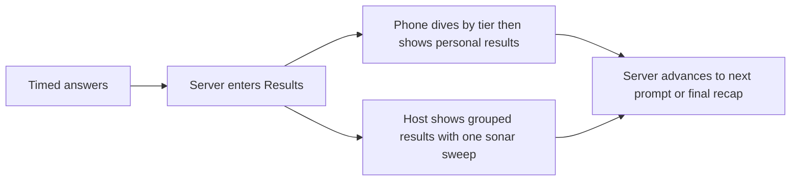

# Epic 7 · Player motion and shared round reveals

Planning started November 19, 2026. Story status lives in the [master backlog](../IMPLEMENTATION-PLAN.md#epic-7). The [Krillion reference study](evidence/E7-S01-KRILLION-MOTION.md) records the observations behind this proposal. The [prototype review](evidence/E7-S02-MOTION-PROTOTYPE.md) contains the storyboard, local demos, verification and open design decision.

## Outcome

Turn the end of a round into a moment players can feel. When the room closes a prompt, each player sees their answer, authored tier and points after a short dive by Niche Out’s research submarine. The host sees a coordinated group reveal, so people in the room can react to the same round together. The final standings and recap remain the place for comparing outcomes over the whole game.

The strongest lesson from Daily Dive is that an abstract score has a visible consequence in the world. The useful lesson from Puffer Party is that a single visual event can tell the room what just happened. Niche Out’s version uses an original submarine, instrument panel and sonar cues within its existing timed multiplayer game.

## What exists today

- The shared ocean scene already changes with round progress. `App.tsx` derives the depth value from the round index and prompt count, then `Ocean` and CSS move scenery and idle decorations. The current effect represents the expedition’s progress through prompts. [App](../../apps/web/src/App.tsx) · [Scenery](../../apps/web/src/components.tsx) · [CSS](../../apps/web/src/styles.css)
- The player result renders the canonical answer, exact tier, points, countdown and Answers/Standings tabs as soon as the Results view arrives. The host already has grouped results and a leaderboard. The UI baseline describes a brief reveal that this epic can develop into a motion sequence. [Player](../../apps/web/src/Player.tsx) · [Host](../../apps/web/src/Host.tsx) · [UI baseline](../UI-UX.md#round-results-and-standings)
- The server sends the player’s own outcome and public grouped results at Results. A valid zero-point answer has an accepted outcome. A miss has its own outcome. The pre-reveal view carries the current prompt, the player’s own submitted text if locked, readiness and previously revealed total. [View schemas](../../packages/contracts/src/views.ts) · [Projections](../../packages/game-core/src/projections.ts)

## Proposed storyboard

| Moment | Player device | Shared host display |
| --- | --- | --- |
| Reading | Prompt and countdown settle into place. Submarine stays in the shared expedition scene. | Same round, prompt and countdown in large type. |
| Answering | Keep the field, timer, and Submit in place. A rejected answer stays editable. Acceptance gets a brief, identical confirmation across tiers, then the player waits. | Progress through the existing submitted count. Use the same cue for every acceptance and coalesce quick changes. |
| Results begins | For a positive award, briefly clear the panels. The submarine dives through rising scenery. Stronger tiers descend farther and the exact award appears when the craft settles. | A single sonar sweep marks the transition into aggregate counts and standings. The prompt remains readable. |
| Results settles | Restore the canonical answer, any submitted alias, points, tier, total, countdown and result tabs. Misses and accepted zero-point answers go directly to these panels and retain distinct outcomes. | Keep grouped answers and rankings available throughout the reveal. Shared ranks keep equal emphasis. |
| Next prompt or final results | Follow the current server phase. The background continues the shared expedition, and the last round leads into the existing final recap. | Show the next prompt or joint winners and full standings. A short completion cue may use the same sonar language. |

Use the viewport for the dive so the submarine and the passing terrain carry the reveal. The main background tracks round progress for the room. Each personal dive represents the payoff for the player's current answer. Compare a wide shot with a camera that follows the submarine more closely, both with exact points and tier at the landing.

## How tiers could affect motion

Krillion’s daily scoring uses a fixed ladder. Niche Out pack authors choose their own tier names and point values, including equal values, valid zero and very large values. Names and file order cannot establish rarity or motion strength. Current room counts describe which answers were submitted. They can vary with attendance and do not determine the authored score. [Pack rules](../PRD.md) · [Colour and tier baseline](../UI-UX.md#colour-system)

The live Follow dive uses three depths. The compiled prompt ranks the distinct positive point values assigned to its accepted answers. Equal scores share a band, one value uses medium, and two values use low and high. For three or more, the three bands cover the lowest, middle and highest ranks. The compiler uses the nearest of three evenly spaced ranks. The same point value can therefore reach different depths on two prompts with different score ranges.

The server sends the derived `diveBand` only with the player's own positive Results outcome. The client renders exact points and the authored tier name, and shows static results for accepted zero, misses and older views without a band. Answer counts and public rankings keep their existing role. [View contract](../../packages/contracts/src/views.ts) · [Prompt compilation](../../packages/game-core/src/compile.ts)

## How the room shares the moment

Everyone follows the same authoritative Results transition. A player device can celebrate its own outcome while the host gives the room one common signal. The reveal should feel coordinated across devices with normal arrival differences. The existing clock estimate and phase deadline support a bounded local effect. A newer snapshot provides the current phase state and cannot reliably tell a new client when a reveal originally began.

For projection, start with one pulse and the existing list of grouped answers alongside standings. If the prototype needs a stronger group story, show an optional distribution of awarded points based on the submitted groups. Sum the counts for groups with the same point value, use labels and explicit counts, and keep the full answer counts accessible. Scope it to accepted answers in this round. Removed players’ submissions are still in the aggregate, while those players are omitted from the leaderboard. The unused-answer example is a suggestion and contributes zero to the distribution. Empty results have a static empty state. Keep active motion bounded even at the 100-player cap. [Result projections](../ARCHITECTURE.md#snapshot-and-information-boundaries)

One room-wide cue and a private dive give players distinct outcomes during the same Results phase. Preserve simultaneous answers, authored scoring, existing ranks and ties, automated round timing, and the boundary between public aggregates and private answers. Later concepts such as an exact shared animation timeline or new multiplayer modes can be considered on their own merits after the reveal prototype.

## Implementation constraints to carry forward

- The server controls deadlines and the end of the round. Play the decorative reveal only on a connected, foreground transition from Answering to Results for the same instance, game and round. Key it by the Results phase identity and run it once. Early completion or a skipped intermediate frame still produces an immediate readable result.
- Review a 1.95-second Follow dive with an opening pause and a landing hold alongside the 600 ms host cue. Temporarily clear the player panels and restore the semantic content, countdown, score and tabs as soon as the dive finishes. Keep enough reading time before the deadline and settle immediately if too little remains. Test the minimum 0.1-second setting. [Phase settings](../../packages/contracts/src/pack.ts)
- Restore settled content on entry into ongoing Results after reload, connection recovery or backgrounding. Cancel motion when the phase or game changes, control is lost, the view becomes hidden, or reduced motion is enabled. A same-phase update to the roster or standings updates the display and keeps the active tab and scroll state where possible.
- Reduced motion gets the same meaningful outcome in text. Avoid flashing, reliance on colour, score-count announcements and movement of focusable elements. Keep the existing silent presentation and original local art. Prefer bounded transform and opacity on a small number of decorative elements. Phone input focus and keyboard dismissal still follow the existing rules.
- Ordinary motion is client-local. It needs no additional clock stream, animation events, client acknowledgements or extra assets from third-party services. If a calibrated hint is selected, scope its additions to the existing authorized Results publication.

## Story dependencies

The released browser game and its qualified initial npm release are the entry point. Current status stays in the master backlog.

| Story | Size | Direct prerequisites |
| --- | --- | --- |
| E7-S01 Reference study | 1 | E4-S12, E6-S12 |
| E7-S02 Storyboard and motion prototypes | 2 | E7-S01 |
| E7-S03 Phase-safe reveal lifecycle | 2 | E7-S02 |
| E7-S04 Personal tier and score reveal | 2 | E7-S03 |
| E7-S05 Shared host and player reveal | 2 | E7-S04 |
| E7-S06 Accessibility and multiplayer verification | 2 | E7-S05 |

### E7 S01 Reference study

**Outcome:** A documented breakdown of Daily Dive and Puffer Party tied to an achievable direction for Niche Out.

**Planned areas:** Source review, prior reference captures, current player/host UI and projection audit.

- Review the daily flow, tier treatment and depth feedback from official sources and observed gameplay.
- Review Puffer Party’s visible room and in-match cues and separate them from Daily Dive scoring.
- Record what can be observed, what remains uncertain, and what can transfer into simultaneous timed play.

**Acceptance:** Reference evidence covers the reveal’s text, values and visual consequence. Multiplayer notes distinguish the shared turn state from personal rarity. The plan identifies which proposals use already permitted data and which need further review.

**Verification:** Check links, label direct observations and patch-dependent unknowns, and cross-reference the original UI baseline and real view contract.

### E7 S02 Storyboard and motion prototypes

**Outcome:** Reviewable motion sketches and a choice of personal payoff and shared cue.

**Planned areas:** `probes/web/` fixtures and a small set of original Niche Out motion sketches.

- Compare Wide and Follow full-screen dives with the same low, medium and high example awards.
- Compare one shared sonar cue and a static aggregate distribution on host and player screens.
- Review the reading-to-results sequence on desktop and narrow phone, including miss, zero-point accepted and reduced-motion cases.
- Iterate on the Follow dive lead-in and landing hold using the sample game recording. Review the revised pacing before closing S02.

**Acceptance:** A player sees the tier and exact points as the dive lands, then can read the accepted answer and use the result panels. The shared cue reads clearly without competing with the personal result or countdown. The review records the selected scale, timing and any needed Results-only field. If the field calls for a distinct implementation concern, split that work into a bounded prerequisite before the personal reveal.

**Verification:** Side-by-side captured clips or frame sequences, a 320/390 px comparison, and an immediate final frame for reduced motion.

### E7 S03 Phase-safe reveal lifecycle

**Outcome:** Reliable browser triggers and recovery behavior for decorative motion.

**Planned areas:** `apps/web/src/App.tsx`, `apps/web/src/Player.tsx`, `apps/web/src/Host.tsx`, existing clock and view state.

- Bind local effects to the current server instance, game, round and Results phase identity.
- Bound and cancel effects against the current deadline, role/control, visibility and reduced motion.
- Preserve screen focus, deadlines and the latest standings through regular view updates and interruption.

**Acceptance:** The effect plays once under the expected connected transition. Duplicate updates and refresh/recovery settle without replay. An early close, short phase or stale view never postpones the next state or input.

**Verification:** Browser/client fixtures for stale views, replacement, reconnect, tab takeover, background restore and minimum-duration phases. [E7-S03 lifecycle evidence](evidence/E7-S03-REVEAL-LIFECYCLE.md)

### E7 S04 Personal tier and score reveal

**Outcome:** The player’s submarine reacts in a way that communicates the round outcome and its score.

**Implemented areas:** Player Results, the shared local Follow scene and CSS, prompt compilation, and the private Results depth hint.

- Build the selected full-screen dive. Show the tier and points at the landing, then restore the canonical answer, any alias, timer and the rest of the result panels.
- Cover equal points, common and strong rewards, accepted zero, miss, custom names and unusually large values.
- Keep lock/retry feedback tier-neutral and preserve the existing text recap.

**Acceptance:** Payoff feels connected to the awarded outcome. Long content, screen-reader announcements and narrow-phone controls remain readable and usable. Reduced motion displays a settled result with the same information.

**Verification:** Fixtures at short/default Results timing and across accepted/miss values, plus a real mobile keyboard transition before release. [E7-S04 verification](evidence/E7-S04-PERSONAL-FOLLOW-DIVE.md)

### E7 S05 Shared host and player reveal

**Outcome:** The room gets one legible group moment around its own results.

**Planned areas:** `Host.tsx`, existing answer groups and standings components, optionally an aggregate-only visual summary.

- Use one pulse to mark the authoritative round reveal, alongside the existing answers and leaderboard.
- Keep the personal and shared cues distinct, and use anonymous aggregate counts for the optional distribution.
- Preserve ties, empty states, removed-player handling and the Manage players overlay’s current focus behavior.

**Acceptance:** No pre-reveal counts beyond existing readiness, no answer-by-player display, and stable scoreboard row identity. A 100-player fixture and an all-tie fixture stay usable. Both devices remain on the current server phase after delivery delays.

**Verification:** Host projection review at 1920 × 1080, phone results tabs, and multiple actual browser contexts connected to the same game. [E7-S05 evidence](evidence/E7-S05-HOST-SONAR.md)

### E7 S06 Accessibility and multiplayer verification

**Outcome:** A production-build game demonstrates the new reveal within the existing multiplayer flow.

**Planned areas:** Existing layout, accessibility and real browser game harnesses plus former motion fixtures.

- Check narrow phones, desktop and projector views, keyboard and reduced motion, zoom, long text and contrast. Record the physical devices actually used.
- Run complete multiplayer games with early close, deadline expiry, reconnect, hidden tab, lost control, removal and final ties. Include short Results and an aggregate fixture at the player cap.
- Compare the browser frame timeline with motion on and reduced motion on a named device, including the reveal during a burst of standings updates. Count view publications over a comparable round. Confirm that motion adds no per-frame messages or added snapshot broadcasts. Use the trace to decide whether to simplify costly effects.

**Acceptance:** Scores, ranks, submissions and active deadlines match the authoritative views. A short or recovered result is readable immediately. Motion remains usable at representative device sizes and its limits are documented.

**Verification:** Run `npm run test:web`, `npm run test:web:layout`, `npm run test:accessibility` and the affected production game smoke. Report actual device and performance results separately from emulation and fixtures. [Browser fixtures](../../probes/web/) · [Web tests](../../tests/web/) · [Core projection tests](../../tests/core/projections.test.ts) · [E7-S06 verification](evidence/E7-S06-MOTION-VERIFICATION.md)
