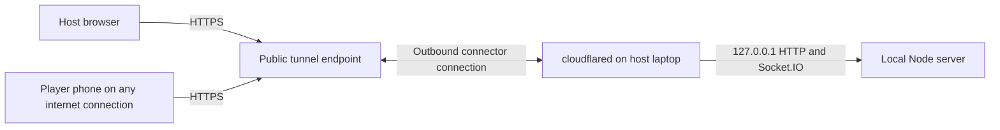

# Epic 1 tunnel implementation handoff

Current application implementation and testing instructions: [managed hosting handoff](EPIC-1-MANAGED.md). Earlier evidence and scope-decision notes below are retained as dated history.

> **Later scope decision, November 14, 2026:** [Managed session hosting](../../TUNNEL-MIGRATION.md) moves the common launcher and temporary-tunnel lifecycle into planned E1-S15–S20. A named endpoint/account/domain is no longer mandatory. Required S13 transport checks feed S20; actual venue/provider capacity qualification remains E6. This dated evidence records the implementation tested before that expansion; use the [master tracker](../../IMPLEMENTATION-PLAN.md) for current scope and dependencies.

November 14, 2026. Work lives in **`~/Projects/niche_out`**. Three parallel contributors handled deployment/contracts, the public probe and connector inventory; the coordinator integrated the shared scripts, reviewed the result and ran the combined checks. This is a foundation and feasibility deliverable. The playable game server, game rules and game screens remain Epics 2–4.

The tunnel contract gate is complete. The public desktop and user-performed iPhone cellular checks pass. Full tunnel G1 remains open because S13 still needs native-tab, connector-interruption and event/provider evidence. The master [story tracker](../../IMPLEMENTATION-PLAN.md) is the status source; these checks do not claim full browser compatibility, event readiness or 100-player capacity.

## Delivered

| Story | Deliverable and evidence |
| --- | --- |
| [S11](E1-S11.md) | Strict canonical HTTPS deployment config, exact loopback/Host/Origin policy, secure-cookie settings and public-origin continuity helpers. |
| [S12](E1-S12.md) | Public invitations with six-digit codes, host-only sanitized readiness, Start disabled while unready, origin-change/error contracts and privacy fixtures. |
| [S13](E1-S13.md) | Runnable synthetic public HTTPS page, local HTTP checks, real public Chrome smoke, phone diagnostics and a reproducible manual test. Remaining evidence is explicitly listed. |
| [S14](E1-S14.md) | Pinned cloudflared 2026.11.0, four-target integrity manifest, verified developer installer, tagged license and packaging/lifecycle owners. |

All 119 tests across seven files pass. Type checking, four workspace builds, the private-fixture browser scan and installed connector verification pass. The final real public Chrome run passed cookies, acknowledged WebSocket traffic, reload/control races, retry recovery, reconnect, upload bounds and negative requests. On iOS 27.0.1, the user also confirmed cellular WebSocket acknowledgement, generation 1, a successful 1,024-byte upload, draft clearing on refresh with generation 2, and reconnect/control checks preserving generation 2. See S13 for exact environment, actual versus simulated faults, and remaining checks.

## Architecture now and later



The host laptop remains responsible for game computation and in-memory state. The provider relays requests to the host-owned connector; it does not become a shared project game server. Host and player browsers use the same public origin, and devices do not need to share Wi-Fi. Both sides need internet access. The listener and connector metrics stay on loopback. Exact Host/Origin checks do not confer an admin role; later production routes still require authenticated roles and bounded requests.

For current development, the user chose a temporary Cloudflare Quick Tunnel with no named account or domain. Each run receives a fresh URL. The prototype probe implements this path with synthetic state; production state, owner bootstrap, game invitations/QR, launcher controls and packaging remain their planned stories. Event hosting still requires a stable configured origin and provider/venue/capacity qualification. A public-origin change requires a fresh game; same-origin interruption recovery is a separate requirement.

## Test on the current Mac

Open Terminal:

```sh
cd ~/Projects/niche_out
export PATH="/Users/kianhong/Documents/Codex/2026-11-12/in-this-project-directory-i-want/work/node-v24.22.3-darwin-arm64/bin:$PATH"
node -v
npm run probe:tunnel
```

Expect Node `v24.22.3`. The pinned connector is already installed on this Mac. On a fresh checkout, use Node 24.22.3, run `npm ci`, then `npm run setup:tunnel` first. Setup downloads and verifies the connector; game/probe startup does not install dependencies. The current runtime path is a development convenience, not a future consumer installation requirement.

Wait for **Open on your phone, including over cellular:** followed by the ready HTTPS URL. Fresh DNS may take up to three minutes. Keep the terminal running. Use this newly printed address; old temporary links stop working when their process ends.

1. Disable iPhone Wi-Fi and open the ready URL in Safari over cellular. Expect **polling → websocket → ok** or **Connected via websocket → ok**, plus **Control generation 1** on a fresh session. This verifies a complete live connection, beyond loading HTML.
2. Tap **Test small upload**. Expect **Upload received: 1024 bytes**.
3. Type into **Temporary draft** and refresh. The draft should clear; the control generation should advance once while the synthetic player remains the same.
4. Tap **Reconnect transport**. The connection should return to **ok**. **Check current control** should keep the generation unchanged for this loaded document.
5. Record the phone iOS/browser version and the two status lines. If it fails, record the exact displayed code, any HTTP status, whether upload works and whether the host terminal is still running. A brief network interruption can be retried with **Reconnect transport** after restoring connectivity.
6. Press **Ctrl-C** to stop. The manual probe also expires ten minutes after readiness. Each cookie can allocate only eight page identities in this experiment; start a fresh private session if it reports PAGE_CAPACITY.

The earlier phone attempt loaded the page but reported a failed connection on a URL that had since closed. Its timing is unresolved, so the cause was not diagnosed. A fresh manual endpoint subsequently passed the user's cellular connection and small-upload checks. Use the manual command above for repeat testing; it keeps the endpoint alive independently of the automated browser test.

For automated checks on the Mac with installed Chrome:

```sh
npm run typecheck
npm run build
npm test
node tests/fixtures/check-browser-assets.mjs
npm run verify:tunnel
npm run probe:tunnel:test
```

Expect 119 passing tests, a successful build/connector verification, and a public browser result containing `"status":"PASS"`. The last command creates and closes its own temporary tunnel. Do not use that short-lived URL for a concurrent manual phone test. `npm run probe:tunnel -- --self-test` runs only the local HTTP-policy investigation without a provider or browser.

## What remains

Close S13's native-tab, connector-interruption and event-network evidence using its checklist. The basic iPhone cellular/recovery checks now pass. Stable event provider/account setup remains deferred by the current temporary-tunnel choice. E3 production integration stays gated on the required S13 evidence. E2-S01 is eligible under the existing contract-gate exception, but was not started. Portable installers/archives, signing, actual Intel/Windows/Linux validation and the 100-player test remain later epics.
